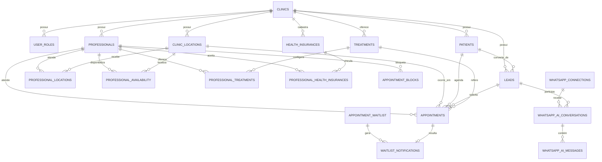
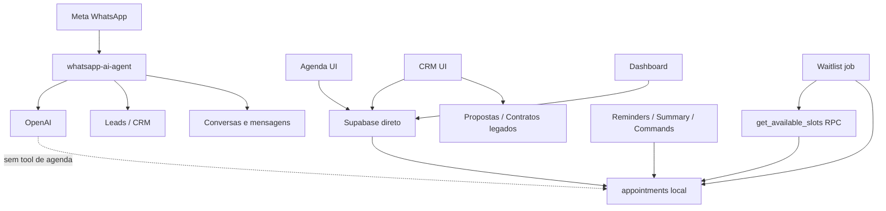

# Auditoria Técnica Completa — Projeto Aura

**Data da inspeção:** 15 de agosto de 2026

**Escopo:** estado local do repositório, código-fonte, migrations, tipos gerados, testes e documentação.

**Natureza:** somente inspeção, inventário, documentação e diagnóstico. Nenhum código, banco, policy, migration ou dependência foi alterado.

## Como ler este documento

- **IMPLEMENTADO:** comprovado no código ou nas migrations locais.
- **DOCUMENTADO:** descrito em documentação local, sem necessariamente ter comprovação completa de execução.
- **PARCIAL:** existe uma parte utilizável, mas o fluxo não está completo.
- **PLANEJADO:** intenção documentada, sem implementação encontrada.
- **NÃO ENCONTRADO:** não apareceu no repositório inspecionado.
- **NÃO CONFIRMADO:** depende do banco implantado, infraestrutura externa ou credenciais e não pôde ser validado apenas localmente.

Esta auditoria descreve o repositório, não garante que todas as migrations tenham sido aplicadas no Supabase remoto. Foram escaneados os 321 arquivos versionados e inspecionados em detalhe aproximadamente 80 arquivos arquiteturalmente relevantes.

---

## 1. Stack completa

### Frontend

| Item | Estado atual |
|---|---|
| Framework | React 18.3.1, SPA |
| Build/dev server | Vite 5.4.19 com SWC |
| Linguagem | TypeScript 5.8.3 e TSX |
| Roteamento | React Router DOM 6.30.1 |
| Estado remoto | TanStack React Query 5.83.0 |
| Estado local | React hooks/context; preferências da Agenda em `sessionStorage` |
| UI/design system | Componentes locais no padrão shadcn/ui sobre Radix UI, Tailwind CSS 3.4.17, Lucide e Sonner |
| Calendário | Implementação própria; `date-fns` para datas. Não há FullCalendar/React Big Calendar |
| Formulários | React Hook Form 7.61.1; também há formulários controlados manualmente |
| Validação | Zod 3.25.76 e validações manuais |
| Data fetching | Cliente `@supabase/supabase-js` usado diretamente em páginas/hooks e React Query para cache/invalidação |
| Autenticação | Supabase Auth, contexto próprio e rotas protegidas |
| Gráficos/PDF | Recharts, jsPDF e jspdf-autotable |

Outras dependências importantes: Framer Motion, React Day Picker, Embla Carousel, Vaul, cmdk e React Resizable Panels.

### Backend

Arquitetura **IMPLEMENTADA**: frontend Vite acessando diretamente Supabase Database/Auth/Storage/RPCs, complementado por 11 Supabase Edge Functions em Deno. Não há backend monolítico nem API própria intermediária.

- API routes: **NÃO ENCONTRADO**.
- Next.js Server Actions: **NÃO ENCONTRADO**.
- Service layer de domínio: muito limitada; Agenda/CRM/Dashboard consultam Supabase diretamente.
- RPCs SQL: operações transacionais da agenda, disponibilidade, autenticação/autorização e rotinas legadas.
- Jobs: funções invocáveis para lembretes, resumo diário, waitlist e orquestração.
- Cron/scheduler configurado no repositório: **NÃO ENCONTRADO**.
- Filas/workers duráveis/dead-letter queue: **NÃO ENCONTRADO**.
- Webhooks: Meta WhatsApp, comandos de appointment e webhook opcional de provedor de envio.

### Banco

- PostgreSQL gerenciado pelo Supabase.
- 61 migrations SQL.
- 63 tabelas no schema `public`, segundo os tipos locais.
- 1 view: `v_renewal_tasks_active`.
- 49 nomes distintos de funções SQL encontrados nas migrations, incluindo helpers, triggers e RPCs.
- Aproximadamente 70 triggers distintos encontrados no histórico de migrations.
- RLS habilitado pelas migrations para as 63 tabelas públicas inventariadas; aplicação efetiva e policies do banco remoto: **NÃO CONFIRMADO**.
- Extensão `btree_gist` usada para impedir sobreposição de appointments.

### Infraestrutura

- `vercel.json`: rewrite SPA de qualquer rota para `/index.html`; indica hosting compatível com Vercel.
- Projeto Supabase localmente identificado em `supabase/config.toml`.
- Docker: **NÃO ENCONTRADO**.
- Workflows CI/CD em `.github/workflows`: **NÃO ENCONTRADO**.
- Cron declarativo: **NÃO ENCONTRADO**.
- Observabilidade externa/Sentry: **NÃO ENCONTRADO**.
- Serviços externos encontrados: Supabase, Meta Graph/WhatsApp Cloud API, OpenAI Responses API, OAuth Google/Facebook e webhook opcional de provedor WhatsApp.

Variáveis de ambiente referenciadas, sem valores:

```text
APP_URL
AGENDA_JOBS_RUNNER_TOKEN
DATABASE_URL
DIRECT_URL
META_APP_ID
META_APP_SECRET
META_CONFIG_ID
META_GRAPH_API_VERSION
OPENAI_API_KEY
OPENAI_MODEL
SUPABASE_ANON_KEY
SUPABASE_PUBLISHABLE_KEY
SUPABASE_SERVICE_ROLE_KEY
SUPABASE_URL
VITE_META_APP_ID
VITE_META_CONFIG_ID
VITE_SUPABASE_PUBLISHABLE_KEY
VITE_SUPABASE_URL
WHATSAPP_ACCESS_TOKEN
WHATSAPP_PHONE_NUMBER_ID
WHATSAPP_PROVIDER_MODE
WHATSAPP_PROVIDER_TOKEN
WHATSAPP_PROVIDER_WEBHOOK_URL
WHATSAPP_TOKEN_ENCRYPTION_KEY
WHATSAPP_WEBHOOK_TOKEN
```

## 2. Estrutura do repositório

```text
src/
  components/
    agenda/                 componentes auxiliares da Agenda
    layouts/                layout da clínica e portal
    patient/                componentes do paciente
    settings/               cadastros e regras operacionais
    ui/                     design system
  contexts/                 autenticação e branding
  hooks/                    acesso, permissões e consultas reutilizáveis
  integrations/supabase/    cliente e tipos do banco
  lib/                      utilidades, agenda, renewal e WhatsApp
  pages/
    clinic/                 produto interno
    portal/                 portal do paciente
  test/                     testes unitários
supabase/
  functions/                11 Edge Functions
  migrations/               61 migrations
  tests/                    teste SQL transacional da Agenda
docs/                       decisões e fases da agenda/escala
e2e/
  smoke/                    smoke tests Playwright
  flows/                    fluxos E2E Playwright
```

Arquivos centrais: `src/App.tsx`, `src/pages/clinic/AppointmentsPage.tsx`, `src/pages/clinic/CrmPage.tsx`, `src/pages/clinic/WhatsAppAiPage.tsx`, `src/contexts/AuthContext.tsx`, `src/integrations/supabase/types.ts` e migrations das fases 2–5.

## 3. Rotas e telas

| Rota | Tela/objetivo | Status real |
|---|---|---|
| `/` | Redireciona para login | Ativo |
| `/login` | Login Supabase e OAuth | Ativo |
| `/reset-password` | Recuperação de senha | Ativo |
| `/onboarding` | Criação/configuração inicial de clínica | Parcial |
| `/clinic` | Dashboard operacional da agenda | Ativo |
| `/clinic/appointments` | Agenda Dia/Semana/Mês/Equipe | Ativo |
| `/clinic/crm` | Kanban e gestão de leads | Ativo, com acoplamentos legados |
| `/clinic/whatsapp-ai` | Caixa de conversas IA/WhatsApp | Ativo/parcial |
| `/clinic/patients` | Cadastro/lista de pacientes | Ativo |
| `/clinic/patients/:id` | Detalhe do paciente | Ativo, mas contém seções legadas |
| `/clinic/treatments` | Catálogo de tratamentos/serviços | Ativo em modo somente leitura |
| `/clinic/health-insurances` | Redireciona para configurações de atendimento | Ativo |
| `/clinic/reports` | Relatórios | Rota ativa, conteúdo predominantemente legado |
| `/clinic/settings` | Clínica, profissionais, unidades, convênios, regras e WhatsApp | Ativo |
| `/clinic/proposals/*` | Propostas | Desativado por redirect |
| `/clinic/contracts/*` | Contratos | Desativado por redirect |
| `/clinic/payments/*` | Pagamentos | Desativado por redirect |
| `/clinic/finance/contracts/*` | Financeiro | Desativado por redirect |
| `/clinic/metas/*` | Metas | Desativado por redirect |
| `/clinic/sessions/*` | Sessões | Desativado por redirect |
| `/clinic/evolution/*` | Evolução clínica | Desativado por redirect |
| `/clinic/photos/*` | Fotos | Desativado por redirect |
| `/clinic/feedback/*`, `/nps/*`, `/satisfaction/*` | Feedback/NPS | Desativado por redirect |
| `/portal` | Resumo do portal do paciente | Parcial |
| `/portal/contract/*`, `/payments/*`, `/sessions/*`, `/evolution/*`, `/photos/*`, `/feedback/*` | Jornada legada | Desativado por redirect |

Profissionais, unidades e convênios não têm rotas autônomas; são subseções de Configurações.

## 4. Componentes da Agenda

O componente dominante é `src/pages/clinic/AppointmentsPage.tsx`. Ele concentra consultas, mutations, filtros, cálculo visual, formulários e dialogs. Filhos específicos:

- `src/components/agenda/AgendaStatCard.tsx`: KPIs.
- `src/components/agenda/AgendaSidePanel.tsx`: painel lateral.
- `src/components/patient/QuickPatientModal.tsx`: criação rápida de paciente.
- componentes genéricos de `src/components/ui/` para Sheet, Dialog, Select, Calendar etc.

Views **IMPLEMENTADAS**:

- Dia: um profissional ou agenda operacional diária.
- Semana: sete colunas de dias e uma coluna fixa de horários.
- Mês: visão mensal.
- Equipe (`doctors-day`): vários profissionais no mesmo dia.

Também há filtro de unidade, profissionais, busca, navegação temporal, KPIs, painel de detalhes e dialogs para novo appointment, remarcação, cancelamento/no-show, disponibilidade, bloqueios e lista de espera. A edição geral de appointment é limitada; status, reatribuição e exceções têm fluxos próprios.

## 5. Fluxo atual de criação de agendamento

```text
AppointmentsPage
  → dialog “Novo Agendamento”
  → estado/formulário local
  → createMutation
  → callAgendaRpc('create_appointment_secure')
  → RPC PostgreSQL
  → assert_appointment_slot
  → INSERT em appointments
  → retorno do registro
  → invalidateQueries + mudança para Dia + toast
```

1. Unidade: selecionada na página; vira `location_id`.
2. Profissional: escolhido entre profissionais habilitados na unidade.
3. Paciente/lead: consulta exige paciente; avaliação pode usar lead. O formulário permite criação rápida de paciente.
4. Tratamento: opcional; se informado precisa estar ativo para o profissional.
5. Particular/convênio: `billing_type` e `health_insurance_id`; vínculo ativo profissional × convênio é validado na versão mais recente da RPC.
6. Data e horário: convertidos para `start_time` com timezone da unidade.
7. Duração: UI exibe valor derivado. A criação envia `p_duration_minutes: null`; o banco resolve a duração autoritativamente.
8. Regra de duração atual: convênio usa `professional_health_insurances.appointment_duration_minutes`; particular usa duração particular do profissional; depois aplica fallbacks de tratamento/configuração/30 minutos.
9. Validação frontend: verifica preenchimento e disponibilidade conhecida.
10. Validação backend: `assert_appointment_slot` confirma tenant, unidade, profissional, tratamento, janela semanal, datas de validade, bloqueios e conflitos.
11. Concorrência: advisory lock por profissional e exclusion constraint.
12. Resultado: registro novo volta para a UI e os caches são invalidados.

Não existe hook/service de domínio intermediário; `callAgendaRpc` é um adaptador fino no próprio arquivo da página.

## 6. Leitura da Agenda

```text
AppointmentsPage
  → cliente Supabase no navegador
  → SELECT direto em appointments
  → filtros clinic_id/location_id/período
  → React Query
  → grid próprio
```

São consultadas diretamente também `patients`, `leads`, `professionals`, `clinic_locations`, `professional_availability`, `appointment_blocks`, `appointment_waitlist` e tabelas de regras. **Não existe SchedulingService nem repository**. Esse é o acoplamento central para providers.

## 7. Acoplamento com `appointments`

| Função | Onde ocorre | Assunção atual |
|---|---|---|
| Leitura Agenda | `AppointmentsPage.tsx` | tabela local é fonte da verdade |
| Criação | RPC `create_appointment_secure` | appointment nasce no PostgreSQL local |
| Status | update direto na página | status local é autoritativo |
| Cancelar/no-show | RPC segura; função WhatsApp possui fallback local | estado local autoritativo |
| Reagendar | RPC segura cria novo registro e encadeia IDs | sem provider externo |
| Dashboard | `DashboardPage.tsx` | métricas calculadas da tabela local |
| CRM | `CrmPage.tsx` | consulta e atualiza appointments locais |
| Paciente/portal | páginas de detalhe e portal | histórico local |
| Waitlist | RPC `get_available_slots` + criação local | availability e booking internos |
| Lembretes/resumo | Edge Functions | carregam appointments locais |
| WhatsApp commands | `process-appointment-whatsapp` | confirma/cancela registro local |
| Relatórios | páginas ativas/legadas | dados locais, parte financeira/legada |
| Triggers/constraints | migrations | integridade e auditoria locais |

Há ainda inserts diretos em páginas legadas, especialmente `SessionsPage.tsx`. As rotas estão desativadas, mas o código permanece. A exclusion constraint ainda protege contra sobreposição, porém erros podem emergir como erros SQL de baixo nível.

## 8. Professionals

`professionals` contém `id`, `clinic_id`, `user_id` opcional, nome, especialidade, telefone, telefones adicionais, e-mail, CPF, entidade e número de registro profissional, role, status e preço de consulta particular.

Relações principais:

- `appointments.professional_id → professionals.id` (**IMPLEMENTADO**, `ON DELETE RESTRICT`).
- `professionals.user_id → auth.users.id` (**IMPLEMENTADO**, `ON DELETE SET NULL`). Um profissional pode existir sem login.
- `professional_locations`: N:N com unidades.
- `professional_availability`: janelas semanais por unidade.
- `professional_settings`: regra 1:1 operacional/IA.
- `professional_treatments`: serviços, duração e preço por profissional.
- `professional_health_insurances`: convênios, duração, autorização e instruções.

A migration de identidade profissional converteu referências de agenda antes ligadas a usuários para `professionals.id` e aborta se houver referências não resolvidas.

## 9. Unidades

`clinic_locations` guarda nome, endereço, cidade/UF/CEP, telefone, timezone, status e flag de unidade principal. Uma trigger cria unidade principal para nova clínica. `professional_locations` vincula profissionais ativos às unidades.

- Agenda: filtra e grava `location_id`.
- Profissional: precisa estar ativo na unidade.
- Disponibilidade/bloqueios: são definidos por unidade.
- Appointment: unidade precisa pertencer à mesma clínica; profissional precisa atendê-la.
- Tratamento: vínculo é por clínica/profissional, não especificamente por unidade.
- IA: a IA conversacional atual não consulta nem escolhe unidades.

## 10. Disponibilidade

`professional_availability` representa janelas recorrentes por dia da semana, profissional e unidade, com `valid_from`/`valid_until` adicionados na migration da Fase 5. `appointment_blocks` representa intervalos bloqueados para unidade e opcionalmente profissional.

O motor canônico é a RPC SQL `get_available_slots`:

1. valida intervalo máximo de 120 dias e passo entre 5 e 60 minutos;
2. valida acesso, unidade e profissional;
3. resolve duração;
4. expande janelas locais no timezone da unidade;
5. gera candidatos, padrão 15 minutos;
6. remove conflitos com appointments ativos e bloqueios;
7. retorna início/fim/duração.

A UI também calcula/valida aspectos da disponibilidade para experiência imediata, mas o backend é a autoridade final. `check-waitlist` usa a RPC canônica. Não há service layer.

**Divergência de tipos:** `valid_from` e `valid_until` de `professional_availability` existem na migration, mas não aparecem no tipo gerado local. Isso indica tipos Supabase desatualizados em relação à última migration.

## 11. Double booking e concorrência

Proteções **IMPLEMENTADAS**:

- validação de conflito no frontend;
- `assert_appointment_slot` no PostgreSQL;
- `pg_advisory_xact_lock` por `professional_id` nas RPCs de criar/reagendar/reatribuir;
- constraint `EXCLUDE USING gist` em `professional_id` + `tstzrange`, para status `scheduled`, `confirmed` e `in_progress`;
- transação implícita da RPC;
- conflito de constraint traduzido para `AGENDA_SLOT_CONFLICT`.

A constraint impede sobreposição inclusive entre unidades. Nas RPCs canônicas não foi identificada janela de race condition capaz de persistir double booking. Caminhos diretos/legados podem disputar a vaga, mas a constraint continua sendo o backstop; o risco passa a ser erro não amigável ou operação não atômica ao redor do insert, não persistência de sobreposição. Aplicação real da migration no banco remoto: **NÃO CONFIRMADO**.

## 12. Waitlist / encaixe

Tabelas:

- `appointment_waitlist`: pedido, janela desejada, prioridade, preferências e status.
- `waitlist_notifications`: oferta de vaga, expiração, resposta e appointment resultante.
- `waitlist_agent_logs`: trilha de execução/decisão.

Fluxo atual:

```text
UI cria waitlist
  → check-waitlist (token de job)
  → get_available_slots por profissional/período
  → cria waitlist_notifications
  → marca entrada como offered/match_found
  → registra waitlist_agent_logs
  → aceite na UI
  → create_appointment_secure
  → atualiza notificação e waitlist
```

**IMPLEMENTADO:** cadastro, procura canônica de vaga, persistência da oferta, aceite e criação segura.

**PARCIAL:** “notificação enviada” representa principalmente registro interno; envio efetivo ao paciente não está demonstrado no `check-waitlist`.

**NÃO ENCONTRADO:** hold exclusivo temporário da vaga, fila durável, dead letter e estratégia robusta de retry.

**Acoplamento:** total com profissionais, disponibilidade e appointments internos.

## 13. WhatsApp

### Conexão

`whatsapp_connections` é multi-tenant e armazena WABA, `phone_number_id`, status, token cifrado, expiração, usuário conector e metadata. `whatsapp-connect` executa Embedded Signup/Meta, troca código por token, assina o app no WABA e cifra o token com AES-GCM usando `WHATSAPP_TOKEN_ENCRYPTION_KEY`. O token não é exposto ao browser.

### Entrada e IA

```text
Meta webhook
  → whatsapp-ai-agent (GET verificação / POST evento)
  → valida HMAC x-hub-signature-256
  → identifica conexão por phone_number_id
  → localiza/cria lead e conversation
  → persiste mensagem inbound
  → OpenAI Responses API
  → envia resposta pela Meta Graph API
  → persiste outbound e interação do lead
```

O provider message ID tem proteção de idempotência. A resposta HTTP é devolvida cedo e o processamento continua com `EdgeRuntime.waitUntil`.

### Comandos e lembretes

`process-appointment-whatsapp` é um fluxo paralelo mais antigo. Interpreta confirmar/cancelar/reagendar; confirmação altera o appointment, cancelamento tenta RPC e possui fallback, e reagendamento exige acompanhamento manual. Não está unificado com o agente IA.

`send-appointment-reminder` cria token/registro de lembrete. `dispatch-appointment-reminders` pode enviar via `WHATSAPP_PROVIDER_WEBHOOK_URL`. `send-daily-agenda-summary` produz comando/log, mas envio real de resumo não foi comprovado. Frequência externa: **NÃO CONFIRMADO**.

## 14. IA atual

| Capacidade | Estado |
|---|---|
| Provider | OpenAI Responses API — implementado |
| Modelo | Por configuração/env, fallback definido no código — implementado |
| System prompt | Assistente administrativo PT-BR, respostas curtas e restrições clínicas — implementado |
| Configuração por clínica | objetivo, modelo, handoff e liga/desliga — parcial |
| Histórico | últimas mensagens da conversation — implementado |
| Estado | conversation aberta/handoff/fechada + `ai_enabled` — implementado |
| Tools/function calling | Inexistente |
| Parsing estruturado | Inexistente |
| Consulta de agenda | Inexistente |
| Criação/cancelamento/reagendamento por IA | Inexistente |
| Guardrails | prompt contra diagnóstico, resultados e invenção; sem camada dedicada — parcial |
| Tokens | uso armazenado em mensagens — implementado |
| Logs | mensagens, interações e console — parcial |
| Fallback/retry de modelo | Não encontrado |
| Handoff humano | controle manual e texto de escalonamento; transição automática robusta não encontrada — parcial |
| RAG/knowledge | Inexistente |

O prompt recebe nomes de tratamentos, mas não usa de forma estruturada regras de preço, convênio, profissional, unidade ou disponibilidade.

## 15. Como a IA acessa a Agenda hoje

Para “Tem horário amanhã?”:

```text
WhatsApp → whatsapp-ai-agent → LLM com prompt/histórico → resposta textual
```

Não há caminho para `get_available_slots`, `appointments`, service ou tool. A IA pode responder genericamente, mas não consultar disponibilidade real.

Para “Pode marcar às 14:30?” também não há tool, parsing estruturado ou criação de appointment. O sistema precisa de atendimento humano ou fluxo separado. O ponto futuro mais seguro para inserir `SchedulingService` é entre qualquer canal/IA/UI e a implementação de agenda, nunca dentro do componente visual ou do prompt.

## 16. CRM

O CRM usa `leads`, `lead_interactions` e `lead_stage_history`; a tela é `CrmPage.tsx` e acessa Supabase diretamente. Stages padrão encontrados: `new_lead`, `contacted`, `scheduled`, `proposal_sent`, `closed_won`, `closed_lost`. Podem ser configurados em `clinic_settings`.

- Criação: manual ou automática pelo WhatsApp.
- Movimentação: updates diretos; trigger registra histórico.
- Interações: tabela própria; trigger atualiza timestamp do lead.
- Conversão: localiza/cria patient, vincula `lead.patient_id` e `converted_at`.
- Appointment: CRM consulta e altera registros locais.
- Automações: timestamps e histórico; IA cria interação.
- Legado: propostas, contratos e renewal ainda são consultados pela tela ativa.

A base comporta um Micro CRM, pois já tem estágio, owner, prioridade, origem, próxima ação, histórico e conversão. Precisa ser adaptada para estágios administrativos e desacoplada dos módulos comerciais/financeiros legados.

## 17. Patients × Leads

- Lead nasce por cadastro/CRM ou mensagem WhatsApp; representa contato ainda em atendimento comercial/administrativo.
- Patient é entidade própria e pode ser criado diretamente.
- Um lead pode referenciar um patient após conversão; ambos coexistem.
- Appointment aceita `patient_id` e também `lead_id`; avaliação pode existir para lead ainda não convertido.
- Conversão no CRM cria/localiza paciente e preserva o lead/histórico.
- WhatsApp procura lead por telefone exato antes de criar.
- Não foi encontrada normalização/unique constraint abrangente de telefone ou CPF capaz de garantir deduplicação cross-channel.

Para IA, é essencial distinguir identidade conversacional (telefone/lead) de identidade assistencial/administrativa (patient) e resolver duplicidade antes de agendar.

## 18. Tratamentos / serviços

`treatment_categories` classifica o catálogo. `treatments` contém nome, duração, preços, custo, sessões, ativo, avaliação prévia e flags de IA/online/renovação. `professional_treatments` sobrescreve duração/preço e define `show_price`, `can_ai_schedule`, `requires_previous_evaluation` e status por profissional.

Uso real:

- Agenda filtra ofertas profissionais e usa duração/regras no backend.
- Configurações permitem administrar catálogo e vínculos.
- IA atual recebe no máximo nomes do catálogo; não aplica as flags de agendamento, preço visível ou avaliação.
- Campos financeiros, sessões, combos, custo e renewal pertencem ao legado e não são essenciais à nova direção.

## 19. Convênios

`health_insurances` contém nome, código ANS, contato, notas de autorização e status. `professional_health_insurances` vincula profissional/convênio e guarda aceitação de novos pacientes, autorização necessária, notas, instruções para IA, status e duração do appointment.

A Agenda consulta o vínculo para seleção, validação e duração. A pergunta “Dra. Ana atende Unimed?” **não é respondida automaticamente pela IA atual**: os dados existem, porém o agente não possui tool/consulta a essas tabelas.

## 20. Knowledge base

- FAQ/knowledge base administrativa: **NÃO ENCONTRADO**.
- Documentos de conhecimento da clínica: **NÃO ENCONTRADO**.
- Embeddings/vector search/RAG: **NÃO ENCONTRADO**.
- `documents`: existe, mas é documentação legada de paciente, não knowledge base.
- Instruções administrativas: somente prompt/configuração genérica — **PARCIAL**.

## 21. Auth e multi-tenant

Supabase Auth fornece sessão e `auth.uid()`. `user_roles` liga usuário, clínica e role; `patient_users` liga usuário ao paciente. Roles encontrados: admin, receptionist, professional, sales e patient. `access_groups`, `access_group_permissions` e `user_access_groups` complementam permissões de menu/ação.

Helpers SQL como `get_user_clinic_ids`, `user_belongs_to_clinic`, `is_clinic_staff`, `has_clinic_role`, `has_role` e `has_menu_access` suportam RLS. Convites de equipe e paciente usam Edge Functions com Admin API.

Risco funcional: o frontend seleciona a primeira role ativa em partes do fluxo, portanto a possibilidade física de múltiplas clínicas por usuário existe no banco, mas a experiência multi-clínica não está plenamente resolvida.

## 22. RLS

Padrão: tabelas operacionais carregam `clinic_id`; policies consultam helpers de associação/role. Tabelas sem `clinic_id` direto (`proposal_items`, `payment_installments`, `treatment_combo_items`, `treatment_cost_items`) dependem da entidade pai. As migrations habilitam RLS para as 63 tabelas inventariadas.

Tabelas críticas — clinics, professionals, locations, patients, leads, appointments, availability, waitlist e WhatsApp — têm policies/mecanismos tenant-aware nas migrations. Triggers adicionais validam que FKs pertencem à mesma clínica.

Possíveis exceções a revisar: funções `SECURITY DEFINER`, buckets/URLs públicas legadas e qualquer acesso via service role. Execução das policies e Supabase Security Advisor no ambiente remoto: **NÃO CONFIRMADO**.

## 23. Service role

| Local | Motivo/operação | Risco |
|---|---|---|
| `create-clinic` | criar clínica e role admin | alto privilégio; valida JWT e ownership |
| `invite-team-member` | Admin API Auth e role/invitation | criação cross-table; valida admin |
| `invite-patient` | convidar usuário e vincular paciente | PII e Admin API; valida staff |
| `whatsapp-connect` | trocar token Meta e persistir segredo | segredo externo; valida JWT/admin |
| `whatsapp-ai-agent` | webhook público, dados multi-tenant, mensagens | blast radius; depende de HMAC correto |
| `check-waitlist` | processar uma/todas as clínicas | acesso global; depende de runner token |
| `run-agenda-jobs` | orquestração e idempotência | acesso global; depende de runner token |
| reminder/dispatch/summary | ler agenda e enviar/logar | PII e comunicação; runner token |
| `process-appointment-whatsapp` | alterar status via comando | token compartilhado e fluxo legado |

Valores de tokens não foram lidos nem reproduzidos.

## 24. Edge Functions / server functions

| Function | Responsabilidade | Chamador provável | Dados/serviços |
|---|---|---|---|
| `check-waitlist` | procurar vagas e criar ofertas | job/UI autorizada | slots RPC, waitlist, logs |
| `create-clinic` | onboarding tenant | frontend autenticado | Auth, clinics, user_roles |
| `dispatch-appointment-reminders` | despachar lembretes pendentes | runner externo | reminders, webhook provider |
| `invite-patient` | convidar paciente | staff | Auth Admin, patients/patient_users |
| `invite-team-member` | convidar colaborador | admin | Auth Admin, roles/invitations |
| `process-appointment-whatsapp` | comandos confirmar/cancelar/reagendar | webhook legado | appointments, RPCs, command logs |
| `run-agenda-jobs` | coordenar jobs com run key | runner externo | job executions e funções |
| `send-appointment-reminder` | preparar/enviar lembrete | dispatcher/manual | appointment, patient, token/reminder |
| `send-daily-agenda-summary` | montar resumo diário | runner/manual | appointments, command logs |
| `whatsapp-ai-agent` | webhook Meta + conversa IA | Meta | WhatsApp tables, leads, OpenAI, Meta |
| `whatsapp-connect` | conectar/desconectar número Meta | admin autenticado | Meta, encrypted tokens, connection |

Não há server functions fora dessas Edge Functions e RPCs SQL.

## 25. Jobs / cron

`run-agenda-jobs` usa `agenda_job_executions` e `run_key` para idempotência. Existem jobs de lembretes, resumo diário e waitlist. Há logs/tabelas de status e algum tratamento de erro, mas:

- frequência: **NÃO CONFIRMADO**;
- configuração cron no repositório: **NÃO ENCONTRADO**;
- fila durável/worker dedicado: **NÃO ENCONTRADO**;
- retry exponencial/dead letter: **NÃO ENCONTRADO**;
- entrega real de todos os canais: **PARCIAL**.

## 26. Migrations

Resumo cronológico das 61 migrations:

- Abril/2026: base multi-tenant, roles, clínica, profissionais, pacientes, tratamentos, appointments e grande conjunto comercial/clínico legado; RLS, storage e portal.
- 10–11/abril: anamnese, métricas, feedback/NPS, pagadores, treatments profissionais e auditoria.
- 29–30/abril: CRM, stages/interações e fundação inicial da Agenda.
- 15/maio: waitlist, lembretes, comandos WhatsApp e jobs.
- 16–18/maio: renewal/financeiro/metas/access groups e hardening.
- 31/maio–21/junho: role sales e compatibilidade/hardening de helpers Auth/RLS.
- 5–11/agosto: agente IA/WhatsApp, tratamentos e endereço de leads.
- 14/agosto: WhatsApp multi-clínica/escala, entidades de classe, telefones, convênios, preço particular e Fases 2–5 da Agenda.
- Final de 14/agosto: duração por modalidade e correção do trigger tenant de convênios.

## 27. Schema atual do banco

Inventário das 63 tabelas públicas conforme `types.ts`:

| Tabela | Função | Estado | `clinic_id` | Relações principais |
|---|---|---:|:---:|---|
| access_group_permissions | permissões de grupo | Ativa infra | sim | access_groups |
| access_groups | grupos de acesso | Ativa infra | sim | clinics |
| agenda_job_executions | idempotência/log de jobs | Ativa | sim | clinics |
| appointment_blocks | bloqueios de agenda | Ativa | sim | clinic_locations, professionals |
| appointment_reminders | lembretes | Parcial | sim | appointments |
| appointment_waitlist | encaixe | Ativa/parcial | sim | patients/leads/professionals/treatments |
| appointment_whatsapp_tokens | tokens de ação | Ativa/parcial | sim | appointments |
| appointments | agenda normalizada local | Ativa, núcleo | sim | clinic/location/professional/patient/lead/treatment |
| audit_logs | auditoria genérica | Ativa infra | sim | clinics/users |
| class_entities | conselhos profissionais | Ativa | sim | clinics/professionals |
| clinic_locations | unidades | Ativa, núcleo | sim | clinics |
| clinic_settings | configuração chave/valor | Ativa | sim | clinics |
| clinics | tenant | Ativa, núcleo | própria entidade | auth por roles |
| contract_installments | parcelas de contrato | Legada | sim | contracts |
| contract_payment_methods | meios de pagamento | Legada | sim | contracts |
| contract_payment_plans | planos de contrato | Legada | sim | contracts |
| contracts | contratos | Legada/desativada | sim | patients/proposals |
| cost_items | custos | Legada | sim | clinics |
| documents | documentos de paciente | Legada | sim | patients |
| health_insurances | convênios | Ativa, núcleo | sim | clinics |
| lead_interactions | histórico CRM | Ativa | sim | leads |
| lead_stage_history | mudanças de estágio | Ativa | sim | leads |
| leads | contatos CRM/WhatsApp | Ativa, núcleo | sim | clinics/patients/users |
| notifications | notificações do portal | Parcial | sim | users/patients |
| nps_responses | NPS | Legada/desativada | sim | patients/appointments |
| patient_anamneses | anamnese | Legada/desativada | sim | patients |
| patient_metrics | métricas clínicas | Legada/desativada | sim | patients |
| patient_photos | fotos clínicas | Legada/desativada | sim | patients |
| patient_portal_access | acesso portal antigo | Legada/parcial | sim | patients |
| patient_users | identidade do portal | Ativa/parcial | sim | patients/auth.users |
| patients | pacientes | Ativa, núcleo | sim | clinics |
| payers | responsáveis pagadores | Legada/referenciada | sim | patients |
| payment_installments | parcelas | Legada | indireto | payment_plans |
| payment_plans | planos de pagamento | Legada | sim | contracts |
| professional_availability | disponibilidade | Ativa, núcleo | sim | professional/location |
| professional_health_insurances | profissional × convênio | Ativa, núcleo | sim | professionals/health_insurances |
| professional_locations | profissional × unidade | Ativa, núcleo | sim | professionals/locations |
| professional_settings | regras profissionais | Ativa, núcleo | sim | professionals |
| professional_treatments | profissional × serviço | Ativa, núcleo | sim | professionals/treatments |
| professionals | profissionais | Ativa, núcleo | sim | clinics/auth.users |
| proposal_items | itens de proposta | Legada | indireto | proposals/treatments |
| proposals | propostas | Legada, ainda referenciada | sim | patients |
| renewal_interactions | interações de renovação | Legada | sim | renewal_tasks |
| renewal_tasks | renovação | Legada | sim | patients/contracts |
| roles | catálogo de roles | Ativa infra | sim | clinics |
| sales_goals | metas comerciais | Legada | sim | clinics/users |
| session_feedback | feedback de sessão | Legada | sim | session_records |
| session_records | sessões clínicas | Legada | sim | appointments/patients/treatments |
| team_invitations | convites de equipe | Ativa infra | sim | clinics/roles |
| treatment_categories | categorias | Ativa | sim | treatments |
| treatment_combo_items | itens de combo | Legada | indireto | treatment_combos/treatments |
| treatment_combos | combos | Legada | sim | clinics |
| treatment_cost_items | custos do serviço | Legada | indireto | treatments/cost_items |
| treatments | serviços/tratamentos | Ativa, núcleo | sim | clinics/categories |
| user_access_groups | usuário × grupo | Ativa infra | sim | access_groups/auth.users |
| user_roles | usuário × clínica × role | Ativa, núcleo | sim | auth.users/roles/clinics |
| waitlist_agent_logs | log de encaixe | Ativa | sim | waitlist |
| waitlist_notifications | ofertas de encaixe | Ativa/parcial | sim | waitlist/appointments |
| whatsapp_ai_conversations | conversa por contato | Ativa | sim | leads/connection |
| whatsapp_ai_messages | mensagens e tokens IA | Ativa | sim | conversations |
| whatsapp_ai_settings | configuração IA | Ativa/parcial | sim | clinics |
| whatsapp_command_logs | comandos/log WhatsApp | Ativa/parcial | sim | appointments |
| whatsapp_connections | números Meta por clínica | Ativa | sim | clinics |

O núcleo do novo produto é formado por clinics, identities/permissions, professionals, locations, services, insurances, patients/leads, appointments/availability/blocks/waitlist e WhatsApp/AI. O restante deve ser tratado como legado ou suporte periférico, não como requisito para a nova arquitetura.

## 28. Foreign keys importantes

- Clinic 1:N professionals, locations, patients, leads, appointments, treatments, health insurances, waitlist e WhatsApp entities.
- Professional N:N locations por `professional_locations`.
- Professional N:N treatments por `professional_treatments`.
- Professional N:N health insurances por `professional_health_insurances`.
- Professional 1:N availability, blocks e appointments.
- Location 1:N availability, blocks e appointments.
- Patient 1:N appointments; Lead 1:N appointments.
- Lead N:1 Patient opcional após conversão.
- Treatment 1:N appointments e N:N professionals.
- Appointment waitlist N:1 patient/lead e preferências opcionais de professional/treatment.
- WhatsApp connection 1:N conversations; conversation N:1 lead; conversation 1:N messages.

Triggers e FKs compostas reforçam que professional/location/insurance pertencem à mesma clínica.

## 29. Diagrama ER atual — núcleo ativo



## 30. Módulos legados

| Domínio | Persistência/backend | Frontend | Influência atual |
|---|---|---|---|
| Anamnese/prontuário | tabelas, triggers e componentes permanecem | rota/fluxo removidos da Agenda | isolado parcialmente; código permanece |
| Sessões/evolução/fotos/métricas | tabelas e páginas permanecem | rotas desativadas | PatientDetail/portal ainda consultam parte |
| Propostas/contratos | tabelas, storage, páginas e lógica | rotas desativadas | CRM e PatientDetail ainda referenciam fortemente |
| Pagamentos/financeiro/custos | várias tabelas e funções | rotas desativadas | Reports e páginas legadas consultam |
| NPS/feedback/satisfação | tabelas/triggers/páginas | rotas desativadas | isolado parcialmente |
| Metas/renewal | tabelas, view, triggers e testes | rotas desativadas | Reports/CRM/settings ainda contêm referências |
| Portal clínico | tabelas e páginas | somente Home acessível | parcial/legado |

O legado não foi removido e ainda influencia telas ativas, especialmente CRM, Relatórios e Detalhe do Paciente.

## 31. Dependências entre módulos



## 32. Acoplamentos que dificultam providers

| Acoplamento | Impacto |
|---|---|
| Agenda lê/escreve Supabase no componente | **ALTO** |
| Dashboard calcula tudo de `appointments` local | **ALTO** |
| Waitlist usa availability/RPC/appointment internos | **ALTO** |
| Reminders e summaries recebem IDs/dados locais | **ALTO** |
| CRM consulta e atualiza appointment local | **ALTO** |
| Cancelamento/status com update direto em alguns fluxos | **ALTO** |
| IA não tem camada de scheduling reutilizável | **ALTO** |
| Patient/portal exibem histórico local | **MÉDIO** |
| Tipos UI refletem schema Supabase diretamente | **MÉDIO** |
| IDs e status não carregam namespace/provider externo | **ALTO** |
| Regras de unidade/profissional são internas | **MÉDIO**; úteis para Internal, exigem mapping externo |

## 33. Ponto de inserção futuro do SchedulingService

O ponto seguro é uma fronteira de aplicação entre canais/UI/jobs e providers:

```text
Agenda UI / IA tools / CRM / Waitlist / Reminders
                    ↓
             SchedulingService
                    ↓
 Internal Provider | Google | Doctoralia | Feegow
```

Chamadas que devem passar por ele: catálogo operacional, disponibilidade, leitura de appointments, criação, confirmação, cancelamento, reagendamento, reatribuição, bloqueios e waitlist. Componentes React não devem conhecer provider, tokens, IDs externos ou particularidades de sync. Edge Functions de WhatsApp, waitlist, reminders, summary e commands precisariam consumir a mesma fronteira. As RPCs transacionais atuais podem ser preservadas dentro do `InternalSchedulingProvider`.

## 34. Capabilities necessárias derivadas do sistema real

```text
listLocations
listProfessionals / listProfessionalsAtLocation
listServices / listProfessionalServices
listInsurances / listProfessionalInsurances
getProfessionalRules
getAvailability / getAvailableSlots
listAppointments / getAppointment
createAppointment
confirmAppointment
updateAppointmentStatus
cancelAppointment / markNoShow
rescheduleAppointment
reassignProfessional
listBlocks / createBlock / removeBlock
createWaitlistEntry / listWaitlistEntries
findWaitlistMatches / offerSlot / acceptOffer
scheduleReminder / cancelReminder / getReminderStatus
importOrUpsertExternalAppointment
handleProviderEvent / reconcile / getSyncStatus
```

Nem todo provider suportará todas as capabilities; será necessária declaração de capacidades, fallback e erro de operação não suportada.

## 35. Google Calendar readiness

Necessidades arquiteturais: OAuth por clínica/profissional, refresh token seguro, mapping `professional ↔ calendar`, seleção de calendário, leitura de free/busy, distinção de evento Aura versus externo, `external_event_id`, timezone, watch channels/webhooks, renovação de subscriptions, sync cursor, idempotência e reconciliação.

Entidades locais reutilizáveis: professionals, locations, treatments e appointments. Faltam entidades explícitas de conexão/provider/mapping e metadata de sync. Google deverá ser fonte da verdade quando escolhido; availability clínica mais rica pode exigir combinar regras Aura com busy events.

## 36. Doctoralia readiness

Mapeamento conceitual local:

- facilities/addresses → `clinic_locations`;
- doctors → `professionals`;
- services → `treatments`/`professional_treatments`;
- insurances → `health_insurances`/vínculos profissionais;
- slots → `get_available_slots` apenas no provider interno;
- bookings → `appointments` ou mirror local;
- cancellation/move → operações atuais de cancel/reschedule.

Faltam conta/conexão por tenant, IDs externos para todas as entidades, capabilities, callbacks, cursor/versionamento, idempotência de eventos, conflito e reconciliação. Endpoints, autenticação, limites e semântica reais da Doctoralia: **NÃO CONFIRMADO** pelo repositório.

## 37. Feegow readiness

O mesmo mapeamento conceitual é possível para unidades, profissionais, serviços, convênios, slots e appointments. Não há código, documentação ou mapping Feegow no projeto. Seriam necessários provider account, external IDs, auth, sync, webhooks/polling, normalização de status e reconciliação.

**Necessário validar API externamente.**

## 38. Source of truth

Hoje o PostgreSQL local é sempre tratado como fonte da verdade por Agenda, Dashboard, CRM, Patient/Portal, Waitlist, Reminders, Summary e comandos WhatsApp. A arquitetura futura precisa tornar explícito por clínica ou agenda:

- Internal: Aura/PostgreSQL é autoritativo.
- Google: Google é autoritativo para eventos/situação ocupada definida.
- Doctoralia: provider é autoritativo.
- Feegow: provider é autoritativo.

Updates locais não podem significar sucesso antes de confirmação do provider. Leituras, analytics e automações precisam saber frescor/origem do mirror.

## 39. Cache / mirror local

`appointments` pode evoluir para mirror normalizado porque já concentra relacionamentos e alimenta todo o produto.

Vantagens: Dashboard/CRM/analytics uniformes, FKs locais, histórico, busca rápida, funcionamento parcial em indisponibilidade e menor rewrite de consumidores.

Riscos: dados obsoletos, dual write, conflitos de status/tempo, eventos duplicados, exclusão externa, timezone e sequência fora de ordem. A exclusion constraint local pode rejeitar um estado aceito externamente se mappings/sync estiverem atrasados.

Campos/conceitos faltantes: provider, connection/account, external appointment ID, external professional/location/service/insurance IDs, source of truth, sync status/cursor/version/etag, provider status bruto, last synced at, event origin, tombstone/deleted at, idempotency key, failure/reconciliation metadata.

## 40. Onboarding

Existe `/onboarding` e `create-clinic`, suficientes para criação inicial simples do tenant. Configurações permitem profissionais, unidades, serviços, convênios, regras e WhatsApp. O onboarding não oferece os dois caminhos completos da nova direção.

- Com sistema: conexão/importação/revisão/provider testing — **NÃO ENCONTRADO**.
- Sem sistema: configuração manual está distribuída nas telas — **PARCIAL**.
- Google/provider selection, knowledge, checklist de teste e ativação — **NÃO ENCONTRADO**.

## 41. Testes

- 10 arquivos unitários Vitest: erros de agenda, resumo diário, métricas/evolution legada, run keys, templates, renewal, waitlist, webhook auth e comandos WhatsApp.
- 11 specs Playwright: 2 smoke e 9 flows, incluindo lifecycle da agenda, waitlist, CRM e diversos fluxos legados.
- 1 teste SQL: Fase 5, com duração, slots, bloqueio, conflito cross-unit, cancelamento, remarcação e tentativa cross-tenant.
- Teste explícito de concorrência com duas sessões simultâneas: não encontrado; o SQL valida conflito sequencial e constraint.
- Suíte RLS sistemática: não encontrada.
- Integração real Meta/OpenAI: não encontrada.
- Testes de tools IA/provider/load/performance: não encontrados.
- Percentual de cobertura: **NÃO CONFIRMADO**; não há relatório versionado.

## 42. Types

`src/integrations/supabase/types.ts` contém tipos gerados do schema, consumidos pelo cliente. Há interfaces manuais e casts em páginas/Edge Functions, além de schemas Zod em formulários. O domínio de Agenda não possui tipos provider-neutral.

Existe drift comprovável: a migration adiciona datas de validade em `professional_availability`, ausentes no tipo local. Antes de futura abstração, tipos de banco e modelos de domínio precisam ser distinguidos; isso é diagnóstico, não mudança proposta nesta auditoria.

## 43. Erros e observabilidade

- UI: toasts, helpers de tradução de erros da Agenda e erros React Query.
- Banco: códigos `AGENDA_*`, constraints e exceptions nas RPCs.
- Auditoria: `audit_logs` e triggers em parte das entidades.
- IA: mensagens armazenam modelo/tokens; Edge logs via console.
- WhatsApp: `whatsapp_command_logs`, conversations/messages.
- Waitlist: `waitlist_agent_logs`.
- Jobs: `agenda_job_executions`, reminder status e console.
- Tracing, métricas, alertas, correlação ponta a ponta e Sentry: **NÃO ENCONTRADO**.

## 44. Segurança

Pontos positivos: RLS e `clinic_id` abrangentes nas migrations, triggers cross-tenant, tokens Meta cifrados, assinatura HMAC do webhook Meta, operações canônicas da Agenda com `SECURITY INVOKER`, grants/revokes explícitos e runner token para jobs.

Revisões necessárias antes de providers:

- validar banco remoto, policies efetivas e Security Advisor;
- reduzir e observar blast radius das funções service role;
- revisar CORS wildcard nas Edge Functions;
- consolidar o webhook legado protegido por token compartilhado com o fluxo HMAC Meta;
- garantir rotação/expiração de tokens externos e OAuth state/PKCE conforme provider;
- revisar URLs/buckets públicos usados pelo legado;
- criar idempotência, replay protection e auditoria para callbacks externos;
- garantir que conexão e mappings sempre tenham `clinic_id` e autorização administrativa;
- revisar PII em logs e payloads enviados a OpenAI/Meta.

## 45. Estado real das fases

| Fase | Estado | Evidência |
|---|---|---|
| 1 — arquitetura | **PRECISA SER REAVALIADA** | núcleo funciona, mas acesso direto impede providers |
| 2 — professional identity | **CONCLUÍDA** | canonicalização em `professionals.id`, vínculos e triggers |
| 3 — locations | **CONCLUÍDA** | unidades, vínculo profissional, timezone e agenda |
| 4 — professional rules/treatments/insurance | **CONCLUÍDA** para agenda interna | tabelas/UI/regras existem; IA não as consome |
| 5 — availability/transactions/double booking | **CONCLUÍDA** no código local | RPC, lock, constraint e teste SQL; deploy remoto não confirmado |
| 6 — waitlist/holds | **PARCIAL** | matching/oferta/aceite; hold, entrega e retry incompletos |
| 7 — knowledge base | **NÃO INICIADA** | sem KB/RAG/embeddings |
| 8 — AI service/tools | **PARCIAL** | conversa LLM existe; tools/scheduling ausentes |
| 9 — WhatsApp × IA × agenda | **PARCIAL** | WhatsApp × IA existe; conexão com agenda não |
| 10 — testes | **PARCIAL** | unit/E2E/SQL existem; RLS, integração real, carga e providers faltam |

## 46. Dívida técnica

### CRÍTICA

- Estado do banco remoto/RLS/constraints não foi validado; se a Fase 5 não estiver aplicada, garantias documentadas não existem em produção. É um risco de verificação, não uma falha comprovada.
- Funções service role operam cross-tenant; erro de autenticação, resolução de clinic ou validação de webhook teria grande impacto. O código contém controles, mas exige auditoria/deploy verification.

### ALTA

- Ausência de SchedulingService/repository; UI, jobs e CRM acoplados ao schema local.
- IA não consulta nem altera agenda, apesar de ser o objetivo central do produto.
- Waitlist/reminders/status não são provider-aware e não usam fila durável.
- Relatórios ativos são majoritariamente do produto legado.
- CRM ativo ainda depende de propostas/contratos.
- Ausência de metadata/mappings/idempotência/sync para providers.
- Experiência multi-clínica de usuário não corresponde plenamente ao modelo do banco.
- Tipos Supabase locais estão atrasados em relação às migrations.

### MÉDIA

- `AppointmentsPage.tsx` e `CrmPage.tsx` concentram muitas responsabilidades.
- Deduplicação/normalização de patient/lead/telefone é fraca.
- Dois fluxos WhatsApp paralelos não estão consolidados.
- Observabilidade, retries e alertas são insuficientes.
- Scheduler/frequência dos jobs não está versionado.
- Páginas ativas de patient/portal ainda consultam legado.

### BAIXA

- Interfaces manuais duplicam tipos de banco.
- Documentação e README podem divergir do conteúdo real de Relatórios e do estado de envio dos jobs.

## 47. O que pode quebrar se introduzirmos Scheduling Providers agora?

- Agenda: continuaria mostrando `appointments` local e poderia não refletir provider.
- Dashboard/analytics: contagens incorretas por atraso, duplicidade ou ausência de mirror.
- CRM: status “agendado” poderia divergir da reserva externa.
- WhatsApp commands: update local não cancelaria/confirmaria no provider.
- IA: não existe ponto único a chamar; lógica poderia ser duplicada por provider.
- Waitlist: ofereceria vaga calculada internamente sem validade externa.
- Reminders: poderiam enviar para appointment cancelado externamente ou duplicar lembrete do provider.
- Concurrency: constraint local protege Aura, mas não coordena lock com sistema externo.
- Reagendamento: modelo atual cria encadeamento de dois rows; provider pode ter semântica diferente.

Introdução direta de providers sem fronteira e mirror/reconciliação quebraria consistência funcional mesmo que a integração HTTP funcionasse.

## 48. O que não devemos reescrever

### PRESERVAR

- Modelo multi-tenant base, Auth/RLS/helpers após validação.
- `professionals` como identidade independente de login.
- Unidades, vínculos profissionais, serviços e convênios.
- RPCs transacionais, advisory lock e exclusion constraint como provider interno.
- Componentes visuais/views da Agenda e design system.
- Leads/interações/histórico como base do Micro CRM.
- Conexão Meta cifrada, validação HMAC e persistência de conversas.

### ADAPTAR

- Agenda UI para consumir modelos/capabilities neutros.
- Dashboard, CRM, patient history, waitlist e reminders para source-of-truth explícito.
- WhatsApp AI para tools com autorização e SchedulingService.
- Schema `appointments` para mirror/provider metadata.
- Onboarding e configurações para escolha/conexão de provider.

### SUBSTITUIR FUTURAMENTE

- Acesso Supabase direto espalhado por telas para operações de scheduling.
- Fluxo legado paralelo `process-appointment-whatsapp`, após consolidação segura.
- Relatórios comerciais/financeiros legados fora do escopo.
- Dependências ativas do CRM/PatientDetail em propostas, contratos e sessões.

## 49. Arquivos mais importantes para a próxima análise

1. `package.json` → stack, versões e comandos.
2. `src/App.tsx` → rotas ativas e legado desativado.
3. `src/integrations/supabase/client.ts` → conexão frontend.
4. `src/integrations/supabase/types.ts` → fotografia tipada do schema.
5. `src/contexts/AuthContext.tsx` → sessão/Auth.
6. `src/components/ProtectedRoute.tsx` → autorização de rotas.
7. `src/hooks/useUserRole.ts` → resolução role/clínica.
8. `src/hooks/useAccessControl.ts` → permissões/grupos.
9. `src/components/layouts/ClinicLayout.tsx` → shell interno.
10. `src/components/layouts/ClinicSidebar.tsx` → módulos expostos.
11. `src/pages/clinic/AppointmentsPage.tsx` → Agenda e acoplamentos principais.
12. `src/components/agenda/AgendaSidePanel.tsx` → experiência operacional.
13. `src/pages/clinic/DashboardPage.tsx` → métricas locais.
14. `src/pages/clinic/CrmPage.tsx` → Micro CRM e legado.
15. `src/pages/clinic/WhatsAppAiPage.tsx` → inbox/handoff.
16. `src/pages/clinic/PatientsPage.tsx` → cadastro de patients.
17. `src/pages/clinic/PatientDetailPage.tsx` → histórico e legado ativo.
18. `src/pages/clinic/SettingsPage.tsx` → composição de configurações.
19. `src/components/settings/ProfessionalRulesTab.tsx` → regras por profissional.
20. `src/components/settings/HealthcareSettingsTab.tsx` → serviços/convênios/preços.
21. `src/components/settings/WhatsAppAiSettingsTab.tsx` → configuração Meta/IA.
22. `supabase/migrations/20260814175403_phase2_professional_identity.sql` → identidade canônica.
23. `supabase/migrations/20260814181018_phase3_clinic_locations.sql` → unidades/tenant.
24. `supabase/migrations/20260814192754_phase4_professional_rules.sql` → regras profissionais.
25. `supabase/migrations/20260814203000_phase5_transactional_scheduling.sql` → slots/transações/concorrência.
26. `supabase/migrations/20260814210000_professional_appointment_durations.sql` → modalidade/duração.
27. `supabase/migrations/20260814220902_fix_professional_insurance_tenant_trigger.sql` → integridade convênio.
28. `supabase/migrations/20260515231500_agenda_avancada_waitlist.sql` e `20260515235000_agenda_whatsapp_foundation.sql` → waitlist, reminders e WhatsApp.
29. `supabase/migrations/20260805120000_whatsapp_ai_agent.sql` → IA/conversas.
30. `supabase/migrations/20260814081105_whatsapp_multiclinic_connections.sql` → conexões multi-tenant.
31. `supabase/migrations/20260814132648_whatsapp_scale_foundation.sql` → escala/jobs/mensagens.
32. `supabase/functions/whatsapp-ai-agent/index.ts` → prompt, OpenAI e Meta.
33. `supabase/functions/whatsapp-connect/index.ts` → OAuth/Embedded Signup e tokens.
34. `supabase/functions/check-waitlist/index.ts` → matching.
35. `supabase/functions/process-appointment-whatsapp/index.ts` → comandos legados.
36. `supabase/functions/run-agenda-jobs/index.ts` → orquestração.
37. `supabase/functions/dispatch-appointment-reminders/index.ts` → entrega de lembrete.
38. `supabase/functions/send-appointment-reminder/index.ts` → preparação do lembrete.
39. `supabase/tests/phase5_transactional_scheduling.sql` → garantias SQL testadas.
40. `README.md`, `docs/FASE_5_MOTOR_TRANSACIONAL_AGENDA.md` e `docs/ESCALABILIDADE.md` → intenção, decisões e escala documentadas.

## 50. Conclusão executiva

O Aura já possui uma agenda interna tecnicamente relevante: identidade profissional separada de login, unidades/timezone, regras por profissional, serviços/convênios, disponibilidade canônica, bloqueios e proteção transacional robusta contra double booking. Também possui base adequada para Micro CRM e uma integração WhatsApp/LLM multi-tenant com persistência e segurança inicial razoáveis.

O produto ainda não implementa o elo principal “IA ↔ Agenda”. A IA conversa, mas não consulta slots nem executa operações. Simultaneamente, quase todos os consumidores assumem PostgreSQL/`appointments` local como fonte única da verdade. Portanto, o maior desafio para a nova direção não é o calendário visual nem a integridade do provider interno; é criar uma fronteira de scheduling, source-of-truth explícito, mappings/mirror/reconciliação e mover Agenda, CRM, Dashboard, Waitlist, WhatsApp e jobs para essa fronteira.

O código legado está desativado em rotas, porém não isolado: CRM, Relatórios, PatientDetail e portal ainda referenciam propostas, contratos, pagamentos, sessões e renewal. Isso deve ser considerado no roadmap para evitar que a evolução da agenda carregue acidentalmente responsabilidades de prontuário, ERP ou financeiro que a nova definição do Aura exclui.

### Cinco achados arquiteturais principais

1. A Agenda interna tem autoridade transacional no PostgreSQL com RPC, advisory lock e exclusion constraint.
2. Não existe SchedulingService/provider boundary; páginas e jobs acessam Supabase diretamente.
3. WhatsApp × IA está implementado, mas IA × disponibilidade/agendamento está ausente.
4. Waitlist, reminders, Dashboard e CRM pressupõem `appointments` local como única fonte da verdade.
5. O legado está desativado na navegação, mas continua acoplado a telas ativas e ao schema.

### Não verificado

- migrations/policies/constraints efetivamente aplicadas no Supabase remoto;
- conteúdo e volume de dados reais;
- configuração e frequência do scheduler externo;
- entrega real ponta a ponta Meta/OpenAI/provider webhook;
- variáveis/secrets implantados, quotas, billing e limites externos;
- Security/Performance Advisors, logs e métricas do ambiente remoto;
- APIs, contratos, limites e webhooks reais de Doctoralia e Feegow;
- percentual de cobertura e resultado atual de todas as suítes, pois a tarefa não autorizou mudanças e a auditoria não depende de executar integrações externas.
