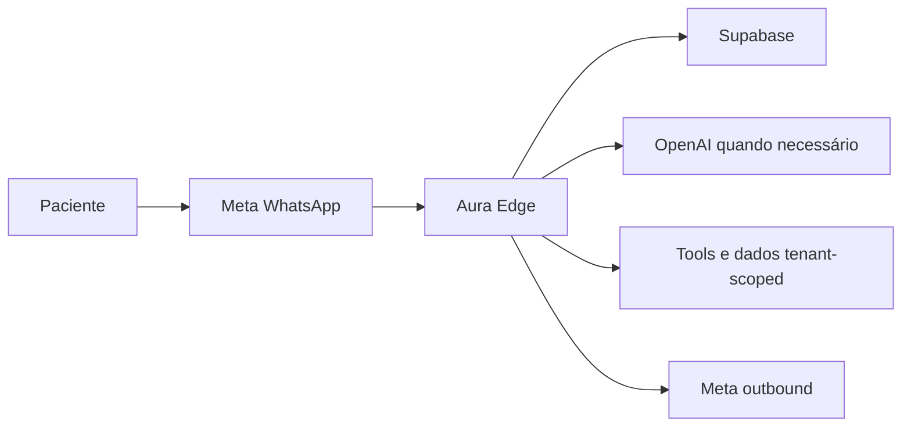

# Aura AI — fluxo de dados e controles técnicos de privacidade

Este documento registra controles técnicos revisados. Não declara “LGPD compliant”, “HIPAA compliant” nem substitui avaliação jurídica/DPO.

## Classificação

| Classe | Exemplos | Regra técnica |
|---|---|---|
| PUBLIC | nome comercial e endereço publicado | uso administrativo autorizado |
| INTERNAL | feature gates, correlation IDs, métricas | staff da clínica/operador |
| PERSONAL | nome, telefone, conversa, appointment | mínimo necessário e tenant-scoped |
| SENSITIVE_HEALTH_RELATED | exame, foto clínica, pedido médico | não interpretar; processamento transitório/restrito |
| SECRET | OpenAI key, service role, Meta token, encryption key | backend-only; nunca persistir em eventos/logs |

## Fluxo técnico

- Meta recebe telefone e conteúdo necessário ao transporte.
- Aura Edge valida assinatura, roteia pela conexão da clínica e normaliza o mínimo necessário.
- Supabase persiste conversation/message por necessidade operacional atual; eventos técnicos não contêm conteúdo.
- OpenAI recebe mensagem/histórico curto e contexto administrativo mínimo, com `store=false` nos adapters novos; não recebe credenciais, banco completo ou outro tenant.
- Tools recebem IDs do contexto backend, nunca IDs arbitrários do LLM.

## Minimização e mídia

- CPF, telefone completo, secrets, internal notes e registros completos não entram em observability.
- Histórico do novo engine é limitado às dez mensagens da mesma conversa/clínica.
- Áudio/imagem são processados em memória e descartados; nenhum bucket permanente foi criado.
- PDF permanece foundation sem parsing/armazenamento permanente.
- Legacy ainda persiste body da conversa por necessidade funcional; isso é conversation data, não log técnico.

## Acesso

- `anon`: webhook público somente com HMAC; liveness sem dados; nenhum acesso a eventos.
- `authenticated staff`: leitura tenant-scoped conforme RLS.
- `admin da clínica`: settings, conteúdo administrativo e auditoria de gates da própria clínica.
- `service_role`: somente Edge/backend para roteamento, eventos técnicos e operações controladas.
- operador global: secrets e kill switch no ambiente backend, não no browser.

## Retenção técnica inicial

Não há purge automático nesta fase, pois prazos ainda precisam de aprovação formal e dependências legais/operacionais. Política proposta para aprovação:

| Grupo | Proposta inicial | Estado |
|---|---|---|
| logs de runtime do provider | menor prazo operacional suportado pelo plano | configurar externamente |
| eventos operacionais/usage | 90 dias | proposta; sem job destrutivo |
| eventos de auditoria/safety/handoff | 180 dias ou política aprovada | proposta |
| conversation/messages | política clínica/legal específica | pendente |
| mídia transitória | somente memória durante processamento | implementado |
| backups | conforme plano Supabase e política aprovada | não verificado no repo |

Números devem virar configuração aprovada antes de qualquer purge.

## Exclusão e anonimização — gaps

Uma solicitação de exclusão precisa mapear patient/lead, appointments, conversations/messages, handoffs, claims e referências legais. Eventos técnicos podem ser anonimizados preservando contagens, mas isso ainda não possui workflow DSAR. Backups e registros que exigem retenção precisam de decisão jurídica. Nenhum delete automático foi criado.

## Subprocessadores e revisão

- Meta: transporte WhatsApp e status de entrega.
- Supabase: banco, auth, Edge runtime e backups conforme plano.
- OpenAI: processamento do novo Aura quando o gate permite.
- Hosting frontend: somente chave publishable e configuração pública.

Confirmar contratos, região, retenção e subprocessadores formalmente antes do piloto real.
