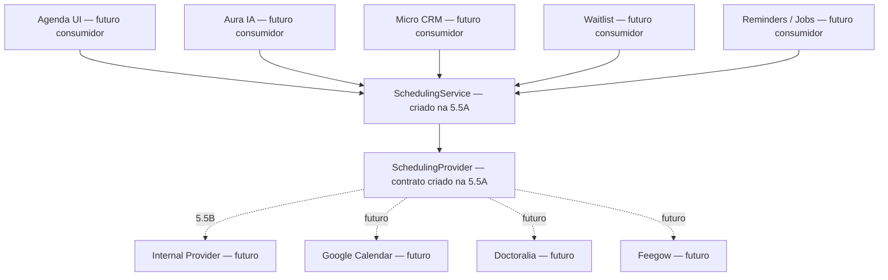

# Fase 5.5A — Scheduling Domain Model + SchedulingService

## Objetivo

Criar uma borda arquitetural provider-neutral para operações de agenda. A camada permite que UI, IA, Micro CRM, waitlist e jobs falem futuramente com uma API comum, sem conhecer Supabase, tabelas, RPCs, tokens ou particularidades de providers externos.

Esta fase é somente estrutural. Nenhum consumidor atual foi migrado e nenhum provider real foi implementado.

## Problema arquitetural resolvido

Antes desta fase, os consumidores de scheduling dependiam diretamente da implementação interna:

```text
UI / Jobs / CRM → Supabase / appointments / RPCs
```

A nova fronteira define contratos estáveis para o caminho futuro:



Somente Domain, contratos, capabilities, erros e `SchedulingService` existem ao final da 5.5A. As setas dos consumidores e providers reais representam o desenho futuro, não integrações ativas.

## O que foi criado

- Tipos de domínio independentes do schema SQL.
- Inputs tipados por operação, sem parâmetros posicionais extensos.
- Contexto multi-tenant explícito.
- Capabilities declarativas por provider.
- Contratos pequenos agrupados por catálogo, disponibilidade, appointments e bloqueios.
- `SchedulingService` com injeção de provider ou resolver.
- Modelo normalizado de erros.
- Barrel export em `@/scheduling`.
- Testes unitários com provider fake, sem acesso a Supabase.

## Estrutura de arquivos

```text
src/scheduling/
  domain/
    capabilities.ts
    inputs.ts
    models.ts
    time.ts
  errors/
    SchedulingError.ts
  providers/
    SchedulingProvider.ts
  services/
    SchedulingService.ts
  index.ts
src/test/
  schedulingService.test.ts
```

## Domain Models

Os modelos mínimos criados são:

- `SchedulingLocation`
- `SchedulingProfessional`
- `SchedulingServiceItem`
- `SchedulingInsurance`
- `SchedulingProfessionalRules`
- `SchedulingSlot`
- `SchedulingAppointment`
- `SchedulingBlock`
- `SchedulingAppointmentStatus`
- `SchedulingConfirmationStatus`
- `SchedulingBillingType`
- `SchedulingAppointmentType`
- `SchedulingSource`
- `SchedulingProviderType`
- `SchedulingSourceOfTruth`
- `SchedulingSyncState`
- `DateRange` e `TimeRange`

`SchedulingAppointment` comporta identidade Aura, `externalId` opcional, provider, source of truth, sync state e status bruto opcional do provider. Esses campos preparam normalização futura sem exigir mudança em `appointments` nesta fase.

O lifecycle operacional foi separado da confirmação. O domínio usa `status` para agendado/em atendimento/finalização/cancelamento e `confirmationStatus` para pendente, confirmado ou não aplicável. O futuro Internal Provider será responsável por traduzir o valor SQL atual `confirmed` para essa distinção, sem alterar o banco na 5.5A.

`SchedulingBillingType` mantém apenas a modalidade administrativa `private | insurance`, necessária para duração e regras de agenda. Nenhum conceito financeiro foi adicionado.

## Datas e timezone

- `IsoInstant` representa um instante absoluto em ISO-8601, com offset explícito ou `Z`.
- `IsoDate` representa uma data `YYYY-MM-DD` interpretada no timezone da unidade.
- `IanaTimezone` representa um identificador IANA, como `America/Sao_Paulo`.
- `SchedulingLocation.timezone` identifica o timezone autoritativo da unidade.
- Inputs podem transportar timezone quando o chamador já o conhece; cada provider continua responsável por interpretar datas locais e devolver instantes absolutos.

A camada não usa `Date` e não altera a lógica atual da Agenda.

## SchedulingProvider

`SchedulingProvider` combina um descritor (`type`, `name`, `capabilities`) com grupos opcionais de operações:

- `SchedulingCatalogOperations`
- `SchedulingAvailabilityOperations`
- `SchedulingAppointmentOperations`
- `SchedulingBlockOperations`

Os métodos são opcionais porque nem todo provider terá todas as capacidades. O `SchedulingService` exige simultaneamente a capability declarada e o método correspondente antes de delegar.

## Provider Capabilities

Capabilities definidas:

```text
locations
professionals
services
insurances
professionalRules
readAvailability
readAppointments
createAppointment
confirmAppointment
cancelAppointment
rescheduleAppointment
updateAppointmentStatus
markNoShow
reassignProfessional
readBlocks
createBlock
removeBlock
webhooks
reconciliation
```

`webhooks` e `reconciliation` são somente declarações de capacidade futura. Não existem handlers, sync ou reconciliação nesta fase.

## SchedulingService

Métodos públicos:

- `listLocations`
- `listProfessionals`
- `listServices`
- `listInsurances`
- `getProfessionalRules`
- `getAvailableSlots`
- `listAppointments`
- `getAppointment`
- `createAppointment`
- `confirmAppointment`
- `cancelAppointment`
- `rescheduleAppointment`
- `updateAppointmentStatus`
- `markNoShow`
- `reassignProfessional`
- `listBlocks`
- `createBlock`
- `removeBlock`

O service valida o contexto, resolve o provider injetado, verifica a capability, exige o método correspondente, delega e normaliza falhas desconhecidas. Ele não consulta Supabase e não contém regra específica de Internal, Google, Doctoralia ou Feegow.

## Multi-tenant context

Toda operação recebe `SchedulingContext` explicitamente:

```ts
interface SchedulingContext {
  clinicId: string;
}
```

O service rejeita contexto vazio antes de chamar ou resolver o provider. Não há dependência da primeira clínica do usuário, React context, sessão global ou variável global. Autenticação e autorização continuam responsabilidade da camada chamadora/provider.

## Source of truth

`SchedulingSourceOfTruth` representa:

- `aura`: PostgreSQL/Aura é autoritativo.
- `external_provider`: o provider externo é autoritativo.

O tipo é independente de `SchedulingProviderType`. Assim, o appointment também informa qual provider o produziu e pode carregar `externalId`, `syncState` e `rawProviderStatus`. Nenhum mirror ou sincronização foi implementado.

## Error model

A camada usa exceções TypeScript simples, seguindo o padrão predominante do projeto, sem biblioteca ou Result framework novo.

- `SchedulingError`: base normalizada com `code`, provider e erro original opcional.
- `SchedulingProviderUnavailableError`
- `SchedulingCapabilityNotSupportedError`
- `SchedulingSlotConflictError`
- `SchedulingNotFoundError`
- `SchedulingValidationError`
- `SchedulingUnauthorizedError`
- `SchedulingProviderError`

Erros já normalizados por um provider são preservados. Erros desconhecidos são encapsulados como `SchedulingProviderError`. O mapeamento de `AGENDA_*`, HTTP ou status específicos será responsabilidade de cada adapter futuro.

## Dependency injection / provider resolution

`SchedulingService` aceita diretamente um `SchedulingProvider` ou um `SchedulingProviderResolver` por constructor injection. O provider fake é injetado diretamente nos testes. O resolver permite futuramente selecionar provider por configuração de tenant/profissional sem introduzir tabela ou hardcode nesta fase.

Nenhuma implementação concreta de resolver baseada em banco foi criada.

## O que deliberadamente NÃO foi implementado

- `InternalSchedulingProvider`.
- Google Calendar, Doctoralia, Feegow ou qualquer provider real.
- Integração HTTP, OAuth, tokens, webhooks, mirror, sync ou reconciliação.
- Migration, tabela, coluna, enum, RLS, trigger ou RPC.
- Alteração de `appointments`.
- Migração de `AppointmentsPage`, Dashboard, Micro CRM, waitlist, reminders ou WhatsApp/IA.
- Nova dependência npm.

## Como o InternalSchedulingProvider se encaixará na Fase 5.5B

Na 5.5B, um adapter interno poderá implementar os contratos usando as queries e RPCs atuais, preservando `get_available_slots`, `create_appointment_secure`, `reschedule_appointment_secure`, `cancel_appointment_secure` e `reassign_appointment_professional_secure` como autoridade transacional. Esse adapter fará a tradução entre rows/status SQL e modelos/erros de domínio.

A Agenda UI continuará sem migração até que o adapter interno seja funcional e testado.

## Como providers externos entrarão futuramente

Cada integração deverá:

1. declarar seu `SchedulingProviderType` e capabilities;
2. implementar somente os grupos de operações suportados;
3. mapear IDs, status, datas e erros próprios para o domínio;
4. declarar `external_provider` como source of truth quando aplicável;
5. ser selecionada por um resolver configurável e multi-tenant;
6. implementar sync/mirror/reconciliação em fases próprias.

## Testes executados

- `npx vitest run src/test/schedulingService.test.ts`: **PASSOU**, 1 arquivo e 10 testes.
- `npm test`: **PASSOU**, 11 arquivos e 42 testes.
- `npm run build`: **PASSOU**, 2.658 módulos transformados. Permanecem somente os warnings já conhecidos de Browserslist desatualizado e chunk acima de 500 kB.
- `npx eslint src/scheduling src/test/schedulingService.test.ts`: **PASSOU**, sem erros ou warnings.
- `npm run lint`: **FALHOU somente por dívida legada preexistente**, com 37 erros fora da nova camada: 36 `no-explicit-any` em arquivos de anamnese isolados e 1 `prefer-const` no `CrmPage.tsx` histórico.
- Revisão de imports em `src/scheduling`: **PASSOU**. Não há imports de Supabase, tipos gerados do banco, React, React Query, Meta, OpenAI ou SDKs externos.

Os testes cobrem delegação de slots, leitura e mutations de appointment, capability ausente, falha desconhecida normalizada, erro normalizado preservado, isolamento por `clinicId`, contexto obrigatório e shape provider-neutral.

## Resultado

A borda de scheduling existe de forma independente, testável e provider-neutral. A implementação é aditiva: não participa ainda de nenhum fluxo do usuário e não modifica o comportamento funcional do Aura.
