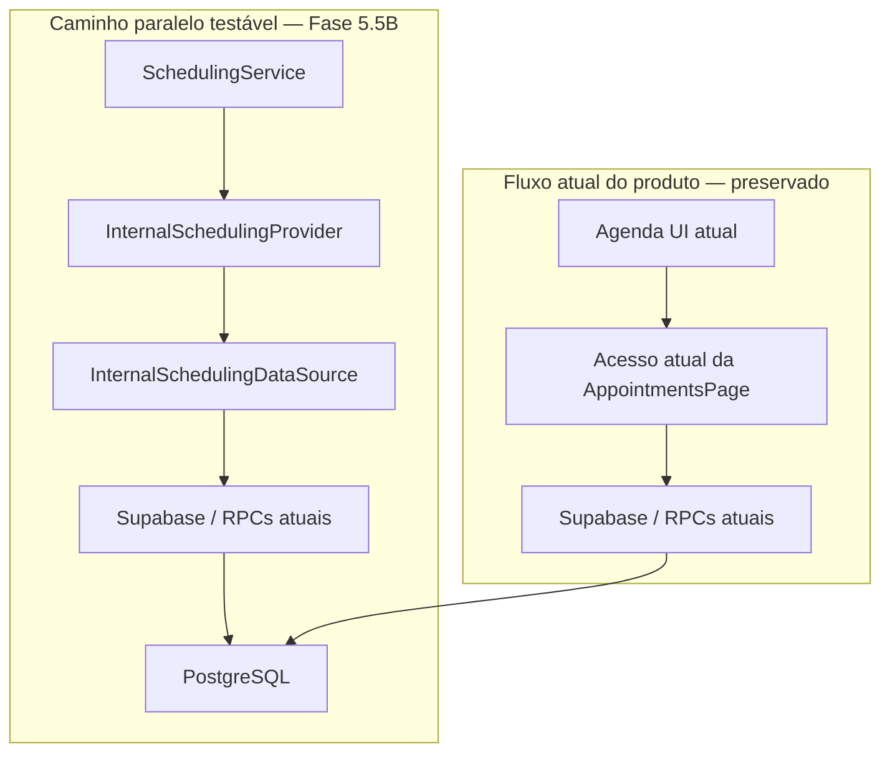

# Fase 5.5B — Internal Scheduling Provider

## Objetivo

Provar que a Agenda Aura existente pode ser representada pelo domínio provider-neutral da Fase 5.5A sem mudar o comportamento do produto. A fase implementa um provider interno real, testável e apoiado nas mesmas tabelas, RLS e RPCs transacionais já usadas pela aplicação.

Esta fase é deliberadamente paralela ao fluxo atual. A Agenda UI ainda não usa `SchedulingService`.

## Estado antes da fase

A Fase 5.5A já entregava modelos, inputs, capabilities, erros, contrato `SchedulingProvider` e `SchedulingService`, mas não possuía adapter real. A tela `AppointmentsPage` continuava acessando Supabase e as RPCs diretamente. O banco já continha a autoridade transacional da Agenda: cálculo de disponibilidade, locks, validação do slot, exclusion constraint e RPCs seguras de lifecycle.

## Arquitetura após 5.5B

O caminho novo não está conectado à Agenda UI nesta fase.

## Arquivos criados

- `src/scheduling/providers/internal/InternalSchedulingDataSource.ts`
- `src/scheduling/providers/internal/InternalSchedulingProvider.ts`
- `src/scheduling/providers/internal/SupabaseInternalSchedulingDataSource.ts`
- `src/scheduling/providers/internal/internalSchedulingMappers.ts`
- `src/scheduling/providers/internal/internalSchedulingErrors.ts`
- `src/scheduling/providers/internal/index.ts`
- `src/test/internalSchedulingMappers.test.ts`
- `src/test/internalSchedulingProvider.test.ts`
- `src/test/supabaseInternalSchedulingDataSource.test.ts`
- `src/test/internalSchedulingIntegration.test.ts`
- `docs/FASE_5_5B_INTERNAL_SCHEDULING_PROVIDER.md`

## Arquivos existentes alterados

- `src/scheduling/index.ts`: exporta o provider interno.
- `src/scheduling/domain/models.ts`: ajustes mínimos e provider-neutral para representar dados já existentes: unidade principal, preço particular, observações de convênio e IDs de unidade/profissional opcionais para linhas legadas em que as colunas SQL são anuláveis.
- `src/scheduling/errors/SchedulingError.ts`: `SchedulingNotFoundError` e `SchedulingValidationError` passaram a preservar opcionalmente o erro original, sem expor sua mensagem ao consumidor.

Nenhum arquivo de UI, Dashboard, Micro CRM, Waitlist, reminder/job, WhatsApp ou IA foi alterado pela Fase 5.5B.

## InternalSchedulingProvider

O provider declara `type = internal` e usa `Aura Internal Scheduling` como nome. Appointments mapeados por ele recebem `sourceOfTruth = aura`, `provider = internal`, `externalId` ausente e `syncState = not_applicable`.

Ele depende somente de `InternalSchedulingDataSource`, recebido no construtor. O provider:

- valida `SchedulingContext.clinicId` em toda operação;
- delega persistência ao data source;
- aplica mapeadores explícitos para não vazar rows SQL;
- normaliza erros internos;
- faz leitura prévia por `appointmentId + clinicId` antes das RPCs cujo contrato recebe somente o ID do appointment, adicionando defesa em profundidade ao controle da própria RPC/RLS.

## Data source / integração Supabase

`InternalSchedulingDataSource` é uma interface pequena e específica para a Agenda Aura. `SupabaseInternalSchedulingDataSource` é a implementação concreta.

O cliente é injetado. Não há import do singleton do browser e não há service role. A implementação aceita estruturalmente um cliente compatível com as operações necessárias, o que permite mocks e evita prender o provider ao runtime React/Vite.

Os tipos gerados do Supabase são importados somente como tipos dentro do adapter. Como as assinaturas das RPCs recentes ainda não aparecem integralmente em `src/integrations/supabase/types.ts`, o adapter usa um contrato estrutural local e restrito para `from`/`rpc`, sem espalhar casts pelo domínio.

## Capabilities implementadas

| Capability | Estado |
|---|---:|
| `locations` | ativa |
| `professionals` | ativa |
| `services` | ativa |
| `insurances` | ativa |
| `professionalRules` | ativa |
| `readAvailability` | ativa |
| `readAppointments` | ativa |
| `createAppointment` | ativa |
| `confirmAppointment` | ativa |
| `cancelAppointment` | ativa |
| `rescheduleAppointment` | ativa |
| `updateAppointmentStatus` | ativa |
| `markNoShow` | ativa |
| `reassignProfessional` | ativa |
| `readBlocks` | ativa |
| `createBlock` | ativa |
| `removeBlock` | ativa |
| `webhooks` | desativada |
| `reconciliation` | desativada |

Somente operações implementadas e testadas foram ativadas.

## Mapeamento de domínio

O módulo `internalSchedulingMappers.ts` contém os mapeamentos de catálogo, slots, appointments e blocks. Rows em `snake_case` não são retornadas a consumidores.

O appointment mapeia:

- IDs internos para os IDs provider-neutral correspondentes;
- `treatment_id` para `serviceId`;
- `health_insurance_id` para `insuranceId`;
- tempos e duração sem recalcular valores autoritativos;
- motivo de cancelamento ou no-show para `cancellationReason`;
- encadeamento de reagendamento para `rescheduledFromId`/`rescheduledToId`;
- status SQL original para `rawProviderStatus`.

O tipo interno `treatment_session`, `session` e valores legados sem representação administrativa própria são traduzidos para `consultation`; `return`, `evaluation` e `post_operative` são preservados.

## Status mapping

Há uma única fonte de tradução em `mapInternalAppointmentStatus` e uma única expansão reversa de filtros em `mapDomainStatusesToInternal`.

| Status SQL | Status operacional de domínio |
|---|---|
| `scheduled` | `scheduled` |
| `confirmed` | `scheduled` |
| `in_progress` | `in_progress` |
| `completed` | `completed` |
| `cancelled` | `cancelled` |
| `no_show` | `no_show` |
| `rescheduled` | `rescheduled` |

Um filtro de domínio por `scheduled` consulta tanto `scheduled` quanto `confirmed` no banco.

## Confirmation status mapping

| Estado interno | `confirmationStatus` |
|---|---|
| SQL `confirmed` | `confirmed` |
| SQL `scheduled` sem `confirmed_at` | `pending` |
| SQL `scheduled` com `confirmed_at` | `confirmed` |
| demais status com `confirmed_at` | `confirmed` |
| demais status sem `confirmed_at` | `not_required` |

Assim, o schema atual continua intacto embora use `confirmed` dentro do enum operacional.

## Billing type mapping

O provider preserva apenas os conceitos administrativos `private` e `insurance`. O valor SQL `insurance` vira `insurance`; o valor interno esperado `private` vira `private`. Nenhum faturamento, custo, margem ou contrato financeiro foi introduzido.

## Source of truth

`appointments` é a fonte de verdade do provider interno. Todo `SchedulingAppointment` retornado é identificado com `provider = internal`, `sourceOfTruth = aura` e `syncState = not_applicable`.

## Operações de catálogo

| Domínio | Tabelas |
|---|---|
| unidades | `clinic_locations` |
| profissionais e unidade | `professionals`, `professional_locations` |
| serviços por profissional | `treatments`, `professional_treatments` |
| convênios por profissional | `health_insurances`, `professional_health_insurances` |
| regras profissionais | `professional_settings` |

Preço particular e overrides administrativos são lidos quando existentes. Custos, margem, combos, pacotes, renewal e conceitos financeiros/legados não são carregados.

## Disponibilidade

`getAvailableSlots` chama exclusivamente a RPC canônica `get_available_slots`. O provider não replica o algoritmo SQL, não calcula slots no browser e não antecipa sucesso. Timezone, janelas semanais, validade da disponibilidade, bloqueios e appointments ocupantes continuam resolvidos no PostgreSQL.

## Appointment lifecycle

- leitura: queries temporais em `appointments`, sempre com `clinic_id`;
- criação: `create_appointment_secure`;
- confirmação: update centralizado em `appointments`, com `clinic_id`, `id` e RLS, refletindo o mecanismo atual;
- cancelamento: `cancel_appointment_secure` com status `cancelled`;
- no-show: `cancel_appointment_secure` com status `no_show`;
- reagendamento: `reschedule_appointment_secure`;
- reatribuição: `reassign_appointment_professional_secure`;
- status `in_progress`/`completed`: update centralizado com `clinic_id`, `id`, timestamps e RLS.

As operações transacionais continuam dependentes dos advisory locks, `assert_appointment_slot` e exclusion constraint existentes no banco.

## Blocks

`listBlocks`, `createBlock` e `removeBlock` usam `appointment_blocks`. Leituras usam interseção de intervalos; unidade e profissional são filtros opcionais. Toda operação inclui `clinic_id` e permanece sujeita à RLS existente.

## Error mapping

| Origem | Erro de domínio |
|---|---|
| `23P01`, `AGENDA_SLOT_CONFLICT`, exclusion violation | `SchedulingSlotConflictError` |
| `P0002`, `PGRST116`, appointment not found | `SchedulingNotFoundError` |
| `22023`, `23503`, `23514` e violações de regra conhecidas | `SchedulingValidationError` |
| `42501`, 401/403, RLS/JWT/forbidden | `SchedulingUnauthorizedError` |
| rede, timeout, status 5xx | `SchedulingProviderUnavailableError` |
| falha inesperada | `SchedulingProviderError` |

Mensagens SQL cruas não são apresentadas aos consumidores. O erro original fica disponível apenas em `originalError` para tratamento interno.

## Multi-tenancy / RLS

- Toda API pública recebe `SchedulingContext.clinicId`.
- Todas as queries de tabelas incluem filtro por `clinic_id`.
- Mutações diretas usam `clinic_id + id`.
- RPCs de lifecycle que aceitam somente `appointmentId` recebem uma leitura prévia explicitamente restrita à clínica; as RPCs e a RLS continuam sendo a autoridade final.
- O provider não procura “a primeira clínica” do usuário.
- Nenhum segredo ou service role é utilizado no frontend.

## Compatibilidade frontend × Edge Functions

A decisão foi separar provider e acesso a dados, sem criar framework genérico. A lógica de domínio/mapping e o `InternalSchedulingProvider` não dependem de browser, React ou singleton Supabase. Um runtime frontend ou Edge Function pode injetar uma implementação de `InternalSchedulingDataSource`; a implementação atual também recebe um cliente Supabase estruturalmente compatível.

Não houve reorganização das Edge Functions nesta fase.

## RPCs preservadas

- `get_available_slots`
- `create_appointment_secure`
- `cancel_appointment_secure`
- `reschedule_appointment_secure`
- `reassign_appointment_professional_secure`

Também foram preservadas, sem reimplementação ou alteração, as garantias de `resolve_appointment_duration`, `assert_appointment_slot`, advisory locks e exclusion constraint.

## O que NÃO foi alterado

- `AppointmentsPage` e seu fluxo atual;
- Dashboard;
- Micro CRM;
- Waitlist e `check-waitlist`;
- reminders, summaries, scheduler e jobs;
- IA/WhatsApp, prompts e tools;
- providers externos, OAuth, webhooks, sync ou reconciliation;
- schema, tabelas, colunas, RLS, triggers, constraints ou RPCs;
- comportamento visual do produto.

Nenhuma migration foi criada na Fase 5.5B.

## Testes executados

### Testes novos da Fase 5.5B

- mapeadores: 13;
- provider: 16;
- data source Supabase: 11;
- integração `SchedulingService + InternalSchedulingProvider`: 5.

Total da fase: **45 testes novos**, todos aprovados.

### Regressão

- `npm test`: **15 arquivos e 87 testes aprovados**;
- `npm run build`: aprovado; apenas avisos não bloqueantes já relacionados a Browserslist desatualizado e chunk principal acima de 500 kB;
- lint direcionado de `src/scheduling` e dos testes de scheduling: aprovado sem erros;
- typecheck direcionado de `src/scheduling/index.ts`: aprovado; o `npx tsc -b` global adicional continua falhando em arquivos existentes fora de `src/scheduling`, principalmente no legado e em queries antigas tipadas como `unknown`, sem erro apontado nos arquivos desta fase;
- inspeção de dependências: domínio e `SchedulingService` continuam sem imports de Supabase, generated DB types, React, React Query, OpenAI, Meta ou providers externos;
- testes SQL: não executados porque o Supabase CLI não está instalado no ambiente (`supabase: command not found`);
- smoke/E2E: não executados porque `E2E_USER_EMAIL` e `E2E_USER_PASSWORD` não estão disponíveis no ambiente.

## Resultado

O caminho `SchedulingService → InternalSchedulingProvider → InternalSchedulingDataSource → Supabase/PostgreSQL` representa e testa as operações reais da Agenda Aura sem migrar consumidores e sem alterar o banco. As capabilities habilitadas possuem implementação e cobertura de teste.

## Limitações identificadas

1. A assinatura atual de `get_available_slots` recebe tratamento, mas não recebe `billing_type` ou `health_insurance_id`. Por isso, embora o input provider-neutral aceite modalidade/convênio, o provider não pode encaminhá-los à RPC nem reproduz o cálculo em TypeScript. A duração do slot continua sendo a duração resolvida pela RPC atual.
2. A versão atual de `reschedule_appointment_secure` não copia `billing_type` e `health_insurance_id` para a nova linha. Um reagendamento de convênio pode herdar os defaults `private`/`NULL`, embora a duração explícita possa ser preservada pelo parâmetro existente.
3. `reassign_appointment_professional_secure` preserva o intervalo original. Ela valida conflito e disponibilidade, mas não recalcula automaticamente a duração conforme a modalidade do novo profissional.
4. Confirmação e atualizações de `in_progress`/`completed` ainda são updates diretos sob RLS porque esse é o mecanismo atual; não há RPC canônica específica.
5. Os tipos gerados do Supabase têm drift em relação às migrations mais recentes, inclusive nas assinaturas das RPCs e nos campos históricos `valid_from`/`valid_until`. O provider não consulta `professional_availability` diretamente, portanto não foi necessária regeneração massiva: a RPC canônica continua responsável por esses campos.
6. As RPCs de cancelamento, reagendamento e reatribuição não recebem `clinic_id` em sua assinatura. A leitura prévia do provider adiciona scoping, mas uma assinatura futura com tenant explícito reduziria a ambiguidade e uma consulta adicional.

## Mudanças de banco recomendadas para fases futuras, mas não executadas

Nenhuma mudança de banco foi executada. Para uma fase futura, recomenda-se avaliar, com migration e testes SQL próprios:

1. ampliar `get_available_slots` com modalidade e convênio, mantendo toda resolução autoritativa no PostgreSQL;
2. fazer `reschedule_appointment_secure` copiar e validar `billing_type`/`health_insurance_id`;
3. definir explicitamente a regra de duração na reatribuição de profissional;
4. considerar RPCs canônicas para confirmação e transições operacionais de status;
5. adicionar `clinic_id` às RPCs de lifecycle baseadas apenas em appointment ID;
6. regenerar os tipos Supabase em uma mudança isolada e revisável.

Essas recomendações não bloqueiam a prova arquitetural da Fase 5.5B e não devem ser aplicadas sem uma fase autorizada.
