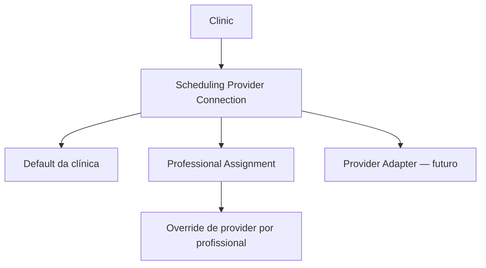
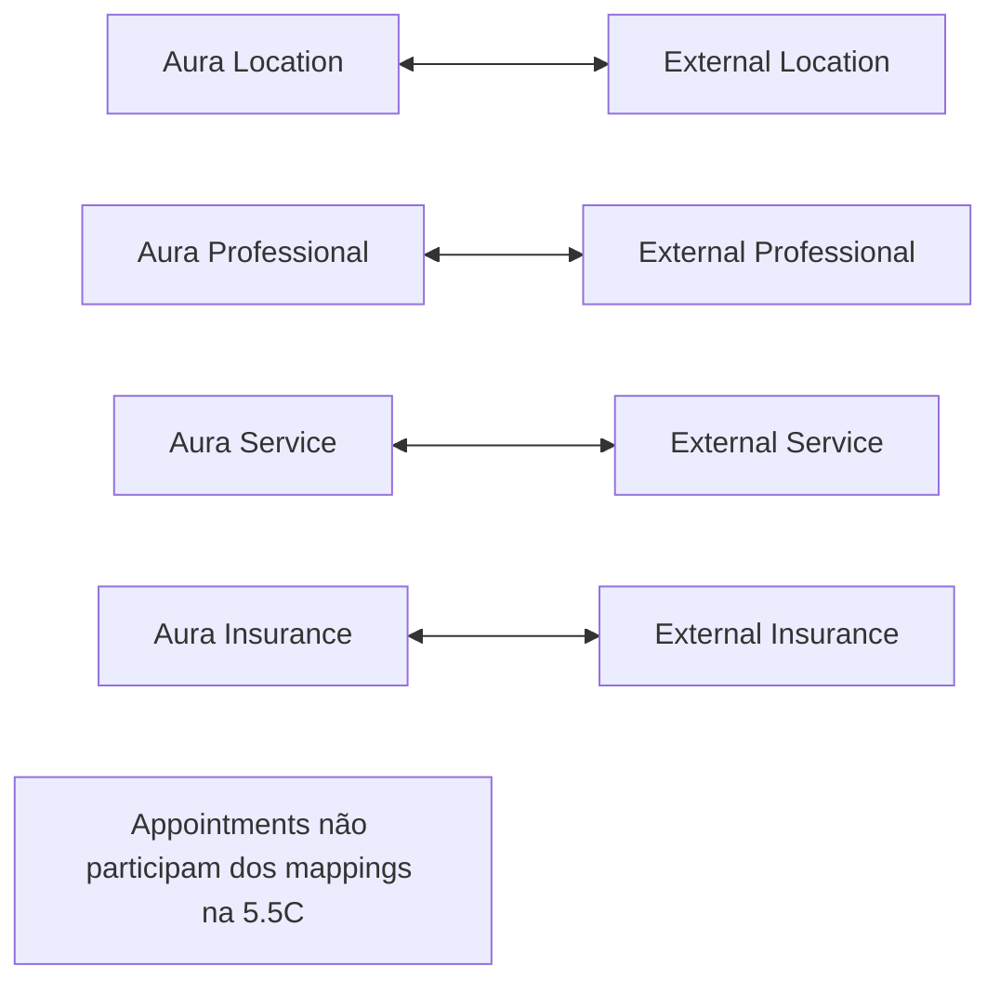

# Fase 5.5C — Provider Connections + External Entity Mappings

## Objetivo

Criar persistência e acesso provider-neutral para conexões de agenda, escopo por clínica/profissional e mapeamentos de entidades Aura para recursos externos. Esta fase prepara providers futuros sem implementar integração externa, appointments externos, mirror, webhook, polling ou sincronização.

## Contexto

As Fases 5.5A–5.5B.1 já entregaram domínio de scheduling, `SchedulingService`, `InternalSchedulingProvider`, data source Supabase e autoridade transacional no PostgreSQL. A Fase 5.5C adiciona somente configuração e identidade externa. O fluxo atual da Agenda continua inalterado.

## Arquitetura





Fluxo futuro, ainda não ativado:

```text
SchedulingService
  → Provider Resolver
  → Scheduling Connection
  → Provider Adapter
```

## Modelo de conexão

`scheduling_provider_connections` representa a conta/contexto lógico de scheduling dentro de uma clínica. Uma clínica pode ter várias conexões, inclusive várias do mesmo provider externo.

Campos centrais:

- `clinic_id` para isolamento direto;
- `provider_type` extensível;
- `status` de lifecycle;
- nome de exibição e identificação opcional da conta externa;
- `source_of_truth` explícito;
- capabilities efetivas;
- metadata limitada e não secreta;
- default da clínica;
- timestamps de conexão, desconexão e verificação.

Não existe coluna `clinics.scheduling_provider`, pois ela impediria múltiplos providers e overrides profissionais.

## Provider type

Foi escolhido `text` com validação de formato (`^[a-z][a-z0-9_]{1,63}$`) em vez de enum PostgreSQL. Assim, novos adapters não exigem alteração destrutiva de enum.

Os providers conhecidos continuam alinhados ao domínio TypeScript:

- `internal`;
- `google_calendar`;
- `doctoralia`;
- `feegow`.

O modelo de conexão usa `SchedulingProviderKey`, que preserva autocomplete dos providers conhecidos e aceita chaves futuras. O contrato de um adapter funcional continua usando `SchedulingProviderType`.

## Connection status

Estados persistidos:

- `pending`;
- `active`;
- `disconnected`;
- `error`;
- `reauthorization_required`;
- `disabled`.

Esses estados descrevem apenas a conexão. Não existem estados de sync de appointments.

## Source of truth

`source_of_truth` aceita `aura` ou `external_provider` e é configurado por conexão. Não existe regra universal hardcoded dizendo que Google, Doctoralia ou Feegow são sempre autoritativos.

Conexões `internal` são obrigatoriamente `aura` e não podem possuir conta externa.

## Scope

A conexão pertence sempre à clínica. O escopo profissional é representado por `scheduling_connection_professionals`, sem duplicar external IDs nessa tabela.

## Default provider

`is_default` identifica o default da clínica. Um índice único parcial impede mais de um default por clínica, independentemente do status. A troca de default deve ocorrer em uma transação: retirar o default atual e marcar o novo.

## Professional assignments

Uma linha ativa em `scheduling_connection_professionals` é um override explícito para o profissional. Um índice único parcial impede dois overrides ativos simultâneos para o mesmo profissional.

A prioridade conceitual futura é:

1. override ativo do profissional;
2. default da clínica;
3. conexão internal como fallback de configuração.

O repository já expõe essa resolução conceitual, mas nenhum consumer de produção foi migrado.

## Decisão sobre o Internal Provider

Foi adotada a opção **internal connection persistida**.

Motivos:

- mantém uma única forma de consultar configuração;
- torna onboarding e default explícitos;
- evita um ramo virtual oculto no futuro resolver;
- permite desativação/configuração futura sem alterar o `InternalSchedulingProvider`.

A migration cria uma conexão internal ativa/default para clínicas existentes e uma trigger faz o mesmo para novas clínicas. Essa linha não representa credencial nem recurso externo. Ela persiste as capabilities efetivas já comprovadas pelo provider interno.

Existe no máximo uma conexão internal por clínica.

## Entity mappings

Foram escolhidas quatro tabelas específicas:

- `scheduling_location_mappings`;
- `scheduling_professional_mappings`;
- `scheduling_service_mappings`;
- `scheduling_insurance_mappings`.

### Decisão: tabelas específicas

O conjunto de entidades é pequeno e estável. Tabelas específicas oferecem FKs reais, nomes explícitos e menor ambiguidade do que `entity_type + aura_entity_id`. Isso evita uma FK polimórfica ingênua.

Location, professional e insurance usam FKs compostas com `clinic_id`. Service usa FK física para `treatments.id` e uma trigger curta valida `treatments.clinic_id`, evitando criar um índice composto redundante na tabela existente.

## Locations

Cada mapping liga `clinic_locations.id` a um `external_id` string dentro de uma conexão. `external_parent_id` pode representar account/facility pai.

## Professionals

Cada mapping liga `professionals.id` a doctor/resource externo. O assignment escolhe a conexão; o mapping identifica o recurso. Os conceitos não são misturados.

## Services

Cada mapping liga `treatments.id` ao procedimento/service externo. Não existe coluna específica por provider em `treatments`.

## Insurances

Cada mapping liga `health_insurances.id` ao convênio externo. Não altera os vínculos `professional_health_insurances`.

## External IDs

Todos os external IDs são `text`, não UUID. Valores vazios são rejeitados. `external_name` é snapshot opcional para UX/debug e não substitui o nome Aura.

## Mapping lifecycle

Estados:

- `active`;
- `stale`;
- `invalid`;
- `disabled`.

Mappings são desativados em vez de apagados automaticamente. `last_verified_at` prepara verificação futura, sem criar job.

## Unicidade dos mappings

Para cada tabela, índices únicos parciais garantem que, enquanto o mapping não estiver `disabled`:

- uma entidade Aura possua no máximo um mapping na mesma conexão;
- um external ID aponte para no máximo uma entidade Aura na mesma conexão.

Depois da desativação, um novo mapping pode ser criado sem apagar o histórico anterior.

## Capabilities

`capabilities jsonb` armazena capabilities efetivas por conexão. Uma check constraint exige objeto JSON. O repository traduz para `Partial<SchedulingProviderCapabilities>`.

Não foram criadas dezenas de colunas booleanas. Defaults do adapter e scopes futuros poderão ser normalizados pela aplicação antes da persistência.

## Metadata

`metadata jsonb` aceita somente objeto e serve para dados provider-specific não essenciais. Provider, status, source of truth, conta, default e lifecycle possuem colunas próprias.

Metadata não deve receber secrets.

## Credentials / tokens — deliberadamente adiados

Não foi criada tabela de token nem `credential_reference`, pois ainda não existe infraestrutura segura comum que justifique a abstração.

O armazenamento de credenciais fica adiado para a fase de implementação de cada provider. Access token, refresh token e client secret não podem ser armazenados em plaintext nem enviados ao frontend.

## Multi-tenancy

Todas as seis tabelas novas possuem `clinic_id`. FKs compostas impedem conectar connection, professional, location ou insurance de clínicas distintas. O service mapping possui validação tenant adicional por trigger.

O repository inclui `clinic_id` em todas as leituras e mutações.

## RLS

RLS está habilitada em todas as tabelas novas.

- staff autorizado pode ler configurações da própria clínica;
- somente admin pode criar, atualizar ou desativar conexões, assignments e mappings;
- nenhuma policy usa `USING (true)`;
- `service_role` possui privilégios para uso futuro somente no backend/Edge Functions;
- o frontend continua sem `service_role`.

## Auditoria

As seis tabelas reutilizam `audit_trigger_func` e `audit_logs`. Não foi criado sistema paralelo de auditoria. Como não há credenciais nas tabelas, a auditoria não replica tokens.

## Constraints

Principais garantias:

- formato extensível de `provider_type`;
- lifecycle e source of truth válidos;
- capabilities/metadata como objetos;
- internal sempre Aura e sem conta externa;
- no máximo um internal e um default por clínica;
- connection/professional do assignment na mesma clínica;
- no máximo um override profissional ativo;
- mappings com connection e entidade na mesma clínica;
- external ID não vazio;
- mapping Aura↔external 1:1 enquanto não desativado.

Deletes de connection e entidades mapeadas usam `RESTRICT`, preservando histórico e exigindo lifecycle explícito.

## Indexes

Foram indexadas as consultas esperadas:

- connections por clínica/provider e clínica/status;
- default e internal únicos por clínica;
- assignments por conexão e clínica/profissional;
- override profissional ativo único;
- mappings por clínica/conexão/status;
- identidade Aura e identidade externa únicas por conexão.

Índices originados por PK/FK/unique não foram duplicados deliberadamente.

## Repository

`SchedulingConnectionRepository` expõe:

- listagem e busca de connections;
- default da clínica;
- override profissional com fallback ao default;
- listagem de mappings;
- lookup Aura → external;
- lookup external → Aura;
- upsert controlado;
- disable sem exclusão física.

`SupabaseSchedulingConnectionRepository` recebe cliente injetado, não importa singleton do browser e normaliza `23505` como `duplicate_mapping`.

## Resolver futuro

O repository fornece a configuração necessária, porém não implementa `SchedulingProviderResolver` nem instancia adapters. Isso evita mudar consumidores antes de existirem providers externos reais.

## Testes SQL

`supabase/tests/phase5_5c_scheduling_provider_connections.sql` usa dois usuários `authenticated` sintéticos e transação com rollback.

Cobertura:

- bootstrap e regra da conexão internal;
- leitura RLS A/B;
- criação administrativa;
- bloqueio cross-tenant;
- default único;
- assignment válido e cross-tenant;
- override ativo único;
- quatro tipos de mapping;
- duplicidade Aura e external;
- desativação preservando histórico;
- mapping cross-tenant;
- capabilities persistidas.

Resultado: **APROVADO**.

Os testes SQL das Fases 5 e 5.5B.1 foram reexecutados e continuam aprovados.

## Testes TypeScript

`src/test/schedulingConnectionRepository.test.ts` possui 7 testes para listagem, default, override, fallback, lookup bidirecional, desativação, tenant propagation e normalização de duplicidade.

Resultados finais:

- scheduling direcionado: 6 arquivos, 66/66 testes;
- suíte completa: 16 arquivos, 98/98 testes;
- lint direcionado: aprovado;
- build: aprovado, 2.658 módulos;
- `git diff --check`: aprovado.

Avisos não bloqueantes: Browserslist desatualizado e bundle principal acima de 500 kB.

## Types Supabase

Depois do reset local com 63 migrations, `src/integrations/supabase/types.ts` foi regenerado oficialmente. As seis tabelas e seus relacionamentos aparecem nos tipos.

Após o deploy, os tipos remotos foram comparados. A diferença foi somente o metadado remoto `PostgrestVersion: 14.15`; não houve drift de tabelas ou relações da Fase 5.5C.

## Deploy

O dry-run remoto mostrou exclusivamente:

`20260815190000_phase5_5c_scheduling_provider_connections.sql`

Sem seeds e sem roles. A migration foi aplicada com sucesso no projeto vinculado `nklccxaeasoxjanxgqcl`. O histórico local e remoto passou a conter 63 migrations.

## O que NÃO foi implementado

- alteração em `appointments`;
- appointment mapping ou mirror;
- external appointment ingestion;
- sync cursor, token, etag ou version;
- webhook, polling ou reconciliação;
- OAuth ou armazenamento de credenciais;
- Google Calendar, Doctoralia ou Feegow funcional;
- chamadas HTTP/APIs externas;
- alteração do `InternalSchedulingProvider`;
- migração da Agenda UI;
- mudança em Waitlist;
- mudança em WhatsApp/IA;
- mudança em Dashboard ou Micro CRM;
- onboarding visual.

## Limitações

- nenhum adapter externo consome as connections ainda;
- capabilities são normalizadas pela aplicação, não por schema JSON rígido;
- a troca de default precisa ser transacional;
- a resolução profissional/default é repository-level e ainda não está ligada ao `SchedulingService`;
- armazenamento seguro de credenciais ainda precisa de desenho específico;
- E2E visual não foi necessário, pois a UI não foi alterada.

## Próxima fase recomendada

A próxima fase pode tratar **Appointment Mirror + Sync Metadata + Reconciliation Foundation**. Ela deve ser autorizada e executada separadamente. A Fase 5.5D não foi iniciada.
