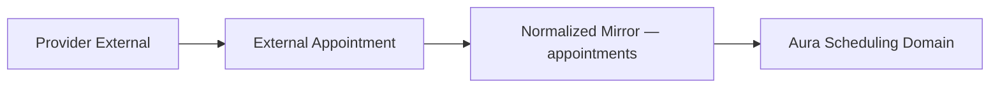
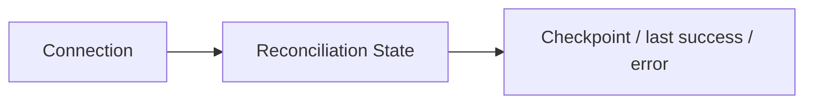

# Fase 5.5D — Appointment Mirror, Sync Metadata e Reconciliation Foundation

## Objetivo

Preparar o domínio de agenda para representar agendamentos mantidos por provedores externos sem integrar nenhum provedor real. A entrega cobre identidade externa, autoridade de escrita, estado de sincronização, tombstone, idempotência de eventos e checkpoint de reconciliação, mantendo o fluxo interno transacional existente.

## Estado anterior

As fases 5.5A–5.5C já forneciam o domínio de scheduling, o provider interno, as RPCs transacionais, conexões provider-neutral, atribuições por profissional e mapeamentos de local, profissional, serviço e convênio. `appointments` continuava sendo a fonte operacional consumida pela Agenda, Dashboard, CRM, histórico do paciente, portal, jobs e WhatsApp/IA, mas não possuía identidade ou metadados de sincronização externos.

## Decisão: `appointments` evoluída ou mirror separado

`appointments` foi evoluída de forma aditiva e passa a ser também o mirror normalizado. Não foi criada uma segunda tabela de mirror.

## Motivo da decisão

Os consumidores atuais consultam diretamente `appointments`. Uma tabela paralela criaria duas fontes operacionais e exigiria migrar a UI e os demais consumidores nesta fase. As novas colunas têm defaults compatíveis, portanto registros existentes continuam internos, com autoridade Aura e sem sincronização aplicável.

## Appointment external identity

A identidade externa é a tupla `(connection_id, external_appointment_id)`. `external_appointment_id` é `text`, nunca é interpretado como UUID e permanece no tombstone para preservar histórico e deduplicação. Um índice parcial único impede duplicatas dentro da mesma conexão, mas permite o mesmo ID em conexões diferentes.

## Provider / connection

`provider_type` é uma chave textual provider-neutral; os registros antigos usam `internal`. `connection_id` referencia, junto com `clinic_id`, `scheduling_provider_connections`. Trigger e foreign key composta impedem misturar clínica ou provider da conexão.

## Source of truth

`source_of_truth` aceita `aura` e `external_provider`. Registros internos têm obrigatoriamente `aura`; um mirror externo não pode declarar provider `internal`.

## Event origin

`event_origin` registra a origem operacional normalizada: `agenda_ui`, `aura_ai`, `micro_crm`, `waitlist`, `system`, `external_provider`, `provider_import` ou `reconciliation`. O campo não substitui source of truth.

## Sync state

O estado provider-neutral do appointment é separado de status clínico e do estado da conexão: `not_applicable`, `synced`, `pending_create`, `pending_update`, `pending_cancel`, `conflict`, `error`, `stale` e `tombstoned`. Appointments internos permanecem obrigatoriamente `not_applicable`.

## Raw provider status

`raw_provider_status` guarda opcionalmente apenas o rótulo de status necessário ao diagnóstico/mapeamento. Não armazena payload bruto.

## External version / etag

`external_version` e `external_etag` são textos opcionais. Eles permitem futura concorrência otimista sem impor semântica de um provedor específico.

## Last synced

`last_synced_at` registra quando o mirror foi sincronizado pela Aura; `last_provider_seen_at` registra quando o appointment foi visto no provedor. A separação suporta futuras varreduras de stale sem confundir processamento local com presença remota.

## Tombstone

Tombstone é representado por ambos: `is_tombstone = true`, `tombstoned_at` preenchido e `sync_state = 'tombstoned'`. Constraints exigem os três em conjunto. Isso é distinto de `status = 'cancelled'`: cancelamento é estado clínico, tombstone indica ausência/exclusão no sistema externo.

## Idempotency

Appointments são deduplicados por conexão e ID externo, inclusive tombstones. Eventos são deduplicados por `(connection_id, external_event_id)` ou, na ausência de ID do provedor, por `(connection_id, payload_hash)`.

## Event inbox — criado ou adiado

Foi criada a inbox mínima `scheduling_provider_events`. Ela contém somente metadados técnicos de identidade e processamento; não contém corpo bruto, headers, tokens ou dados clínicos. Sua existência não implementa webhook, polling ou worker.

## Reconciliation state

`scheduling_reconciliation_states` mantém exatamente um estado por connection. O lifecycle é `idle`, `running` ou `error`, com início, conclusão, último sucesso, falhas consecutivas e erro sanitizado.

## Checkpoint/cursor/token

Cada estado possui `checkpoint`, `sync_token` e `checkpoint_metadata` JSON restrito a objeto. São campos opacos/provider-neutral; nenhum consumidor ou algoritmo de paginação foi implementado.

## Conflict

O appointment mantém `sync_conflict_code` e `sync_conflict_at`. O estado `conflict` é distinto de `error`: conflito representa divergência/resolução pendente; erro representa falha técnica. Mensagens livres de conflito não são persistidas, reduzindo risco de PHI/PII.

## Unmapped external entities

Appointment externo parcialmente mapeado pode existir. `location_id`, `professional_id`, `treatment_id` e `health_insurance_id` podem permanecer nulos, e `unmapped_entity_types` informa as categorias pendentes: `location`, `professional`, `service` e/ou `insurance`. Lista não vazia exige `source_of_truth = external_provider` e `sync_state = conflict`.

## Patient limitation

Não foi criado patient mapping nesta fase. `patient_id` pode permanecer nulo no mirror externo e nenhum paciente Aura é criado automaticamente. Também não são persistidos nome, telefone, e-mail, documento, notas clínicas ou payload bruto do paciente externo.

## Write authority

`source_of_truth = aura` permite o fluxo local. `source_of_truth = external_provider` exige escrita por backend técnico/provider. O trigger bloqueia INSERT e qualquer UPDATE autenticado de registros externos/provider-backed com `AGENDA_PROVIDER_WRITE_REQUIRED`, inclusive tentativas de converter o registro para interno. O helper de domínio `canWriteSchedulingAppointmentLocally` torna a mesma regra explícita no código.

## Multi-tenancy

Todas as relações técnicas carregam `clinic_id`. Foreign keys compostas validam que connection e registro pertencem à mesma clínica. Repositórios sempre filtram `clinic_id`; os testes SQL cobrem tentativa cross-tenant.

## RLS

Equipe autenticada pode ler estados e eventos apenas da própria clínica. INSERT/UPDATE/DELETE técnico foi revogado de `authenticated` e `anon`; `service_role` recebeu acesso integral para a futura infraestrutura. A RLS de `appointments` foi mantida e complementada pelo guard de autoridade.

## Indexes

- identidade única de appointment por connection;
- busca por connection e sync state;
- agenda por clínica, provider e início;
- varredura de mirrors externos stale;
- estado de reconciliação por clínica/status e erros;
- inbox por status/recebimento, identidade do evento e appointment externo.

## Constraints

As constraints validam chaves de provider, IDs não vazios, source of truth, sync states, origins, identidade interna/externa, tombstone, conjunto de unmapped entities, limites de erros sanitizados, provider/tenant da connection e cronologia de reconciliação. A exclusão de sobreposição continua idêntica para appointments com autoridade Aura; mirrors externos podem refletir fielmente sobreposições do provedor.

## Repository

Foram adicionados contratos e implementações Supabase para:

- consultar/upsert de mirror por identidade externa;
- marcar synced, conflict, error e tombstone;
- listar pending e stale;
- iniciar, concluir e falhar reconciliação;
- persistir checkpoint;
- registrar e concluir eventos idempotentes.

Nenhum repositório contém chamada a API externa.

## Tests SQL

`phase5_5d_appointment_mirror_sync_foundation.sql` valida defaults internos, identidade externa, version/etag/status bruto, unicidade por connection, isolamento cross-tenant, estados inválidos, tombstone versus cancelamento, mirror parcial sem auto-criação, lifecycle de checkpoint, idempotência de eventos, RLS e bloqueio de escrita autenticada. Executado diretamente com `psql -v ON_ERROR_STOP=1`: aprovado.

## Regression SQL

As suítes `phase5_transactional_scheduling.sql`, `phase5_5b1_internal_scheduling_hardening.sql`, `phase5_5c_scheduling_provider_connections.sql` e 5.5D passaram no PostgreSQL local. O runner TAP do CLI reporta “No plan found” porque esses arquivos são transacionais/`DO`, não TAP; por isso a execução conclusiva foi feita com `ON_ERROR_STOP`.

## Tests TypeScript

Foram adicionados 11 testes de repositório/autoridade. A suíte total terminou com 18 arquivos e 109 testes aprovados.

## Types Supabase

`src/integrations/supabase/types.ts` foi regenerado a partir do banco local após reset integral das 64 migrations.

## Deploy

`migration list --linked` e `db push --linked --dry-run` confirmaram que apenas `20260815200435_phase5_5d_appointment_mirror_sync_foundation.sql` estava pendente. A migration foi aplicada ao Supabase remoto e a consulta pós-deploy confirmou o timestamp nos dois lados. Os tipos local/remoto coincidem no schema da aplicação; o gerador remoto acrescenta somente o metadado informativo `PostgrestVersion: 14.15`.

## O que NÃO foi implementado

Não foram implementados adapters Google Calendar, Doctoralia ou Feegow; provider resolver ativo; APIs externas; OAuth; armazenamento de credenciais/tokens; webhook; polling; worker de sync; job de reconciliação; outbox; desired-state duplicado; persistência de payload bruto; ou auto-criação de entidades Aura. Agenda UI, Dashboard, Micro CRM, Waitlist, reminders/jobs e WhatsApp/IA não foram migrados nem alterados por esta fase.

## Limitações

- O mirror externo ainda depende de futuro backend com `service_role`.
- Patient mapping está fora do escopo.
- Stale é apenas modelado; nenhum job o calcula.
- O lint dos arquivos 5.5D passa. O `npm run lint` global permanece bloqueado por débitos preexistentes fora desta fase (componentes legados de Anamnese, `CrmPage.tsx` e artefato temporário do Supabase), preservados para não misturar escopo.
- O bundle de produção mantém o aviso preexistente de chunk acima de 500 kB.

## Próxima fase recomendada

Somente em uma fase futura: provider resolver ativo, adapter externo, OAuth/credential storage, webhook ou polling e sincronização/reconciliação executável. Nada disso foi iniciado nesta entrega.

## Diagramas

Nenhum provider real está chamando esta infraestrutura.

## Compatibilidade confirmada

O backfill ocorre pelos defaults das colunas: registros anteriores tornam-se `provider_type = internal`, `source_of_truth = aura`, `sync_state = not_applicable`, `event_origin = system` e não tombstone. As RPCs transacionais e o provider interno não foram alterados. A Agenda e os demais consumidores atuais continuam usando `appointments` como antes.
