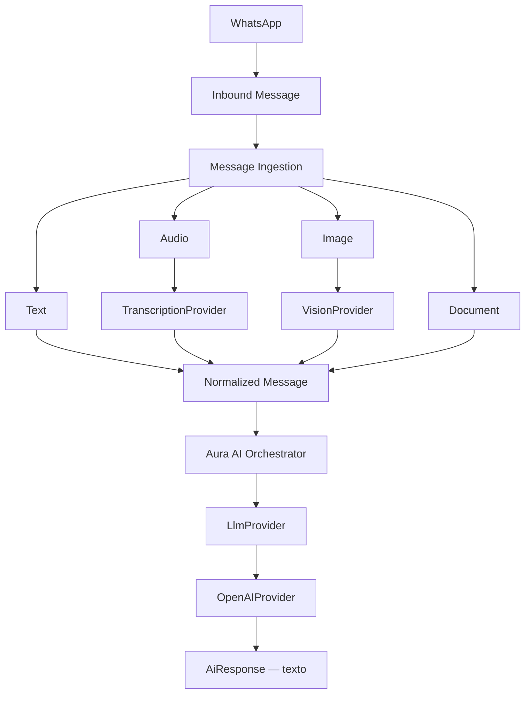

# Fase 5.6A — Aura AI Foundation + Multimodal Message Ingestion

## Objetivo

Criar a fundação provider-neutral do Aura AI Engine para receber texto, áudio, imagem e documento, normalizar o conteúdo e produzir somente resposta textual administrativa. Nesta fase a IA compreende, raciocina e responde; ela não consulta nem altera a Agenda.

## Estado anterior

O produto já possuía `whatsapp-ai-agent`, um webhook Meta multi-clínica com chamada direta à OpenAI Responses API, histórico curto, persistência de mensagens e envio pela Graph API. O fluxo era exclusivamente textual e coexistia com `process-appointment-whatsapp`, um caminho legado separado para comandos de confirmação/cancelamento/reagendamento.

## AI architecture

O core foi criado em `src/ai` e dividido em domain, policies, processors, providers, services, usage, adapters, bridges, config, errors e testing. O domínio não importa React, Supabase generated types, SDK Meta, SDK OpenAI ou scheduling.

## Existing AI audit

- **Entrada:** `whatsapp-ai-agent` recebe webhook Meta, valida HMAC `x-hub-signature-256` e confirma cedo com `EdgeRuntime.waitUntil`.
- **Clinic:** `phone_number_id` resolve `whatsapp_connections`, que contém `clinic_id` e token Meta cifrado.
- **Conversation:** lookup por `clinic_id + phone`; cria ou atualiza `whatsapp_ai_conversations`.
- **Lead/patient:** procura lead por `clinic_id + phone`, cria lead se necessário; patient não é resolvido automaticamente.
- **Histórico:** últimas 10 mensagens, antes filtradas apenas por conversation; o novo loader exige também `clinic_id`.
- **OpenAI:** chamada direta a `POST /v1/responses`, modelo por settings/env, fallback `gpt-5.6-luna`.
- **Resposta:** texto enviado pela Meta Graph API e persistido em `whatsapp_ai_messages`.
- **Usage:** tokens eram armazenados somente na mensagem outbound; não havia latência, request type, outcome ou metering de mídia.
- **Erros:** batch assíncrono com console; mensagens brutas do vendor podiam aparecer no erro. O novo caminho usa códigos normalizados e logs sanitizados.
- **Mídia:** inexistente; mensagens não textuais eram ignoradas.
- **Código paralelo:** `process-appointment-whatsapp` continua legado e não foi integrado ao Aura AI.

## Keep / Adapt / Replace Later

- **KEEP:** webhook, HMAC, roteamento por número, conexão/token cifrado, lead/conversation, idempotência pelo provider message ID, outbound sender e handoff atual.
- **ADAPT:** extração multimodal, raw payload sanitizado, history com tenant explícito, metering, timeout, erros e seleção por feature flag.
- **REPLACE LATER:** chamada OpenAI direta e prompt único do agente legado, somente após homologação do novo engine.

## AiInboundMessage

Modelo normalizado com IDs de mensagem, clínica e conversa, canal, sender técnico, tipo, horário, texto opcional e referência de mídia opcional. Não usa shapes Meta.

## AiNormalizedMessage

Unifica texto digitado, transcrição, descrição administrativa de imagem e placeholder documental. Inclui somente referências/metadata de attachment, decisão de clarificação, safety disposition, métricas técnicas e latência de preprocessing; nunca inclui bytes.

## Multimodal pipeline

`AiMessageIngestionService` valida contexto, tenant, conversa e canal; escolhe um processor pequeno por tipo e devolve `AiNormalizedMessage`. Ele não envia mensagens e não importa scheduling.

## Text processing

Normaliza Unicode, quebras de linha, caractere nulo e espaços externos. Não corrige, resume ou reescreve semanticamente. “oi tem hr amanha dra ana?” permanece equivalente.

## Audio transcription

O backend baixa o `media_id` com o token Meta já cifrado/descriptografado no servidor, valida MIME/tamanho, mantém bytes somente em memória e chama `AiTranscriptionProvider`. Transcrição vazia produz `needsClarification = true`; nenhuma confidence é inventada.

## Image understanding

O backend baixa JPEG/PNG temporariamente e chama `AiVisionProvider`. O resultado estruturado classifica `administrative_document`, `insurance_card`, `appointment_document`, `medical_order`, `exam_result`, `clinical_photo`, `unrelated` ou `unknown` e produz descrição administrativa.

## Clinical image policy

A restrição existe em código, além do prompt. Para `clinical_photo` e `exam_result`, qualquer descrição clínica retornada pelo vendor é descartada e substituída por texto genérico de encaminhamento. O core também bloqueia diagnóstico e orientação de dose de forma determinística.

## Document foundation

PDF e texto simples são reconhecidos no modelo, mas o conteúdo ainda não é baixado nem parseado. O processor retorna attachment `unsupported` e pede tratamento pela equipe, preservando espaço para parsing futuro.

## Media retention

Áudio/imagem são baixados somente no backend, processados em memória e descartados ao fim da execução. Não foi criado bucket ou storage permanente. PostgreSQL recebe somente metering e mensagens textuais necessárias ao fluxo existente.

## PII / PHI minimization

Novos raw payloads de WhatsApp foram reduzidos a provider e tipo. Logs do novo engine contêm somente IDs técnicos, tipo, disposition e error code. Não são registrados mídia, URL, header, token, prompt completo, resposta shadow ou conteúdo de documento. Registros históricos e o fluxo textual legado ainda podem conter corpo de conversa, pois sua remoção exigiria uma fase de retenção/migração própria.

## LlmProvider

`AiLlmProvider` recebe policy, clinic context, histórico limitado, mensagem atual, idioma, estilo e abort signal. Retorna somente resultado normalizado; consumidores não veem o payload OpenAI.

## OpenAIProvider

O adapter usa `fetch` no backend e a Responses API com Structured Outputs por `text.format`, sem SDK e sem tools. A documentação oficial confirma o uso de JSON Schema para respostas estruturadas: [Structured model outputs](https://developers.openai.com/api/docs/guides/structured-outputs). A configuração continua central, com uma única `OPENAI_API_KEY` backend-only.

## TranscriptionProvider

`AiTranscriptionProvider` é independente do vendor. `OpenAiTranscriptionProvider` usa `POST /v1/audio/transcriptions`, modelo configurável e multipart temporário.

## VisionProvider

`AiVisionProvider` é independente do vendor. `OpenAiVisionProvider` usa input de imagem na Responses API, Structured Output e regra administrativa restritiva. Modelos atuais suportam texto e imagem com saída textual conforme o [catálogo oficial de modelos](https://developers.openai.com/api/docs/models).

## AuraAiOrchestrator

Valida tenant/contexto, carrega configuração e últimas N mensagens, separa core policy, clinic context, conversation context e current message, aplica decisões determinísticas de segurança, chama `AiLlmProvider`, valida a resposta e grava usage. Não recebe nem chama `SchedulingService`.

## Multi-tenancy

Toda execução exige `AiExecutionContext` com `clinicId`, `conversationId`, `channel` e `correlationId`; patient/lead são opcionais. Não existe fallback para primeira clínica.

## Clinic isolation

Message, config e history precisam coincidir com a clínica/conversa do contexto. O repository filtra ambos; o orchestrator ainda descarta qualquer row incompatível como defesa em profundidade. A tabela de usage possui FK composta conversation/clinic e RLS.

## System policy

Aura é recepcionista administrativa: pode conversar e coletar informações, mas não diagnostica, prescreve, interpreta exame, recomenda dose/tratamento ou inventa fatos da clínica. Sem fonte para convênio/preço/horário, pede confirmação da equipe.

## Prompt architecture

O adapter recebe blocos separados: core policy, preferred language/style, clinic context, histórico limitado e mensagem atual. Knowledge, tool results e directives futuras têm pontos de extensão, mas não foram implementados.

## Conversation history

Somente as últimas 10 mensagens da mesma clínica/conversa são carregadas. O inbound atual é removido do histórico se já estiver persistido, evitando duplicação. Não há summary ou memória persistente avançada.

## Usage accounting

`ai_usage_events` mede por clínica/conversa/correlação: provider, model, channel, message type, request type, input/output/total units, latências, outcome, error code e timestamp. Não existe custo monetário hardcoded.

## Latency

São separados `preprocessing_latency_ms`, `provider_latency_ms` e `total_latency_ms`. Transcrição, visão, documento e LLM podem gerar eventos próprios.

## Retry / timeout

Providers recebem `AbortSignal`. LLM/vision usam 30 s, transcrição 25 s e download usa o mesmo controle do processor. O máximo padrão é duas tentativas. Retry ocorre somente para timeout, network/indisponibilidade, 5xx e rate limit normalizados; validation, safety e bad media não repetem.

## Error model

Existem `AiError`, provider unavailable, rate limit, validation, media processing, transcription, vision, safety e timeout. O adapter não devolve corpo bruto da OpenAI/Meta ao consumidor ou log.

## Correlation ID

Cada inbound recebe `crypto.randomUUID()`, propagado por ingestão, preprocessing, orchestrator, usage, logs e interação administrativa. Nunca deriva de telefone, nome ou outro PII.

## WhatsApp bridge

`WhatsappAuraAiBridge` conecta a mensagem já roteada ao ingestion/orchestrator. O webhook existente continua responsável por autenticação, conexão, idempotência, lead/conversation, persistência e envio.

## Feature flag / shadow mode

`ai_engine_mode` aceita:

- `legacy` — default; somente agente atual executa e envia;
- `shadow` — Aura executa e gera metering, mas somente legacy envia;
- `active` — somente Aura executa/envia.

Uma função pura garante que exatamente um engine seja autorizado a enviar. Shadow output não é persistido nem enviado.

## Edge Function runtime decision

Download Meta, transcription, vision e LLM executam na Supabase Edge Function. Secrets nunca entram no React/Vite. O core em `src/ai` usa TypeScript e Web APIs portáveis; a Edge Function injeta Meta loader, OpenAI adapters e Supabase repositories. O bundle foi compilado e servido no runtime local compatível com Deno 2.1.4.

## Database changes

Migration `20260815213000_phase5_6a_ai_foundation.sql`:

- adiciona `ai_engine_mode`, `preferred_language` e `response_style` a `whatsapp_ai_settings`;
- cria `ai_usage_events`;
- não adiciona storage, prompt log, media, raw payload, billing ou memória.

## Deployment

Em 15/08/2026, a migration `20260815213000_phase5_6a_ai_foundation.sql` e a Edge Function `whatsapp-ai-agent` foram publicadas no projeto Supabase `nklccxaeasoxjanxgqcl`. A listagem remota confirmou a migration nos dois lados. O modo seguro padrão continua `legacy`; nenhuma clínica passa a responder pela Aura AI até uma ativação explícita de `shadow` ou `active`.

## Tests

Testes cobrem texto, áudio, transcrição vazia/falha, imagem administrativa, clinical photo, exam result, PDF foundation, tenant, history, safety, usage, correlation, feature modes, timeout, retry/rate limit e adapters OpenAI via fetch fake. Nenhum teste utiliza dado real ou chama OpenAI. A suíte completa terminou com 21 arquivos e 133 testes aprovados; lint direcionado e build também passaram.

O SQL valida defaults, constraints, FK cross-tenant, RLS e bloqueio de escrita técnica por usuário autenticado. As regressões SQL de scheduling 5–5.5D também passaram.

## Security

- API key central em environment secret, backend-only;
- token Meta permanece AES-GCM e backend-only;
- allowlist e limites de tamanho por tipo;
- nenhum URL/token/header em logs;
- nenhum byte no PostgreSQL;
- RLS sem `USING(true)`;
- service role restrito ao backend;
- idempotência existente por provider message ID preservada;
- nenhuma resposta duplicada por modo.

## What was NOT implemented

Scheduling tools, mutations de appointments, knowledge/RAG/embeddings, intent engine aprofundada, memória de longo prazo, handoff novo, billing, storage permanente, provider externo de agenda, Google Calendar, Doctoralia e Feegow não foram implementados.

## Limitations

- `legacy` permanece o default e suporta resposta somente para texto.
- `shadow` não envia respostas Aura, inclusive para mídia.
- PDF possui somente foundation.
- A política clínica completa pertence à 5.6E.
- Conteúdo histórico já persistido pelo agente legado não foi reescrito.
- O lint global possui débitos legados fora desta fase; lint direcionado é a validação desta camada.

## Next phase

A próxima fase autorizável é 5.6B — Conversation Engine, para intent, referências, missing information, ambiguidade e follow-ups. Ela não foi iniciada.
