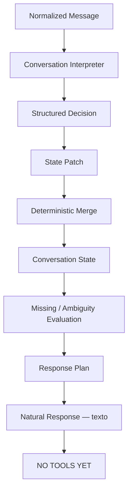

# Fase 5.6B — Aura Conversation Engine

## Objetivo

Transformar a fundação multimodal da 5.6A em entendimento conversacional acumulativo, provider-neutral e seguro. A Aura interpreta intent, entidades, tempo, follow-up, correção, negação, elipse, referência, ambiguidade e informação faltante, mas não consulta nem altera a agenda.

## Estado anterior

`whatsapp_ai_conversations` já guardava clínica, lead, telefone, status, flags, atividade e `metadata`, mas não possuía state formal. O conteúdo conversacional estava em `whatsapp_ai_messages`. O loader da 5.6A entregava as últimas dez mensagens, filtradas por clínica e conversa.

O agente legado reenvia as mensagens recentes a um prompt livre. Ele pode inferir contexto dentro da janela, porém não possui patch determinístico, `clear`, revisão, controle de concorrência, missing fields ou regra explícita para correções e ambiguidades.

Auditoria e decisão:

- **KEEP:** webhook, HMAC, roteamento multi-clínica, idempotência, mensagens, histórico curto, metering, core safety e modos `legacy/shadow/active`.
- **ADAPT:** orchestrator, provider OpenAI, usage e logs shadow para receber o resultado conversacional.
- **ADD:** domínio, interpreter estruturado, state, patch, merge, clarificação, referências, persistência e revisão otimista.
- **DEFER:** tools, agenda, Knowledge/RAG, memória longa, handoff novo e providers externos.

## Conversation architecture

O design usa uma chamada estruturada que entrega interpretação e texto proposto. O domínio mantém `AiConversationDecision` e `AiResponsePlan` separados; regras determinísticas podem substituir o texto para safety ou clarificação.

## Conversation domain

Os tipos ficam em `src/ai/domain/conversation.ts`: state, turn, interpretation, patch, ambiguity, clarification, decision, response plan, result, repository e provider. Nenhum deles importa OpenAI, Supabase, Meta, React ou scheduling.

## Intent taxonomy

Taxonomia inicial pequena: `greeting`, `administrative_question`, `scheduling_request`, `reschedule_request`, `cancellation_request`, `confirmation_request`, `waitlist_request`, `professional_question`, `service_question`, `insurance_question`, `price_question`, `location_question`, `human_handoff`, `medical_restricted` e `unknown`.

Intent representa direção da conversa, nunca autorização operacional.

## Entities

O state pode guardar referências a professional, service, insurance, billing type, date, location, appointment reference e selected option. Cada valor registra origem, confidence categórica e necessidade de confirmação. Esses valores são seleções conversacionais, não verdade da agenda.

## Temporal expressions

`AiTemporalExpression` representa expressão original, tipo, data resolvida/range, weekday, preferência de período, limites de horário e timezone. Hoje, amanhã, depois de amanhã, weekday, semana seguinte, manhã, tarde, fim do dia, depois das quatro e antes do almoço possuem resolução determinística básica.

O timestamp original da mensagem e o timezone carregado da unidade padrão são explícitos. Na ausência de unidade, usa-se o fallback documentado `America/Sao_Paulo`; não existe timezone global oculto.

## State model

`AiConversationState` guarda somente o que a conversa sabe ou tenta completar: intent ativa, status, entities, constraints negativas, pending question, opções apresentadas e último turno. Não guarda disponibilidade, preço real, aceitação de convênio, appointment, prompt, documento ou tool result.

History responde “o que foi dito”; state responde “o que sabemos e qual tarefa está ativa”.

## State persistence

A decisão foi adicionar `conversation_state JSONB`, `state_revision` e `state_updated_at` à conversa existente. Isso evita reconstrução indefinida pelo histórico e uma tabela adicional sem necessidade. O JSON é objeto, schema 1 e limitado a 16 KB.

## State patch

O interpreter retorna operações, não um state completo. A aplicação valida e aplica cada operação sobre a versão carregada, preservando campos não mencionados.

## Clear/unset semantics

`operation=set` atualiza um campo; ausência não o altera; `operation=clear` remove explicitamente. Se billing muda para `private`, insurance é removido determinística e automaticamente. Se insurance é selecionado, billing passa a `insurance` quando não houve operação contrária.

## Revision/concurrency

`update_whatsapp_ai_conversation_state` executa compare-and-swap com `clinic_id + conversation_id + expected revision`. Conflito usa SQLSTATE `40001`; o engine recarrega state e reaplica o mesmo patch validado, sem repetir a chamada ao modelo, por até três tentativas. O update é atômico e evita lost update sem criar uma fila.

## Follow-ups

Cada turno altera somente os campos presentes no patch. “sexta” → “à tarde” → “com a Ana” → “Unimed” acumula contexto sem exigir repetição.

## Corrections

Correções sobrescrevem o campo relevante. “Não, quinta” substitui sexta sem apagar professional ou billing. A resposta usa plano `acknowledge_correction`.

## Negation

Entidades negadas não são selecionadas. Constraints pequenas registram profissionais, convênios ou períodos recusados.

## Ellipsis

O interpreter recebe state e histórico recente. Respostas como “tarde” ou “o segundo” são interpretadas no contexto da pergunta/opções anteriores.

## References

Referências gerais são interpretadas no structured output. Primeira, segunda, terceira, última e referência única como “esse mesmo” também possuem resolução determinística contra `lastPresentedOptions`.

## Presented options

`AiPresentedOption` contém id, label, value e kind. Nesta fase são contexto simulado ou previamente apresentado; não representam slots reais.

## Missing information

`AiRequiredFieldsPolicy` é extensível. A política default pede, conforme intent, professional ou service, date, billing, insurance ou appointment reference. Nenhum formulário universal é gravado no provider.

## Clarification engine

O engine escolhe somente o primeiro missing field relevante e produz uma pergunta curta e específica. Não pergunta novamente um dado já presente.

## Ambiguity

Quando o interpreter fornece candidatos, o engine não escolhe silenciosamente. Ele apresenta os candidatos e pede escolha explícita.

## Confidence/uncertainty

Confidence aceita apenas `high`, `medium` ou `low` oriundos do structured output. Nenhuma porcentagem falsa é inventada. Ambiguidade ou confirmação pendente sempre vence a prontidão.

## Intent switching

Perguntas administrativas temporárias podem ser respondidas sem destruir a tarefa operacional ativa. Para o MVP existe uma tarefa principal; não há planner multi-task.

## Stale context

Uma nova intent operacional reinicia state se a tarefa anterior está `completed/abandoned` ou se o último turno ultrapassou 24 horas. Encerramento marca a tarefa sem apagar imediatamente todo o conteúdo.

## Small talk

Saudações e agradecimentos preservam a intent e as entities. A personality é cordial, curta, objetiva, sem saudar novamente a cada turno e sem excesso de emojis.

## Multimodal continuity

O engine recebe somente `AiNormalizedMessage`. Texto e transcrição equivalentes seguem o mesmo pipeline; a origem muda apenas o evidence source.

## Image extracted candidates

Valores extraídos de imagem/documento são marcados para confirmação. Uma carteirinha pode gerar `insuranceCandidate=Unimed`, mas não confirma `insurance` automaticamente.

## Response planning

Planos possíveis: `answer`, `ask_clarification`, `acknowledge_correction`, `request_handoff`, `refuse_medical` e `ready_for_tool`. `ready_for_tool` é apenas um sinal futuro; nenhuma tool existe nesta fase.

## Structured output

`OpenAiConversationInterpreter` usa Responses API com JSON Schema estrito, versão 1, `store=false` e nenhuma tool. Output inválido não aplica patch parcial nem persiste state.

## AuraConversationEngine

O serviço carrega state/history, chama o interpreter, normaliza evidência/tempo, resolve referência, aplica patch, calcula missing/ambiguity, cria plano, persiste por revisão e devolve `AiConversationResult`.

## AuraAiOrchestrator integration

O orchestrator continua validando tenant, configuração e preprocessing. Agora delega entendimento ao Conversation Engine e mapeia o resultado para `AiResponse`. Ele não recebe nem chama scheduling.

## Multi-tenancy

Load e save usam clinic e conversation explícitos. A FK composta existente, RLS, filtros do repository e RPC com os dois IDs impedem associação cross-tenant.

## RLS

Staff autenticado pode ler a conversa da própria clínica e alterar somente colunas administrativas permitidas. State e revision são escritas exclusivamente pelo backend via RPC disponível apenas a `service_role`.

## Usage / latency

`ai_usage_events.request_type` aceita `conversation_interpretation`. Provider, modelo, unidades e latências são registrados por clinic/conversation/correlation. Logs shadow adicionam intent, clarification e safety, nunca state, prompt ou resposta completa.

## Tests

A suíte cobre missing fields, follow-up, correção de data/billing, clear, negação, referência ordinal/última, ambiguidade, timestamp/timezone, tempo, small talk, intent switch, safety, mixed medical/admin, handoff, pergunta duplicada, áudio, image candidate, invalid output, stale context e conflito otimista. Fixtures reutilizáveis iniciam a futura suíte de avaliação. Na validação final, 23 arquivos e 161 testes passaram; a camada AI teve lint e typecheck direcionados aprovados, e o build de produção foi concluído.

O SQL cobre defaults, shape/size, schema version, revision, conflito, cross-tenant, RLS, grants por coluna e RPC backend-only. As regressões SQL das fases 5–5.6A permanecem verdes.

A Edge Function foi carregada no runtime local `supabase-edge-runtime-1.74.3`, compatível com Deno 2.1.4, e respondeu ao probe de webhook sem configuração com o `403` esperado.

## Deployment

Em 15/08/2026, a migration `20260815224500_phase5_6b_conversation_engine.sql` e a Edge Function `whatsapp-ai-agent` foram publicadas no projeto Supabase `nklccxaeasoxjanxgqcl`. A listagem remota confirmou a mesma migration local e remota. `ai_engine_mode` permanece `legacy` por padrão; nenhuma clínica foi promovida automaticamente para `shadow` ou `active`.

## What was NOT implemented

Não foram implementados SchedulingService, listProfessionals, getAvailableSlots, create/cancel/reschedule/confirm appointment, Waitlist operacional, Knowledge/RAG/embeddings, memória longa, novo handoff, Google Calendar, Doctoralia ou Feegow.

## Limitations

- Compreensão semântica de linguagem livre depende do interpreter configurado; regras determinísticas protegem merge, referência, missing e safety.
- Resolução temporal cobre o vocabulário inicial em PT-BR, não recorrência ou feriados.
- State possui uma tarefa ativa simples; não há planner multi-task.
- Opções apresentadas ainda não são slots reais.
- Dados administrativos extraídos de imagem exigem confirmação.

## Next phase

A próxima fase autorizável é 5.6C — execução de tools. Ela não foi iniciada.
