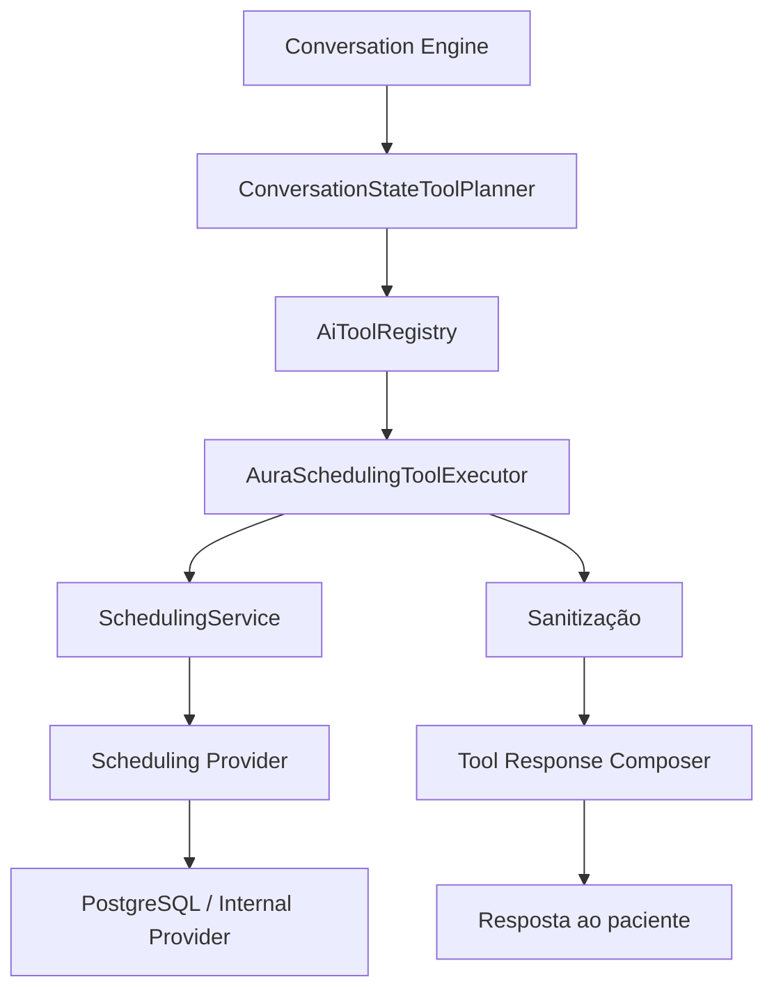

# Fase 5.6C — AI Tool Execution + Scheduling Tools

## Objetivo

Conectar o Aura Conversation Engine ao domínio operacional da agenda por uma borda controlada, tipada, validada e multi-tenant. O modelo de linguagem não recebe cliente Supabase, credencial, função RPC, data source nem scheduling provider.

Esta fase foi executada em dois gates reais. A 5.6C.1 read-only foi implementada e aprovada isoladamente antes da introdução da 5.6C.2. As mutations existem no código, porém permanecem desativadas por padrão em todas as clínicas.

## Arquitetura entregue



O planner produz somente nome, kind, intent e argumentos escalares permitidos. `clinicId`, `conversationId`, `patientId` e `leadId` vêm exclusivamente do contexto confiável da aplicação e não são aceitos como argumentos do modelo.

## Pipeline de segurança

Para cada solicitação:

1. o Conversation Engine valida e persiste intent/state;
2. o planner cria uma solicitação de tool schema 1;
3. o registry valida tool, kind, intent, chaves aceitas, obrigatoriedade e tamanho dos valores;
4. o executor valida gates da clínica e identidade da conversa;
5. nomes informados são resolvidos para IDs dentro da aplicação;
6. permissões do profissional e vínculos ativos são avaliados;
7. somente o `SchedulingService` é chamado;
8. resultados são reduzidos a campos administrativos autorizados;
9. IDs/referências técnicas são retirados antes do composer;
10. o modelo redige a resposta apenas a partir do resultado sanitizado.

## 5.6C.1 — Read-only tools

| Tool | Fonte operacional | Proteções principais |
|---|---|---|
| `list_locations` | `SchedulingService.listLocations` | clínica explícita; somente ativas |
| `list_professionals` | `listProfessionals` | clínica/unidade; somente ativos |
| `list_services` | `listServices` | vínculo profissional; `canAiSchedule`; preço só com `showPrice` |
| `list_insurances` | `listInsurances` | vínculo profissional; ativos/novos pacientes |
| `get_available_slots` | `getAvailableSlots` | IDs resolvidos; regras profissionais; RPC autoritativa |
| `find_patient_appointments` | `listAppointments` | apenas `patientId/leadId` do contexto confiável |

Catálogos são limitados a 20 itens, slots a seis e appointments a cinco. Consultas de appointment nunca aceitam um patient/lead arbitrário do LLM.

## 5.6C.2 — Mutation tools

| Tool | Operação canônica |
|---|---|
| `create_appointment` | `SchedulingService.createAppointment` |
| `confirm_appointment` | `confirmAppointment` |
| `cancel_appointment` | `cancelAppointment` |
| `reschedule_appointment` | `rescheduleAppointment` |

Uma mutation exige simultaneamente:

- `ai_engine_mode = active`;
- `ai_read_tools_enabled = true`;
- `ai_read_tools_validated_at IS NOT NULL`;
- `ai_mutation_tools_enabled = true`;
- patient ou lead proveniente do contexto backend;
- regra profissional correspondente (`allow_ai_booking`, `allow_ai_cancellation` ou `allow_ai_rescheduling`);
- vínculo de serviço/convênio ativo quando aplicável;
- slot ainda presente no resultado autoritativo de disponibilidade;
- claim atômico inédito por clínica, correlação e tool.

A constraint SQL impede habilitar mutations se qualquer gate estrutural estiver ausente. O executor repete as mesmas verificações em código e falha fechado se não houver `AiToolMutationGuard` injetado.

## Proteção contra horário inventado

Um timestamp produzido ou repetido pelo modelo não é suficiente para escrever. Antes de `create` ou `reschedule`, o executor consulta novamente `getAvailableSlots` para a combinação resolvida de clínica, unidade, profissional, serviço, modalidade e convênio. A mutation só prossegue se o instante escolhido estiver exatamente na resposta autoritativa.

O PostgreSQL continua sendo a última barreira: duração, locks, conflitos, vínculos, RLS e exclusion constraint permanecem nas RPCs canônicas do Internal Provider.

## Idempotência

`claim_ai_tool_mutation` grava uma chave única em `ai_tool_mutation_claims` com:

- `clinic_id`;
- `conversation_id`;
- `correlation_id`;
- `tool_name`.

A função é exclusiva de `service_role`, valida conversa × clínica e retorna `false` em repetição. Nenhuma mutation é chamada sem um claim positivo. Uma falha de auditoria posterior não transforma uma operação já gravada em nova tentativa.

## Auditoria sem PHI

`ai_tool_execution_events` guarda somente metadados técnicos:

- clínica, conversa e correlação;
- nome/kind da tool;
- outcome e código de erro normalizado;
- latência e timestamps.

Não são persistidos argumentos, resultados, nomes de pacientes, telefone, texto, prompt, resposta, appointment payload, token ou credencial. Staff vê apenas eventos da própria clínica via RLS; escrita é backend-only.

## Estado e opções apresentadas

Slots e opções reais são persistidos em `lastPresentedOptions` pelo compare-and-swap já criado na 5.6B. O texto entregue ao modelo contém labels sanitizados; os valores técnicos usados para uma seleção posterior permanecem no state controlado da aplicação.

Mutation concluída marca a tarefa conversacional como `completed`. Ambiguidade ou ausência de entidade nunca resulta em escolha silenciosa.

## Feature flags e rollout

Novas colunas em `whatsapp_ai_settings`:

- `ai_read_tools_enabled`, default `false`;
- `ai_read_tools_validated_at`, default `NULL`;
- `ai_mutation_tools_enabled`, default `false`.

Rollout recomendado por clínica:

1. manter `legacy` e todos os gates desligados;
2. usar `shadow` com leitura habilitada para homologar catálogos/slots sem resposta Aura ao paciente;
3. registrar `ai_read_tools_validated_at` após evidência de validação;
4. promover o engine para `active` ainda com mutations desligadas;
5. homologar conversas read-only em produção controlada;
6. habilitar mutations apenas para clínica piloto e profissionais autorizados.

Mutation nunca é executada em `shadow`, mesmo que exista configuração inconsistente na aplicação. A constraint do banco também impede salvar essa combinação.

## Arquivos principais

```text
src/ai/tools/
  domain.ts
  errors.ts
  registry.ts
  ConversationStateToolPlanner.ts
  AuraSchedulingToolExecutor.ts
  AuraToolCoordinator.ts
  OpenAiToolResponseComposer.ts
src/ai/adapters/supabase/SupabaseAiToolRepository.ts
supabase/migrations/20260815233000_phase5_6c_ai_scheduling_tools.sql
supabase/tests/phase5_6c_ai_scheduling_tools.sql
```

## Validação

- gate 5.6C.1 foi aprovado antes de 5.6C.2;
- testes unitários cobrem registry, argumentos proibidos, gates, tenant, catálogos, preço, appointments próprios, resolução de IDs e sanitização;
- mutations cobrem permissões, engine mode, read gate, claim atômico, duplicidade, appointment próprio e revalidação autoritativa do slot;
- coordinator cobre remoção de IDs antes do LLM, persistência de opções, conclusão de tarefa e bloqueio de conteúdo clínico;
- o script SQL cobre defaults, constraint do gate, claim único, cross-tenant, grants e RLS.

Resultado final:

- typecheck: aprovado;
- lint direcionado de AI, scheduling, testes 5.6C e Edge Function: aprovado;
- Vitest: 26 arquivos e 179 testes aprovados;
- build de produção: aprovado, preservando apenas os warnings conhecidos de Browserslist e chunk acima de 500 kB;
- migration aplicada no Supabase local: aprovada;
- teste SQL transacional com `ON_ERROR_STOP`: aprovado e revertido por `ROLLBACK`;
- Edge Function carregada no `supabase-edge-runtime 1.74.3` compatível com Deno 2.1.4 e probe inválido respondeu `403`;
- migration remota e Edge Function publicadas no projeto `nklccxaeasoxjanxgqcl` em 15/08/2026.

O histórico remoto confirmou `20260815233000` e a função `whatsapp-ai-agent` ativa na versão 3. Todos os gates 5.6C permanecem nos defaults seguros (`false`/`NULL`); nenhuma clínica foi ativada automaticamente.

## Fora do escopo

- Waitlist operacional por IA;
- criação automática de pacientes;
- Knowledge/RAG/embeddings;
- memória longa;
- diagnóstico, triagem ou orientação clínica;
- Google Calendar, Doctoralia ou Feegow como nova integração;
- alteração visual da Agenda;
- ativação automática de qualquer clínica.

## Próxima fase

Esta implementação encerra somente a 5.6C. Nenhuma fase seguinte foi iniciada.
