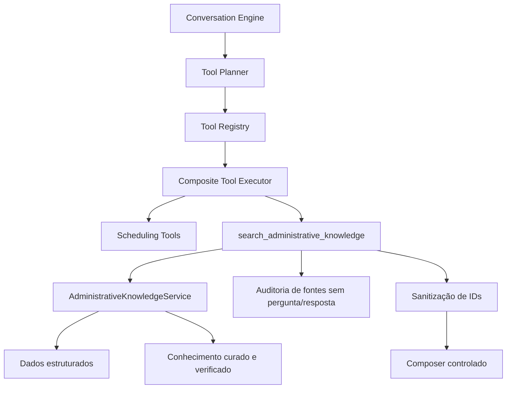

# Fase 5.6D — Administrative Knowledge Engine

## Objetivo

Disponibilizar à Aura informações administrativas reais, verificáveis e específicas de cada clínica sem conceder ao modelo acesso a Supabase, SQL, RPC ou providers. Toda resposta factual precisa apontar para uma fonte estruturada ou para uma entrada curada, publicada e verificada.

Esta fase não implementa diagnóstico, triagem, prescrição, interpretação de exames ou orientação clínica. Na ausência de fonte, a resposta obrigatória é: **“Não tenho essa informação confirmada aqui. Posso encaminhar sua dúvida para a equipe da clínica.”**

## Auditoria do conhecimento existente

| Classificação | Dados encontrados | Decisão |
|---|---|---|
| `STRUCTURED_AND_REUSABLE` | contatos de `clinics`; endereço/telefone/timezone de `clinic_locations`; profissionais e especialidades; serviços; convênios e observações de autorização; regras profissionais | Consultados diretamente, sem cópia para texto livre |
| `NEEDS_NEW_FIELD` | horário, estacionamento e acessibilidade da unidade; preparo e orientação administrativa do serviço | Campos tipados adicionados às entidades canônicas |
| `NEEDS_KNOWLEDGE_ENTRY` | FAQ e orientações administrativas particulares da clínica, unidade, profissional, serviço ou convênio | Entradas curadas, versionadas, verificadas e com validade |
| `OUT_OF_SCOPE` | diagnóstico, conduta, dose, interpretação de exames; políticas financeiras do legado de contratos | Bloqueados ou ignorados pelo engine |

## Arquitetura

O `AdministrativeKnowledgeService` é provider-neutral e depende apenas de `AdministrativeKnowledgeRepository`. A implementação Supabase é um adapter. A busca inicial é determinística e lexical; não usa embeddings e não envia conteúdo a um serviço de vetores.

## Structured first

- endereço, telefone e horário: `clinic_locations`;
- profissional e especialidade: `professionals`;
- preparo/orientação administrativa: `treatments`;
- convênio e autorização: `health_insurances`;
- chegada, documentos, acompanhante, crianças, primeira consulta, pagamentos, atraso e cancelamento: `clinic_administrative_policies`;
- exceções e FAQ: `administrative_knowledge_entries`.

Uma entrada textual não substitui nem duplica o cadastro canônico quando há campo estruturado adequado.

## Modelo de dados

### Campos estruturados novos

- `clinic_locations.opening_hours`, `parking_information`, `accessibility_information`;
- `treatments.preparation_instructions`, `administrative_instructions`.

### `clinic_administrative_policies`

Uma linha por clínica. Armazena antecedência, instruções de chegada, documentos, acompanhante, crianças, primeira consulta, meios de pagamento, atraso e cancelamento. Campos têm limites de tamanho e RLS por `clinic_id`.

### `administrative_knowledge_entries`

FAQ e orientações com:

- `topic` e `scope` (`clinic`, `location`, `professional`, `service`, `insurance`);
- apenas uma referência de escopo compatível;
- pergunta, resposta e palavras-chave limitadas;
- prioridade, revisão, status, verificação e janela de validade;
- FKs compostas com `clinic_id`, impedindo referência cross-tenant;
- conteúdo publicado não pode ser alterado diretamente: deve voltar a rascunho e ser verificado novamente.

Somente entradas `published`, com `verified_at` e dentro da validade são lidas pelo adapter operacional.

### Auditoria

`ai_knowledge_answer_events` registra clínica, conversa, correlação, tópico, outcome, referências das fontes, latência e timestamps. Não armazena pergunta do paciente, resposta gerada, prompt, telefone ou PHI.

## Tool controlada

`search_administrative_knowledge` aceita somente:

- `query`;
- hints opcionais de unidade, profissional, serviço e convênio.

IDs de clínica, conversa, paciente ou entidades não são aceitos do LLM. O tenant vem do `AiExecutionContext`. O registry valida intent, argumentos escalares e tamanho; o executor valida os gates, chama o service e audita as fontes. Antes do composer, `recordId` e demais IDs são removidos.

O composer recebe fatos e rótulos de fonte suficientes para exigir factualidade, mas não recebe identificadores internos.

## Segurança e rollout

Novos gates, sempre desligados por padrão:

- `ai_knowledge_enabled = false`;
- `ai_knowledge_validated_at = NULL`.

A constraint impede ligar o engine sem data de validação. O executor também falha fechado se a leitura geral, o gate de knowledge ou a validação estiverem ausentes.

Rollout recomendado:

1. cadastrar dados estruturados e FAQ em rascunho;
2. revisar e publicar apenas conteúdo confirmado;
3. executar testes de tenant, ausência e conteúdo clínico;
4. preencher `ai_knowledge_validated_at`;
5. habilitar `ai_knowledge_enabled` em uma clínica piloto;
6. monitorar outcomes `not_found` sem registrar a pergunta do paciente.

Nenhuma clínica é ativada automaticamente por esta fase.

## Configuração administrativa

Em **Configurações → WhatsApp IA**, a seção **Base administrativa da Aura** permite manter políticas e FAQs. Novas respostas nascem como rascunho e só entram no engine após a ação explícita **Verificar e publicar**.

Dados de unidade, serviço, profissional e convênio continuam em seus cadastros canônicos.

## Validação

- TypeScript: aprovado;
- lint direcionado dos arquivos 5.6D e integrações alteradas: aprovado;
- Vitest: 28 arquivos e 188 testes aprovados;
- build de produção: aprovado, com apenas os avisos já conhecidos de Browserslist e chunk acima de 500 kB;
- migration aplicada do zero no Supabase local: aprovada;
- teste SQL transacional com defaults, publicação verificada, imutabilidade publicada, FK cross-tenant, RLS, auditoria e gate: aprovado e revertido por `ROLLBACK`;
- Edge Function carregada no `supabase-edge-runtime 1.74.3` e probe sem assinatura respondeu `401 invalid_meta_signature`, como esperado.

A migration `20260816003000` foi publicada no projeto Supabase `nklccxaeasoxjanxgqcl` em 15/08/2026, e `whatsapp-ai-agent` ficou ativa na versão 4. Os gates 5.6D permaneceram nos defaults seguros (`false`/`NULL`); nenhuma clínica foi habilitada automaticamente.

O lint global continua apontando débitos preexistentes em componentes legados de Anamnese, `CrmPage` e artefatos temporários gerados pelo runtime local; nenhum erro pertence aos arquivos da 5.6D.

## Fora do escopo

- embeddings, banco vetorial ou RAG semântico;
- ingestão automática de sites/documentos;
- conhecimento clínico;
- respostas sem fonte;
- alteração da fonte de verdade da agenda;
- habilitação automática em produção;
- qualquer fase posterior à 5.6D.
