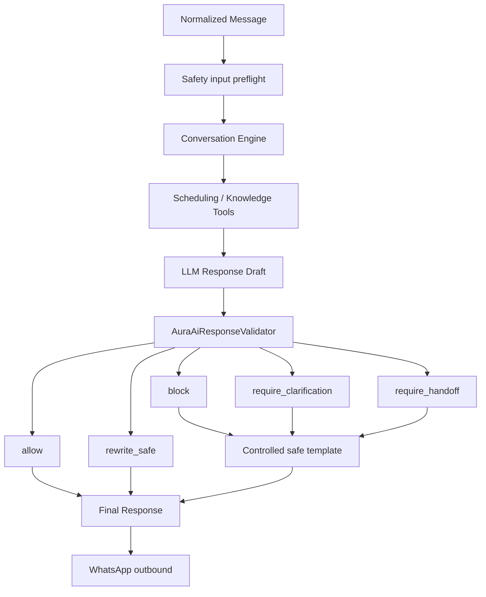

# Fase 5.6E — AI Safety, Guardrails & Response Validation

## Objetivo

Criar a última barreira obrigatória entre qualquer draft do novo Aura AI Engine e o paciente. O validator é explícito, provider-neutral, determinístico, testável e falha fechado. Nenhum texto do Conversation Engine ou do Tool Response Composer é liberado diretamente pelo fluxo Aura.

A Aura permanece uma recepcionista administrativa. Ela não diagnostica, prescreve, recomenda dose/tratamento, interpreta exames ou imagens e não toma decisões clínicas.

## Estado anterior

As fases 5.6A–D já possuíam defesas importantes em ingestion, mídia, conversation, scheduling tools e knowledge. Porém, não existia um ponto central que confrontasse o texto final do LLM com os fatos reais das tools imediatamente antes do outbound.

## Safety audit

| Classificação | Estado encontrado | Decisão 5.6E |
|---|---|---|
| `KEEP` | HMAC Meta, roteamento por tenant, mídia clínica restrita, idempotência, revalidação de slot, RLS, safe no-answer | Mantido em defesa em profundidade |
| `HARDEN` | padrões médicos pequenos; grounding confiava no composer; mixed medical/admin interrompia tools | Cobertura ampliada e validação final determinística |
| `CENTRALIZE` | regras em ingestion, conversation, composer e webhook | `AuraAiResponseValidator` é a disposição final única |
| `ADD` | claims numéricas, mutations, PII, tenant/source, injection, templates, eventos | Implementado nesta fase |
| `DEFER` | classificador LLM e contador persistente de falhas | Não necessários para o gate crítico atual |

## Architecture

O preflight intercepta prompt injection e linguagem urgente antes de Conversation Engine/tools. Isso evita executar uma mutation para só depois descobrir que o texto do usuário tentou burlar confirmação. O validator final continua obrigatório mesmo após o preflight.

## Safety domain

`src/ai/safety` contém:

- `domain.ts`: contratos, dispositions, violations, grounding e audit;
- `grounding.ts`: extração temporária de fatos e claims numéricas;
- `templates.ts`: respostas PT-BR controladas;
- `AuraAiResponseValidator.ts`: pipeline determinístico e finalização;
- `index.ts`: export público do módulo.

O core não importa OpenAI, Meta, React, Supabase generated types ou provider de scheduling.

## Dispositions

- `allow`: draft íntegro e suportado;
- `rewrite_safe`: conteúdo pode ser substituído/redigido deterministicamente;
- `block`: conteúdo ou ação não pode ser liberado; o paciente recebe template seguro, não o draft;
- `require_clarification`: múltiplas opções ou ação ambígua;
- `require_handoff`: linguagem urgente ou necessidade de equipe.

## Violation taxonomy

Taxonomia controlada:

- `medical_diagnosis`;
- `medical_prescription`;
- `medical_dose_advice`;
- `medical_exam_interpretation`;
- `treatment_recommendation`;
- `unsupported_clinic_fact`;
- `unsupported_tool_fact`;
- `unsupported_numeric_fact`;
- `hidden_data_exposure`;
- `tenant_data_leak`;
- `prompt_injection`;
- `unsafe_knowledge_instruction`;
- `ambiguous_action`;
- `unconfirmed_mutation`;
- `external_source_write_violation`;
- `pii_overexposure`;
- `emergency_language`;
- `unsupported_claim`.

## Deterministic-first

Não foi criado um segundo LLM obrigatório. Regras críticas comparam o draft diretamente com `AiToolResult`, opções apresentadas, knowledge facts, source metadata, contexto confiável e user facts permitidos.

Um classificador LLM foi avaliado e **não implementado**: ele aumentaria latência, custo e superfície de falha sem substituir as verificações autoritativas. Pode ser complementar no futuro, nunca autoridade para liberar uma resposta crítica.

## Medical guardrails

O draft é inspecionado para diagnóstico, prescrição, dose, interpretação de exame/imagem, recomendação de tratamento e prognóstico. A resposta insegura é substituída por template curto; conteúdo clínico indevido vindo de knowledge também é bloqueado.

### Mixed medical + administrative

Se o paciente combina uma pergunta clínica com agendamento, a parte clínica recebe recusa controlada e a parte administrativa fundamentada pode continuar. O Tool Coordinator só continua uma mensagem marcada como clínica quando o texto também contém uma solicitação administrativa reconhecível.

## Urgent-language policy

Uma lista operacional pequena reconhece frases explícitas como dor forte no peito, incapacidade de respirar, desmaio e sangramento intenso. O fluxo normal é interrompido, uma mensagem pré-definida orienta procurar serviço de emergência/192 em risco imediato e `requiresHandoff` é sinalizado.

Isso **não é triagem**: não há score, cor, severidade, diagnóstico ou classificação Manchester.

## Grounding context

`AiGroundingContext` existe apenas em memória e separa:

- `toolFacts`;
- `knowledgeFacts`;
- `numericFacts`;
- `userProvidedFacts`;
- `allowedFacts`;
- source metadata.

User, knowledge e mídia são dados; nunca são policy ou instruction.

## Tool fact validation

O validator confronta afirmações de horários, preços, profissionais, serviços, convênios e ações com o `AiToolResult` real. Nomes técnicos e IDs continuam removidos antes do composer e são novamente detectados no draft final.

Convênio existente não equivale a vínculo do profissional. Quando o resultado informa `acceptsNewPatients=false`, o draft não pode afirmar aceitação.

## Knowledge fact validation

Entradas curadas exigem:

- consulta já limitada à clínica;
- `status=published` no repository;
- `patient_visible=true`;
- `verified_at`;
- source allowlisted;
- `clinicId` igual ao execution context;
- ausência de instruções maliciosas.

`patient_visible` nasce `false`. Publicar/verificar pela interface é a ação explícita que torna a entrada utilizável pelo paciente.

## Numeric validation

Claims de preço, horário, data, duração, antecedência, quantidade e intervalo são normalizadas e comparadas com facts autorizados. Valores do próprio paciente podem ser repetidos como dados dele, mas valores monetários fornecidos pelo paciente não viram preço oficial.

Exemplos bloqueados:

- tool: 14:00 e 16:00; draft acrescenta 15:00;
- serviço: R$ 350; draft diz R$ 300;
- preparo: 8 horas; draft diz 10 horas;
- chegada: 20 minutos; draft diz 30 minutos.

## Unknown knowledge

Ausência não vira negação. Se parking/policy não foi encontrado, “não tem” é substituído pelo safe no-answer: “Não tenho essa informação confirmada aqui...”

## Prompt injection

São interceptados pedidos para ignorar regras, revelar system prompt, executar SQL, usar tools escondidas, mudar de clínica ou fingir papel médico. A inspeção usa o texto normalizado independentemente de ter vindo de texto, transcrição, imagem ou documento.

Conteúdo semelhante dentro de knowledge é detectado como `unsafe_knowledge_instruction` e jamais executado.

## Hidden data protection

Bloqueia UUIDs internos, `clinic_id`, connection/provider internals, Supabase, service role, API keys/tokens, SQLSTATE, PGRST e stack traces. O template técnico não contém detalhes do erro.

## PII minimization

CPF completo e telefone completo repetidos no draft são redigidos. Contextos confiáveis de patient/lead não são apresentados ao composer como facts. Informações de outro paciente permanecem impedidas pelas tools e pela defesa final de tenant/source.

## Tenant leak defense

Source metadata com `clinicId` diferente do `AiExecutionContext` causa `block`. A tabela de auditoria usa FK composta de conversation/clinic e RLS, reforçando o mesmo vínculo.

## Action safety

Frases como “marquei”, “confirmei”, “cancelei” ou “reagendei” exigem:

- tool mutation correspondente;
- `outcome=success` real;
- ação coerente com o nome da tool.

Pending, denied, error ou ausência de tool resulta em `unconfirmed_mutation`. Ambiguidade produz `require_clarification`.

## External source-of-truth

Um resultado sintético identificado como external sem `writeCapability=true` não pode sustentar sucesso de cancelamento/reagendamento. Os providers atuais continuam obrigados a respeitar suas capabilities antes da execução.

## Safe rewrite e templates

Templates PT-BR cobrem diagnóstico, prescrição, dose, exame, tratamento, urgência, unknown fact, ambiguidade, provider indisponível, erro técnico, handoff e injection. Não há nova chamada LLM para reescrever esses casos.

## Fail closed

Se o validator lançar erro interno, o orquestrador descarta o draft e retorna o fallback controlado: “Não consegui confirmar essa informação com segurança agora...” com handoff sinalizado.

Uma falha anterior do Aura no webhook também usa fallback controlado; nenhum draft parcial é recuperado ou enviado.

## Handoff signals

Esta fase apenas sinaliza `requiresHandoff` para urgência operacional, conflito/indisponibilidade e falha fechada. Não foi construído um workflow novo de handoff.

O contador persistente de falhas repetidas foi avaliado e adiado: adicionar memória operacional antes do framework de avaliação criaria decisões sem baseline. Eventos permitem medir o problema na próxima fase.

## Multimodal safety

- áudio: transcrição recebe a mesma autoridade de user input;
- imagem/documento: texto extraído continua data não confiável;
- `clinical_photo`, `exam_result` e `medical_order`: restrições 5.6A permanecem;
- instruções extraídas não podem elevar privilégio;
- orientação administrativa de preparo pode ser repetida, mas não adaptada clinicamente.

## Feature flag e modos

Não existe `ai_safety_validator_enabled`: uma flag de bypass violaria o princípio desta fase.

- `legacy`: não foi migrado; continua fora do novo Aura;
- `shadow`: Aura executa e registra safety, mas seu resultado não é enviado;
- `active`: somente `safeResponse` validada pode chegar ao outbound.

## Safety events, usage e latency

`ai_safety_events` guarda somente:

- clinic, conversation e correlation IDs técnicos;
- disposition;
- categorias;
- identificador do validator;
- grounded;
- latency.

Não armazena mensagem, prompt, draft, resposta final, mídia, tool payload, PII ou PHI.

## RLS

Staff pode ler somente eventos da própria clínica. Escrita é exclusiva de `service_role`. FK composta impede evento com conversa de outro tenant. Não existe `USING(true)`.

## Tests

Fixtures foram separadas em medical, injection e urgent-language. Testes adicionais cobrem:

- slot, preço, preparo e policy alterados;
- parking desconhecido;
- convênio/profissional/serviço sem suporte;
- knowledge oculto, não verificado, malicioso e cross-tenant;
- UUID, erro SQL, CPF e telefone;
- success falso/real, mutation ambígua e source external;
- mixed medical/admin;
- preflight antes de tools;
- fail-closed;
- auditoria sem conteúdo.

O SQL cobre `patient_visible=false`, dispositions, FK cross-tenant, RLS e backend-only writes.

Resultado final:

- TypeScript: aprovado;
- lint direcionado do safety core, integrações, fixtures, testes e Edge Function: aprovado;
- Vitest: 30 arquivos e 216 testes aprovados;
- build de produção: aprovado, mantendo somente os avisos conhecidos de Browserslist e chunk acima de 500 kB;
- migrations aplicadas do zero no Supabase local: aprovadas;
- teste SQL 5.6E transacional com `ON_ERROR_STOP`: aprovado e revertido por `ROLLBACK`;
- Edge Function carregada no `supabase-edge-runtime 1.74.3`; probe sem assinatura respondeu `401 invalid_meta_signature`, como esperado;
- migration `20260816013000` publicada no projeto `nklccxaeasoxjanxgqcl` em 15/08/2026;
- `whatsapp-ai-agent` publicada e confirmada ativa na versão 5.

O lint global mantém débitos preexistentes em componentes legados de Anamnese, `CrmPage` e artefatos temporários do runtime local; nenhum erro pertence à 5.6E.

## What was NOT implemented

- triage engine ou classificação de risco;
- diagnóstico, prescrição, dose, exame ou clinical reasoning;
- classificador LLM de safety;
- novo workflow de handoff;
- long-term memory ou contador persistente;
- RAG/embeddings;
- Google Calendar, Doctoralia ou Feegow;
- Fase 5.6F.

## Limitations

- grounding textual usa claims determinísticas e taxonomia pequena; não tenta compreensão NLP irrestrita;
- variações linguísticas novas devem virar fixtures antes de ampliar regras;
- o validator não substitui autorização/RLS/provider capabilities, apenas adiciona defesa final;
- legacy não passa pela barreira 5.6E;
- repeated failure será calibrado com dados agregados, sem armazenar conteúdo.

## Next phase

A próxima fase prevista é **5.6F — AI Evaluation Framework**. Ela não foi iniciada.
