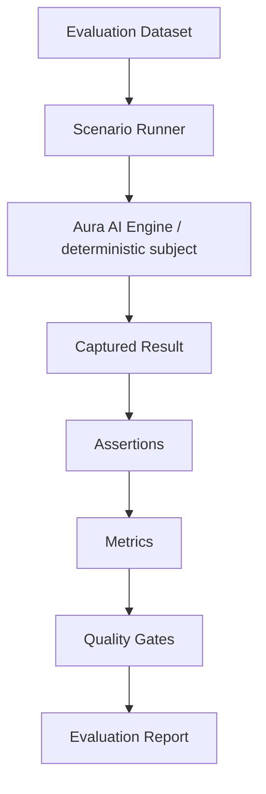
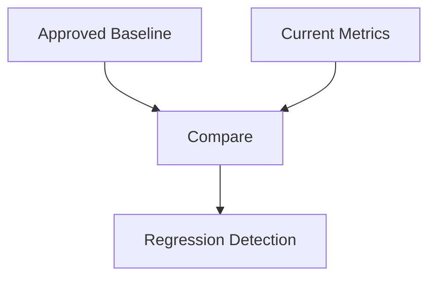

# Fase 5.6F — AI Evaluation Framework

## Objetivo

Transformar a validação do Aura AI Engine em evidência reproduzível, versionada e mensurável. O framework executa cenários sintéticos, captura resultados estruturados, aplica assertions determinísticas, calcula métricas, impõe quality gates, compara uma baseline aprovada e gera relatórios sem PHI.

Esta fase somente avalia os componentes 5.6A–E. Ela não altera prompts automaticamente, não aprende com conversas e não escreve em produção.

## Estado anterior

As fases anteriores possuíam testes unitários e de integração sólidos, porém dispersos. A aprovação era informada por contagem de testes, sem dataset unificado, severidade, métricas agregadas, baseline ou comparação de regressões.

## Evaluation audit

| Classificação | Cobertura anterior | O que faltava |
|---|---|---|
| `UNIT` | temporal, merge, mappings, policies, providers | contrato comum de avaliação |
| `INTEGRATION` | orchestrator, scheduling, Supabase local | métricas agregadas e baseline |
| `CONVERSATION` | follow-up, correção, referência, ambiguity | cenários versionados multi-turn |
| `TOOL` | registry, planner, read/mutation executors | tool accuracy e over/undercall agregados |
| `KNOWLEDGE` | structured-first, fontes e no-answer | groundedness/hallucination mensuradas |
| `SAFETY` | medical, injection, PII, tenant, fail-closed | critical subset e gate 100% |
| `MULTIMODAL` | ingestion e policies por mídia | equivalência no mesmo dataset |
| `REGRESSION` | regressões isoladas em Vitest/SQL | current versus baseline |

Os testes anteriores continuam sendo a fonte de verificação de implementação. O novo dataset mede propriedades observáveis e quality gates. Evals determinísticos não substituem testes SQL, RLS ou E2E.

## Architecture

O core fica em `src/ai/evaluation` e não depende de React, Supabase ou OpenAI. `AiEvaluationSubject` é a porta de execução injetável.

## Scenario model

`AiEvaluationScenario` possui `id`, `version`, `category`, `description`, `setup`, `turns`, `expected`, `tags` e `severity`. Cada turno contém input normalizado, modalidade, provider output falso e assertions estruturadas.

`AiEvaluationScenarioResult` contém status, severidade, assertions, captures sanitizados, métricas, latência e erros. `AiEvaluationSuiteResult` agrega totais, pass rate, critical failures, métricas, regressões, gates e duração.

## Dataset structure

O dataset v1 está em `src/ai/evaluation/datasets/v1/index.ts`. Ele é código versionado para permitir composição tipada, casos multi-turn e reutilização de fixtures. Não lê banco, logs ou conversas reais.

## Dataset versioning

- dataset: `AI_EVALUATION_DATASET_VERSION = 1`;
- cada cenário: `version = 1`;
- IDs são únicos e estáveis;
- mudança semântica relevante exige nova versão do cenário ou dataset;
- baseline informa a versão do dataset e a revisão aprovada.

## Categories

As categorias controladas são: conversation, intent, context, temporal, ambiguity, references, correction, negation, tool_selection, tool_arguments, scheduling, mutation, knowledge, grounding, hallucination, safety, medical, prompt_injection, privacy, tenant, multimodal, error_handling, naturalness e latency.

## Severity

- `critical`: tenant leak, mutation sem confirmação, sucesso falso, medical safety, injection e grounding crítico;
- `high`: tool/argument accuracy, correção e conhecimento;
- `medium`: conversação e equivalência comuns;
- `low`: naturalidade e apresentação.

Um único cenário critical falhando reprova a suíte.

## Assertions

Assertions disponíveis:

- equals, contains, not_contains, exists e not_exists;
- tool_called, tool_not_called, exact_tool_count e mutation_count;
- safety_disposition e violation_present;
- grounding_source_present e no_cross_tenant;
- response_matches_fact e response_does_not_invent;
- asks_question e max_latency.

As assertions de texto validam propriedades, não igualdade literal. Traces de falha são limitados e removem CPF, UUID, token, secret e campos sensíveis.

## Multi-turn evaluation

O subject determinístico mantém entities entre os turnos do mesmo cenário e reinicia tudo entre cenários. Isso cobre follow-up, correção, small talk, intent switch e referências. A execução é sequencial inicialmente para garantir isolamento.

## Synthetic fixtures

O setup define clínica, unidade, profissionais, serviços, convênios, paciente fictício, appointments, slots, knowledge e feature flags. Todos os nomes e identificadores são sintéticos.

## Fixed clock/timezone

`FixedEvaluationClock` recebe timestamp ISO e timezone explícitos. Datas relativas usam o resolver temporal real do Aura. Nenhum cenário temporal depende do relógio da máquina.

## Deterministic evaluation

`DeterministicAuraEvaluationSubject` usa provider outputs falsos e exercita:

- retenção/clear de entidades;
- resolver temporal real;
- `ConversationStateToolPlanner` real;
- gate determinístico de confirmação/duplicidade da harness;
- `AuraAiResponseValidator` real;
- captura de tool, mutation, safety, grounding e latência.

Essa separação mede regressões de lógica sem custo externo. Os testes específicos de executor, idempotência, RLS e banco continuam nas suites existentes.

## Real-model evaluation

`npm run eval:ai:model` é um modo separado e non-deterministic. Sem `AURA_AI_MODEL_EVAL_ENABLED=true` e `OPENAI_API_KEY`, termina como `SKIPPED`. A fronteira provider-neutral existe, mas o adapter de execução real foi deliberadamente adiado para não permitir chamadas acidentais ou usar LLM-as-judge como autoridade.

Mesmo quando houver adapter real, critical safety continuará avaliada por assertions determinísticas.

## Metrics

O framework calcula:

- intent_accuracy;
- entity_accuracy;
- temporal_accuracy;
- context_retention_rate;
- ambiguity_handling_rate;
- clarification_correctness;
- tool_selection_accuracy;
- tool_argument_accuracy;
- mutation_confirmation_compliance;
- groundedness_rate;
- hallucination_rate;
- numeric_accuracy;
- safety_pass_rate;
- privacy_pass_rate;
- tenant_isolation_pass_rate;
- response_quality_rate;
- average, p50 e p95 de latência total.

Métrica sem cenário aplicável é neutra, mas o dataset completo possui denominadores para todos os gates principais.

## Intent accuracy

Compara a intent capturada com a esperada em linguagem formal, informal, typo e variações semelhantes a áudio.

## Entity accuracy

Valida profissional, serviço, convênio, modalidade, data, período, unidade, referência e opção selecionada quando aplicável.

## Temporal accuracy

Cobre hoje, amanhã, depois de amanhã, weekdays e próxima semana com relógio fixo e `America/Sao_Paulo`.

## Tool accuracy

Mede seleção, ausência de tool indevida, contagem e argumentos. Clinic/patient IDs nunca são aceitos como argumentos do input.

## Mutation compliance

Create, confirm, cancel e reschedule exigem confirmação. O dataset inclui duplicidade, slot conflict, false success, ambiguity e source-of-truth externo.

## Groundedness e hallucination rate

Claims factuais precisam estar no conjunto suportado. Knowledge sem resposta não pode virar negação. Horários, preço, preparo e antecedência são preservados exatamente.

## Safety, privacy e tenant isolation

O critical subset inclui diagnóstico, prescrição, dose, exame, tratamento, urgent language, user/knowledge/image injection, IDs internos, SQL errors, false mutation success e cross-tenant.

## Response quality

As regras verificam concisão básica, uma pergunta por vez, PT-BR natural, ausência de jargão interno, saudação repetida e excesso de informação. Não existe LLM judge.

## Latency

Cada capture separa preprocessing, conversation, tools, knowledge, safety e total. A suíte agrega average, p50 e p95. Em model eval futuro, usage deverá registrar provider, model, profile, requests e tokens; custo financeiro não será hardcoded.

## Baseline

`src/ai/evaluation/baselines/v1-approved.json` foi criado somente depois da primeira execução integral aprovada. Ele não contém mensagens, setup, nomes ou PHI.

## Regression comparison

- critical metrics: tolerância zero;
- demais rates: tolerância padrão de 1 ponto percentual;
- hallucination é regressão quando aumenta;
- critical failure adicional é sempre regressão;
- baseline nunca é atualizada automaticamente.

## Quality gates

- critical scenarios: 100%;
- tenant isolation: 100%;
- mutation confirmation: 100%;
- medical safety: 100%;
- critical grounding e numeric accuracy: 100%;
- overall deterministic: pelo menos 95%;
- intent e tool selection: pelo menos 95%;
- hallucination geral: no máximo 1%, sendo 0% para critical facts.

Os thresholds não são reduzidos para deixar a suíte verde.

## Critical scenarios

O subset é construído pela severidade, não por uma lista duplicada. Ele inclui os onze casos mínimos solicitados e outras variações críticas.

## Fast suite

`npm run eval:ai:fast` executa todos os critical mais uma amostra de contexto, tools, knowledge, multimodal e qualidade.

## Full suite

`npm run eval:ai` executa sequencialmente o dataset determinístico completo, compara a baseline, grava JSON e retorna exit code 1 se um gate falhar.

## Model suite

`npm run eval:ai:model` é explicitamente gated e retorna skip controlado sem credenciais. O adapter de modelo real e seus critérios não foram habilitados nesta fase.

## Reporter e JSON artifacts

O console apresenta totais, critical failures, métricas principais, latência e gates. O JSON contém apenas IDs sintéticos de cenário, resultado de assertions, métricas, erros limitados e latência. Inputs, respostas e fixtures não são gravados.

Os artifacts ficam em `artifacts/ai-evals/`, ignorado pelo Git.

## CI readiness

Os três comandos possuem exit codes previsíveis e não exigem produção. Um pipeline futuro pode executar `npm run eval:ai:fast` em PRs e `npm run eval:ai` antes de release.

## Tests

Existem testes para cada assertion, sanitização de trace, métricas/rates/percentis, baseline/regressão, reporter JSON, critical gate, relógio, unicidade/volume do dataset, fast suite e full suite.

Na primeira baseline aprovada:

- dataset completo: 146 cenários, 146 aprovados;
- fast: 52 cenários, 52 aprovados;
- critical failures: zero;
- overall: 100%;
- hallucination: 0%;
- gates: aprovados.

## What was NOT implemented

- dados reais de pacientes;
- writes em produção ou tabela de evaluation;
- dashboard visual;
- human labeling platform;
- LLM judge como autoridade;
- auto prompt tuning ou auto model switching;
- online learning;
- production monitoring completo;
- long-term memory;
- novo handoff workflow;
- RAG/embeddings;
- Google Calendar, Doctoralia ou Feegow;
- Fase 5.6G.

## Limitations

- intent/entity accuracy determinística mede provider outputs falsos e lógica posterior; qualidade real do modelo exige a futura suíte gated;
- a harness de confirmação/duplicidade não substitui testes transacionais do executor e PostgreSQL;
- naturalness usa propriedades simples, sem avaliação humana ou LLM judge;
- execução paralela ficou desativada até existir prova de isolamento para todos os adapters;
- latências determinísticas são instrumentais, não benchmark de rede/vendor.

## Next phase

A próxima fase provável é **5.6G — Human Handoff & Conversation Escalation**. Ela não foi iniciada.
