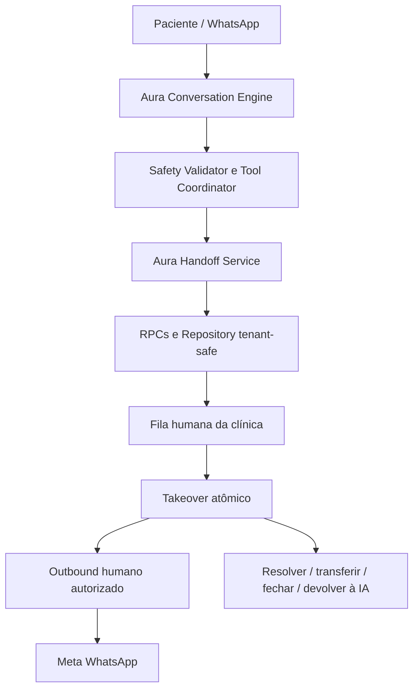
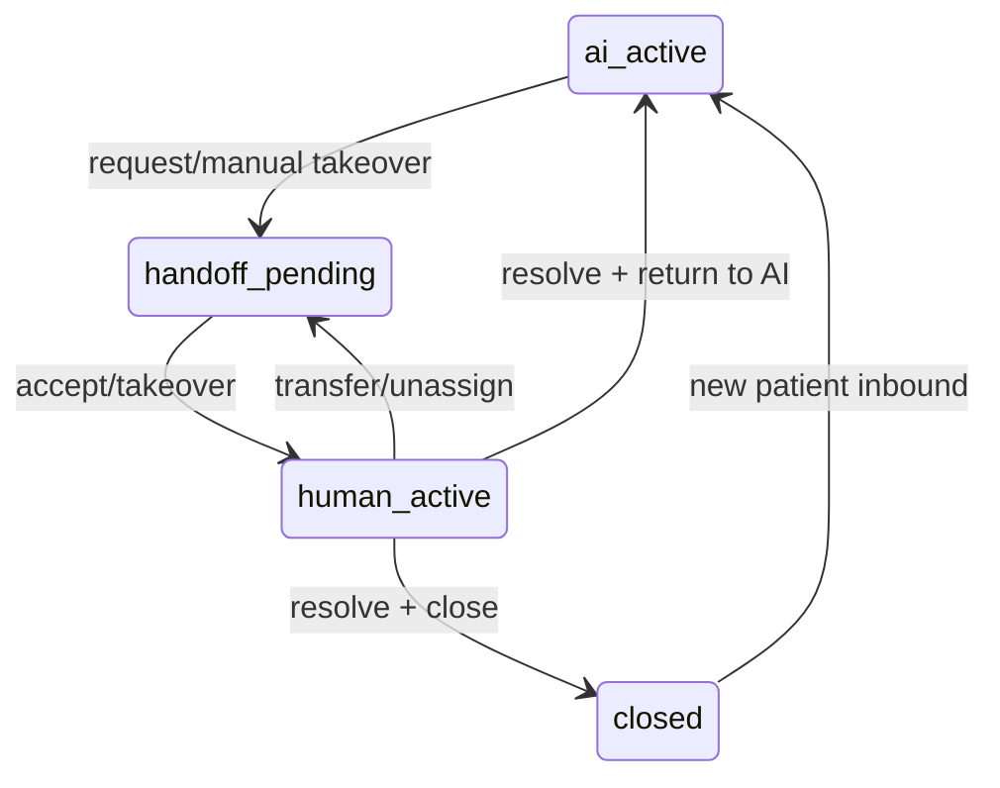

# Fase 5.6G — Human Handoff & Conversation Escalation

## Objetivo e estado

Esta fase transforma `requiresHandoff` em um fluxo operacional multi-tenant, auditável e idempotente. Quando há handoff, a Aura para de responder e nenhuma tool operacional pode ser executada. Um atendente assume a conversa de forma atômica, responde pelo canal oficial e pode transferir, resolver, fechar ou devolver o controle à IA.

O handoff automático nasce **desativado** (`ai_handoff_enabled = false`) e exige simultaneamente engine `active` e `ai_handoff_validated_at`. O takeover manual permanece disponível para a equipe autorizada. Nenhuma clínica foi ativada automaticamente.

## Auditoria do legado

| Classificação | Decisão |
|---|---|
| KEEP | webhook Meta, inbox existente, persistência de mensagens, vínculo conversa/contato e status legado para compatibilidade |
| ADAPT | inbox para fila e ownership; Edge agent para suspensão/fence; mensagens para registrar origem e ator |
| REPLACE | updates diretos de `status`/`ai_enabled` pela UI por RPCs de lifecycle com autorização |
| ADD | domínio provider-neutral, tabela de handoffs, eventos, control mode, resumo, fila, takeover, transferência, retorno à IA e outbound humano |
| DEFER | call center, SLA, auto-assignment complexo, departamentos, copilot, sentimento, triagem clínica e notificações externas |

Antes desta fase havia apenas `status = open|handoff|closed` e `ai_enabled`, sem owner, assignee, fila, resumo, auditoria, resposta humana protegida ou retorno transacional para IA.

## Arquitetura

O core em `src/ai/handoff/` não depende de React, Supabase, Meta ou OpenAI. O LLM não acessa o banco nem controla ownership. A persistência fica no adapter Supabase e a transição de estado fica em RPCs transacionais.

## Modelo de controle

`whatsapp_ai_conversations.control_mode` é a fonte operacional:

- `ai_active`: IA pode interpretar, planejar, executar tools e enviar;
- `handoff_pending`: conversa na fila; IA suspensa;
- `human_active`: apenas o owner aceito pode responder;
- `ai_resume_pending`: estado reservado para retorno controlado;
- `closed`: conversa fechada; novo inbound reabre de forma explícita.

Toda troca incrementa `control_revision`. A entrada em handoff invalida opções de tool apresentadas e seleções pendentes, evitando confirmar uma ação planejada antes da troca de controle.

## Motivos, origem e prioridade

Motivos tipados incluem solicitação explícita, falha repetida, ambiguidade não resolvida, knowledge ausente/conflitante, bloqueio de segurança, linguagem urgente, falha de tool/provider e takeover manual. A origem registra conversation, safety, tool, knowledge ou staff.

Prioridades `normal`, `high` e `urgent` servem somente para ordenar atendimento. `urgent` aparece como **Prioridade de atendimento** e não representa classificação, diagnóstico ou triagem médica. A Aura continua limitada a orientação segura e encaminhamento humano.

## Gatilhos e idempotência

- pedido explícito do paciente;
- disposition `require_handoff` do Safety Validator;
- ambiguidade/falha operacional repetida no limiar de três ocorrências;
- falha de knowledge/tool/provider mapeada;
- linguagem urgente, com handoff imediato quando validado;
- takeover manual pela equipe.

Há no máximo um handoff ativo por conversa. `correlation_key` e índice parcial impedem duplicidade; chamadas repetidas retornam o registro ativo. Sucesso operacional útil zera o contador de falhas.

## Resumo seguro

O resumo é determinístico e usa somente estado conversacional e resultados estruturados já validados. Contém motivo, contexto administrativo, campos pendentes e último resultado de tool. CPF e UUID são removidos; não inclui diagnóstico, inferência clínica, segredos, prompts internos nem texto livre completo da conversa.

## Ownership, fila e envio humano

- a fila é isolada por `clinic_id` e ordenada por prioridade/data;
- `take_over_ai_conversation` bloqueia a linha e resolve disputas atomicamente;
- apenas o owner aceito, membro da mesma clínica, pode enviar;
- transferir atribui o destino, volta a `handoff_pending` e exige aceite explícito;
- unassign devolve à fila;
- `authorize_human_conversation_outbound` revalida owner e `human_active` imediatamente antes do envio;
- a Edge Function `whatsapp-human-outbound` usa a conexão Meta da clínica, persiste `message_origin = human` e `actor_user_id`;
- falha de entrega não devolve o controle para IA e gera evento sem conteúdo.

O `whatsapp-ai-agent` também executa um fence imediatamente antes do outbound. Se um humano assumiu enquanto a resposta era gerada, a mensagem da IA é bloqueada. É permitida uma única mensagem segura de encaminhamento somente quando vinculada ao handoff pendente correspondente.

## Banco, RLS e auditoria

### Estruturas

- `ai_conversation_handoffs`: tenant, conversa, motivo, prioridade, status, source, resumo sanitizado, owner e timestamps;
- `ai_handoff_events`: transições e falhas operacionais, sem conteúdo da conversa;
- novos campos de controle em `whatsapp_ai_conversations`;
- `message_origin` e `actor_user_id` em `whatsapp_ai_messages`;
- flags de ativação e validação em `whatsapp_ai_settings`.

RLS permite leitura somente a staff da própria clínica. Escritas de lifecycle são feitas por RPCs autorizadas; updates diretos de `status` e `ai_enabled` foram revogados. Operações backend-only exigem service role. Transferência e ownership verificam membership no mesmo tenant.

Eventos registram request, queue, assign, accept, transfer, unassign, resolve, return, close, reopen e falha de outbound. Métricas podem ser derivadas de `requested_at`, `accepted_at`, `resolved_at`, motivo, prioridade e eventos, sem armazenar mensagem ou dado clínico.

## Interface administrativa

A tela WhatsApp IA agora oferece:

- filtros IA, fila, humano e fechado;
- contador visível da fila;
- badges de modo e prioridade administrativa;
- contexto resumido e sanitizado;
- assumir, transferir, remover atribuição, resolver, fechar e devolver à IA;
- composer humano somente para o owner;
- diferenciação visual entre Paciente, Aura e Equipe.

A tela de configuração informa o estado do gate. A ativação automática não é exposta antes da homologação.

## Segurança e comportamento fail-closed

- IA e Tool Coordinator revalidam `control_mode` antes do pipeline e antes das tools;
- outbound da IA revalida o estado imediatamente antes da Meta;
- outbound humano exige JWT, membership, owner e modo correto;
- payload humano é limitado a 2.000 caracteres;
- tokens Meta continuam criptografados;
- logs e eventos não armazenam mensagem, telefone, token ou resumo completo;
- falha ao criar handoff não libera resposta médica ou factual insegura;
- retorno à IA é ação explícita; texto como “pode voltar” não altera estado sozinho.

## Validação executada

- TypeScript: aprovado;
- ESLint dos arquivos da fase: aprovado;
- Vitest: 38 arquivos, 255 testes aprovados;
- SQL local: lifecycle, idempotência, disputa, transferência, retorno, invalidação, auditoria e cross-tenant aprovados;
- evaluation full: 159/159, zero falhas críticas, todos os gates aprovados;
- evaluation fast: 63/63;
- build de produção: aprovado.

Os novos cenários cobrem pedido explícito, falhas repetidas, urgência, resposta única, corrida entre atendentes, isolamento de tenant, retorno à IA, inbound durante atendimento humano, takeover manual, duplicidade, resumo grounded e remoção de PII.

## Rollout

1. aplicar migration e publicar as duas Edge Functions;
2. manter `ai_handoff_enabled = false` para todas as clínicas;
3. validar fila, permissões, owner e envio humano em ambiente controlado;
4. marcar `ai_handoff_validated_at` para a clínica homologada;
5. ativar somente clínicas cujo `ai_engine_mode = active`;
6. monitorar eventos, tempo até aceite, falhas de outbound e handoffs não resolvidos;
7. desativar o gate imediatamente em caso de regressão.

## Limitações e itens não implementados

- não há SLA, roteamento por departamento ou auto-assignment complexo;
- não há call center, copilot humano, sentimento ou triagem clínica;
- não há notificação push/e-mail; o alerta operacional é o contador/filtro da inbox;
- não há memória longa nem armazenamento de transcript no handoff;
- não há provider externo de agenda;
- não há mensagem automática de retorno à IA;
- não foi iniciada qualquer fase posterior à 5.6G.
