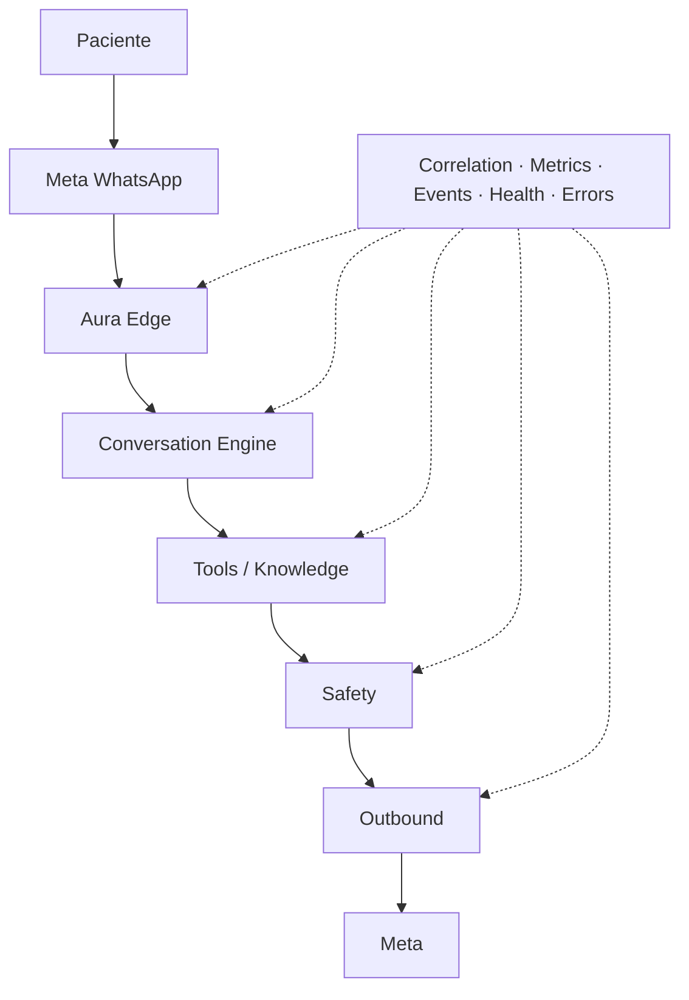
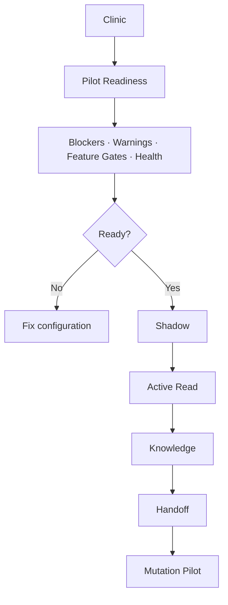

# Fase 5.7 — Production Readiness, Observability & Pilot Rollout

> Correção 5.7.1-R (2026-08-15): o remoto `nklccxaeasoxjanxgqcl` foi oficialmente reclassificado como **staging**. Production está **NOT PROVISIONED**. As referências históricas abaixo descrevem o estado observado durante a execução original da 5.7, antes dessa decisão.

## Objetivo

Preparar o Aura para avaliação por uma clínica piloto real, sem ativar clínica, adicionar provider externo ou criar nova feature clínica. Esta fase torna saúde, configuração, falhas, métricas, rollback e limites de privacidade verificáveis.

## Estado anterior

As fases 5.6A–G já possuíam eventos separados, correlation ID, HMAC Meta, metering, tools, grounding, Safety Validator obrigatório, evaluation e handoff. Faltavam health/readiness, visão agregada, eventos do canal/outbound, audit de gates, kill switch global, modelo de erro comum e runbooks.

## Production readiness audit

| Classe | Resultado |
|---|---|
| READY | HMAC, token Meta cifrado, secrets backend, idempotência inbound, mutation claims, RLS recente, Safety sem bypass, gates default-off |
| HARDEN | resposta de erro do webhook, log legado, eventos outbound, grants da inbox/settings, policy histórica de criação de clínica |
| ADD | observability core, health endpoint, readiness service, métricas limitadas, audit de gates, global switch, UI mínima e runbooks |
| DEFER | PagerDuty/Slack, queue durável geral, active OpenAI probe contínuo, DSAR portal, purge automático e BI |
| BLOCKER | staging separado não evidenciado; `APP_ENV` remoto não confirmado; backup/PITR/restore não verificáveis no repo; secrets/Meta production precisam validação operacional |

O `WITH CHECK(true)` histórico em `clinics` foi removido; criação permanece pela Edge Function autenticada `create-clinic`. Inbox/settings receberam grants explícitos protegidos pelas RLS existentes.

## Architecture

`src/ai/observability` é provider-neutral: domain, environment, sanitization, health, metrics e `AuraPilotReadinessService`. Não importa React, OpenAI, Meta ou Supabase.

## Environment separation

Ambientes aceitos: `local`, `staging`, `production`. `APP_ENV` é obrigatório e não é inferido por URL. Cada ambiente deve ter Supabase, hosting, OpenAI project/key e Meta configuration separados quando disponível. O repositório atual comprova local + um Supabase vinculado; staging separado permanece blocker até provisionamento/evidência.

## Secrets

Auditados: OpenAI, Meta app/token/webhook, encryption key, Supabase service role e provider credentials. O frontend usa somente publishable/config IDs. `.env.local` não é rastreado. Eventos, error response, safety/tool/knowledge/handoff audit não possuem campos de secret. Erros agora usam code/category/retryable/timestamp e nunca body/stack/raw payload.

## Observability model e correlation

`OperationalTraceContext` contém apenas clinic/conversation/correlation IDs, canal, componente e início. `ai_operational_events` cobre gaps de inbound/outbound e falhas gerais; os eventos especializados existentes continuam fontes canônicas. A taxonomia é pequena e possui 16 tipos. Nenhum evento guarda texto, prompt, transcript, nome, telefone, CPF ou payload.

## Health checks e readiness

Estados: `healthy`, `degraded`, `unhealthy`, `unknown`.

- liveness pública e sem dados: runtime responde;
- readiness autenticada: database, environment, global switch, OpenAI configuration, WhatsApp, catálogos, scheduling e staff;
- clinic readiness: snapshot tenant-scoped, gates, blockers e warnings;
- configuration health não chama OpenAI/Meta ativamente;
- active probes são checklist controlado de staging, não health recorrente.

`aura-operational-health` nunca retorna secrets, stack, internals do banco ou dados de outra clínica.

## Pilot readiness service

`PilotReadinessResult` retorna `ready`, stage, checks, blockers e warnings sem alterar configuração. Blockers incluem environment desconhecido/local, kill switch não configurado, global/clinic disable, banco/WhatsApp/catálogo/scheduling ausentes, OpenAI ausente quando requerida, staff ausente e combinação insegura. Warnings incluem convênio ausente, cobertura de knowledge baixa e handoff ainda desligado.

## Metrics

`get_aura_operational_metrics` exige staff da clínica e range máximo de 31 dias; UI usa today e pode pedir 7d. Agrega:

- inbound, conversations, AI responses/failures;
- tools e failures;
- mutations por attempt/success/failure (e tool name na fonte);
- knowledge `answered/not_found/ambiguous/restricted`;
- safety `allow/rewrite_safe/block/require_clarification/require_handoff`;
- handoffs, reason, takeovers e outbound failures;
- AI usage/tokens/model por eventos existentes;
- average, p50 e p95 de `total_latency_ms`.

### AI containment

`eligible AI conversations` são conversas com `ai_usage_events` no período. `containment = max(eligible - conversations with handoff, 0) / eligible`. É aproximação operacional: não prova resolução clínica/comercial nem deve ser usada como ROI.

`handoff rate = conversations with handoff / eligible AI conversations`, com breakdown por reason. Tool/mutation rates usam outcome da tabela especializada. Safety block alto não é automaticamente falha; requer análise de mix e critical violations.

## Alert conditions

Warnings operacionais devem sinalizar spike de falha AI/outbound/provider, fila de handoff crescente, critical safety inesperada, mutation failure e volume anormal por clínica. Thresholds dependem do volume observado e devem ser configuráveis; nenhum preço/token ou bloqueio por consumo foi hardcoded. Entrega PagerDuty/Slack/e-mail foi adiada, portanto o piloto depende do cartão administrativo, health e revisão assistida.

## Error taxonomy e sanitization

Categorias: provider timeout/rate limit/invalid response, database, RPC conflict, tool denied, knowledge unavailable, safety fail-closed, WhatsApp send, configuration e unknown. Persistência aceita apenas código normalizado; respostas ao cliente são `internal_error`, `delivery_failed` ou equivalentes controlados.

## Retry e timeout

- LLM/conversation/vision: 30 s; tool composer: 20 s; transcription: 25 s; Meta: 15 s.
- Provider pode tentar até duas vezes somente para erro normalizado retryable; media evita repetir download/processamento não seguro.
- conversation CAS reaplica patch sem nova chamada ao modelo por até três conflitos.
- mutations não possuem retry cego; dependem de claim/idempotência e revalidação.
- Meta outbound não é repetido automaticamente nesta fase, pois falta claim de entrega cross-provider.

## Deduplication e durable work

Inbound Meta tem índice único global de `provider_message_id` e lookup anterior ao processamento. Mutations usam claims; AI outbound revalida control mode; humano exige owner. Reminders/jobs possuem infraestrutura própria. Long AI work e retries de delivery não têm queue durável geral: gap aceito para piloto assistido, candidato futuro.

## Backup/recovery audit

Migration e Git permitem reconstruir schema, mas não restauram dados. Backup, PITR, retenção e teste de restore dependem do plano/configuração Supabase e não foram confirmados pelo repositório/CLI atual. Isso é blocker antes de dados reais. Procedimento exigido: confirmar plano → registrar RPO/RTO → restaurar backup em ambiente isolado → validar tenant/appointments → documentar evidência.

## Data classification, privacy e data flow

Classes: PUBLIC, INTERNAL, PERSONAL, SENSITIVE_HEALTH_RELATED e SECRET. O mapa completo está em `AURA_AI_PRIVACY_DATA_FLOW.md`. Esta é revisão técnica de privacidade, não parecer legal. Observability usa IDs/counts/latência/outcome; mídia continua transitória; LLM recebe contexto mínimo e history tenant-scoped.

## Retention e deletion

Não foi criado purge destrutivo. Propostas de 90/180 dias precisam aprovação. Conversation data, backups e dados legalmente necessários exigem política específica. Exclusão/anônimização de patient/lead/conversation/events/backups ainda requer workflow DSAR e decisão jurídica.

## Access control, service role e RLS

- anon: webhook HMAC e liveness sem dados;
- authenticated staff: leitura tenant-scoped e RPCs permitidas;
- admin: settings/conteúdo/audit da própria clínica;
- service role: somente Edge/backend para routing, events e operações controladas.

Service role foi localizado apenas em Edge Functions, não no browser. Novas tabelas têm RLS, writes backend-only e FK tenant composta. A suíte busca `USING(true)` nas tabelas AI. O único caso histórico perigoso (`clinics INSERT`) foi removido.

## Feature gates e dependency protection

Inventário: `is_enabled`, `ai_engine_mode`, read enabled/validated, mutation enabled, knowledge enabled/validated, handoff enabled/validated. Constraint 5.7 exige active + validated read para knowledge/mutation e active + validation para handoff; foi criada `NOT VALID` para não alterar silenciosamente rows legadas, mas é aplicada a novos updates. Read em legacy é proibido em novos updates.

Safety não possui switch: active Aura sempre passa pelo validator. O global switch `AURA_AI_GLOBAL_DISABLED` é backend-only e interrompe toda resposta AI; clinic kill switches permanecem `is_enabled`, engine mode e gates individuais. Toda alteração de gates é auditada com ator técnico e booleans/mode, sem conteúdo.

## Pilot stages, exit criteria e monitoring

- Shadow: zero critical failure/leak; métricas e erro aceitáveis definidos antes do início.
- Active Read: reads/outbound estáveis; zero factual hallucination crítica.
- Knowledge: sources verificadas; not_found observado; zero inventado.
- Handoff: fila/ownership/human outbound e no-double-response 100%.
- Mutation: confirmação 100%, idempotência, zero false success.

Use janela assistida por estágio e volume suficiente; não foi criado rollout temporal automático.

## Kill switches, rollback e incident response

Flags são primeiro rollback. Global switch atende incidente amplo; clinic/gate atende isolamento. Edge/frontend voltam para release anterior somente depois; migration recebe correção aditiva. Incidentes SEV1/2/3 e fluxo detect-contain-investigate-recover-validate-reenable estão no guia operacional.

## Deployment checklist e smoke tests

Sequência: tests → eval fast → eval full → reset/migration local → SQL tenant packs → Edge runtime → staging → smoke sintético → deploy production → flags off → readiness → ativação humana do stage.

Staging testa webhook assinado, inbound, conversation, knowledge, disponibilidade, safety, handoff e outbound com dados sintéticos. Production testa inicialmente liveness, readiness e leitura não destrutiva; não cria appointment real.

## Evaluation additions

Foram adicionados cenários sintéticos para global disable, clinic disable, readiness blocker, provider outage, DB fail-closed, outbound failure e secret leak. Nenhum dado real ou chamada OpenAI é usado.

## Operational dashboard e UI

Configurações → WhatsApp IA ganhou cartão mínimo: Ready/Not Ready, environment, stage, blockers, warnings e cinco counters today. Não foi criado BI ou dashboard financeiro.

## Validation results

- Vitest: 40 arquivos, 267 testes aprovados;
- evaluation fast: 69/69, zero critical failures;
- evaluation full: 166/166, zero critical failures e todos os quality gates aprovados;
- model eval: skip controlado, sem credencial/chamada externa;
- SQL: 11 packs scheduling/AI/tenant aprovados com fixtures sintéticas e rollback;
- TypeScript e lint direcionado: aprovados;
- build de produção: aprovado, com warnings conhecidos de Browserslist/chunk;
- Edge runtime: liveness `200`, readiness anônima `401`, human outbound anônimo `401` e webhook inválido `403`;
- Supabase remoto: migration `20260816033000` e três funções confirmadas ativas; liveness remoto `200` com environment `unknown` (blocker explícito).

## What was NOT implemented

Google Calendar, Doctoralia, Feegow, provider externo, RAG, embeddings, long-term memory, prompt tuning, billing, call center, SLA engine, diagnóstico, triagem, prescrição, prontuário, PagerDuty/Slack, purge, DSAR portal e nova feature de IA.

## Limitations e blockers restantes

- staging, APP_ENV remoto e separação real de secrets precisam evidência operacional;
- backup/PITR/restore precisam confirmação do plano e teste real;
- não há active probe contínuo nem alerta externo;
- containment é proxy, não resolução comprovada;
- logs/runtime do legado e políticas de conversation retention precisam decisão formal;
- rollout real continua bloqueado até checklist, staging e responsáveis estarem concluídos.

## Next phase

Nenhuma próxima fase foi iniciada. O próximo passo deve ser decidido após remover blockers e revisar este relatório: piloto controlado, governance adicional, provider externo, performance/queue ou onboarding comercial.
